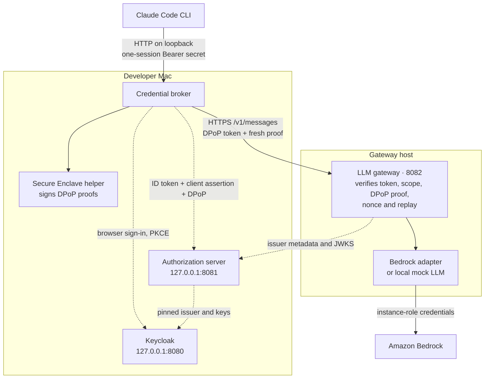

# Secure Claude Code – MCP & LLM Gateway

A reference implementation that connects Claude Code on macOS to AWS Bedrock
through an LLM [gateway](docs/glossary.md#gateway), using OAuth 2.0 [token exchange](docs/glossary.md#token-exchange) and
[sender-constrained](docs/glossary.md#sender-constrained-token) ([DPoP](docs/glossary.md#dpop-demonstrating-proof-of-possession)) [access tokens](docs/glossary.md#access-token). A stolen access token cannot be replayed without the
client's private key, and AWS credentials never reach the developer laptop.

> **This is a learning lab, not a product.** It runs with synthetic identities
> on [loopback](docs/glossary.md#loopback) addresses and disposable keys. It has been accepted gate by gate
> for that lab only. Read [Known limitations](#known-limitations) before
> borrowing any part of it.

MCP is in the project name because MCP gateway support is planned. Nothing in
the repository implements MCP yet.

## What it demonstrates

| Standard | Where it is used |
|---|---|
| [OpenID Connect](docs/glossary.md#openid-connect-oidc) with [PKCE](docs/glossary.md#pkce-proof-key-for-code-exchange) ([RFC 7636](https://www.rfc-editor.org/rfc/rfc7636.html), [RFC 8252](https://www.rfc-editor.org/rfc/rfc8252.html)) | Browser sign-in against Keycloak |
| [Token exchange](docs/glossary.md#token-exchange) ([RFC 8693](https://www.rfc-editor.org/rfc/rfc8693.html)) | Keycloak ID token → short-lived gateway access token |
| [`private_key_jwt` client authentication](docs/glossary.md#client-assertion-private_key_jwt) ([RFC 7523](https://www.rfc-editor.org/rfc/rfc7523.html)) | Exchange client → authorization server |
| [JWT](docs/glossary.md#jwt-json-web-token) [access tokens](docs/glossary.md#access-token) ([RFC 9068](https://www.rfc-editor.org/rfc/rfc9068.html)) | Authorization server → gateway |
| [DPoP](docs/glossary.md#dpop-demonstrating-proof-of-possession) with server [nonces](docs/glossary.md#nonce) ([RFC 9449](https://www.rfc-editor.org/rfc/rfc9449.html)) | Token binding at the authorization server and proof per request at the gateway |
| Apple [Secure Enclave](docs/glossary.md#secure-enclave) | Hardware-held DPoP signing key |
| Amazon [Bedrock Converse](docs/glossary.md#bedrock-converse) API | Inference behind the gateway, using an [instance role](docs/glossary.md#instance-role) |

## Architecture

Claude Code only ever holds a random secret that is valid for one broker
session on loopback. The broker holds the gateway token and signs a fresh
proof for every request. The gateway is the only party with AWS credentials.

The terms in the diagram are defined in the glossary:
[credential broker](docs/glossary.md#credential-broker), [Keycloak](docs/glossary.md#keycloak),
[authorization server](docs/glossary.md#authorization-server-as), [ID token](docs/glossary.md#id-token),
[client assertion](docs/glossary.md#client-assertion-private_key_jwt), [issuer](docs/glossary.md#issuer),
[JWKS](docs/glossary.md#jwks-json-web-key-set), [scope](docs/glossary.md#scope), [nonce](docs/glossary.md#nonce),
[replay protection](docs/glossary.md#replay-protection), [Bearer token](docs/glossary.md#bearer-token) and
[mock LLM](docs/glossary.md#mock-llm).

## Components

| # | Component | Code and README | Design and evidence |
|---|---|---|---|
| 1 | Mock LLM (Anthropic Messages-compatible) | [`components/mock-llm`](components/mock-llm) | [docs](docs/component-01) |
| 2A | Keycloak browser sign-in | [`components/oauth-lab`](components/oauth-lab) | [docs](docs/component-02) |
| 2B | Authorization server foundation | [`components/oauth-as`](components/oauth-as) | [docs](docs/component-02) |
| 3 | RFC 8693 token exchange | [`components/oauth-as`](components/oauth-as) | [docs](docs/component-03) |
| 4 | Gateway authentication and authorization | [`components/gateway`](components/gateway) | [docs](docs/component-04) |
| 5 | DPoP sender-constrained tokens | [`oauth-as/dpop.py`](components/oauth-as/dpop.py), [`gateway`](components/gateway) | [docs](docs/component-05) |
| 6 | macOS credential broker | [`components/broker`](components/broker) | [docs](docs/component-06) |
| 7 | Secure Enclave key custody | [`components/broker/native`](components/broker/native) | [docs](docs/component-07) |
| 8 | Bedrock integration | [`gateway/bedrock.py`](components/gateway/bedrock.py) | [docs](docs/component-08) |

## Running the lab

Follow the **[quickstart](docs/quickstart.md)**: one page from a fresh clone to
Claude Code getting an answer through the whole path, in about ten minutes. You need
macOS, Docker, Python 3.12 or newer, [uv](https://docs.astral.sh/uv/) and the Claude
Code CLI.

Each component's README, linked in the table above, covers running and testing that
part on its own. Keys, certificates and replay databases are created under
`~/secure-claude-lab` (override with `LAB_HOME`), never inside the repository.

## Documentation

- [Quickstart](docs/quickstart.md) — run the lab.
- [One request, end to end](docs/concepts/request-walkthrough.md) — how the parts
  fit together.
- [Glossary](docs/glossary.md) — every term, in plain language.
- [Documentation index](docs/README.md) — all explanations and verification records.
- [Changelog](CHANGELOG.md) — what each release contains.

## Tests

Run `uv run python -m pytest -q` in a component directory. Continuous
integration runs the offline tests on every push, along with a linter
(`uv run ruff check`), a documentation check (`uv run python tools/check_docs.py`)
and a secret scan.

| Suite | Runs offline | Needs a live dependency |
|---|---|---|
| `mock-llm`, `oauth-as`, `gateway` | All tests | — |
| `oauth-lab` | Fixture tests | 11 tests need the running Keycloak realm; they run when `LAB_TLS_DIR` is set, so unset it when Keycloak is down |
| `broker` | Broker tests | 6 tests need the built signer and Secure Enclave hardware (`SECURE_SIGNER_TEST_BINARY` set) |

## Threat model

**What the design defends against**

- **Replay of a stolen access token.** The token is bound to a P-256 key. The
  gateway requires a fresh signed proof for each request, tied to the token,
  the endpoint, a server nonce and a one-time identifier.
- **AWS credentials on laptops.** Only the gateway host holds them, as
  temporary instance-role credentials.
- **Token substitution and downgrade.** Tokens are checked for issuer,
  audience, type, lifetime, scope and client. A DPoP-bound token is refused as
  a Bearer token and the reverse.
- **Copying the signing key (hardware profile).** The Secure Enclave key is
  created per session and cannot be exported.

**What it does not defend against**

- **Code running as the same macOS user.** It can read the child's session
  secret, drive the broker, or ask the signer helper to sign. Hardware custody
  stops the key being copied; it does not decide who may use it.
- **A compromised gateway host, identity provider or authorization server.**
- **Anything involving real data.** The lab has no data-loss controls and must
  only be used with synthetic identities and prompts.

## Known limitations

- **Lab acceptance only.** Every gate was accepted for the synthetic lab. None
  of this is production-ready.
- **The exchange client key sits on the laptop.** The broker authenticates to
  the authorization server with an RSA key file. In production that authority
  belongs at a separate service boundary
  ([Component 6 design](docs/component-06/design-spec.md)).
- **The broker is a smoke harness.** It launches Claude Code for one fixed
  text prompt with tools disabled. There is no token refresh; a session ends
  when the five-minute token expires.
- **Text only.** Tool use, images, thinking and prompt caching are rejected.
  The Bedrock adapter supports one route and caps output at 128 tokens.
- **The software DPoP key can be extracted** by a debugger with macOS
  Developer Tools authorization
  ([evidence](docs/component-06/debugger-extraction-verification.md)).
- **The Secure Enclave helper is an unsigned local build** and detects screen
  lock by polling every 250 ms.
- **Matched stop sequences are untested against live Bedrock.** The adapter
  asks Converse for the matched sequence and returns it, but only offline
  tests cover this.
- **No mutual TLS.** The live Bedrock run reached the gateway through SSH
  forwarding with server-verified HTTPS inside it.
- **Addresses and ports are fixed** to loopback: 8080 (Keycloak), 8081
  (authorization server), 8082 (gateway), 8765 (mock) and 8766 (sign-in
  callback).

Checks that were planned but not completed:

- Reachability from a second device (all components).
- Calling the gateway with a debugger-recovered token and key (Component 6).
- Observing the operating system refuse signing during screen lock,
  independently of the helper's own lock check (Component 7).
- Reading the final November invoice for the live Bedrock run. The estimate, about
  $0.04, and the budget alert's verified recipient are
  [recorded](workflow/releases/0.2.0/close-pending-checks/billing-check.md); no
  alert email has been observed arriving (Component 8).

## How this was built

The project was built with AI coding assistants under a gated workflow, and
the repository keeps the evidence. Components 1–8 were built with Codex
(ChatGPT, powered by Codex & OWL, version 26.1027.51404) using
GPI 6.1 Sol (light).

- **The agent works to written rules.** Components 1–8 were built under a
  Design → Review → Approve → Implement → Test → Accept sequence that forbade
  advancing without explicit human approval. Since publication the project
  uses a checked-in workflow ([`CLAUDE.md`](CLAUDE.md),
  [`.claude/skills/swe-workflow`](.claude/skills/swe-workflow/SKILL.md)) with
  the same gates, project rules in [`workflow/PROJECT.md`](workflow/PROJECT.md)
  and planned work in [`workflow/ROADMAP.md`](workflow/ROADMAP.md).
- **Design comes before code.** Each component has a design spec under
  [`docs/`](docs) that was approved before implementation started. New work
  records its intent, spec and plan under [`workflow/releases`](workflow/releases).
- **Claims need evidence.** The rules forbid calling something tested unless
  the tests were run. Each verification record separates what the assistant
  ran, what the human reviewer ran, and what is still pending.
- **Only synthetic inputs.** No production credentials, real identities or
  patient data were ever given to the assistant.
- **A human made the decisions.** The assistant drafted designs, wrote code
  and ran offline tests. The owner approved each design and gate and ran the
  live browser, hardware and AWS checks.

Two honest gaps:

- Components 2–8 were developed before they were committed, so the git history
  for them is one commit per directory and does not show the step-by-step
  process the documents describe.
- Preparation for publication, including an independent code review, was done
  with Claude Code 2.1.330 and Claude Fable 5.2. The agent's
  permissions are checked in at [`.claude/settings.json`](.claude/settings.json),
  and [continuous integration](.github/workflows/ci.yml) runs the offline
  tests and a secret scan.

## License

[MIT](LICENSE). To report a vulnerability, see [SECURITY.md](SECURITY.md).
