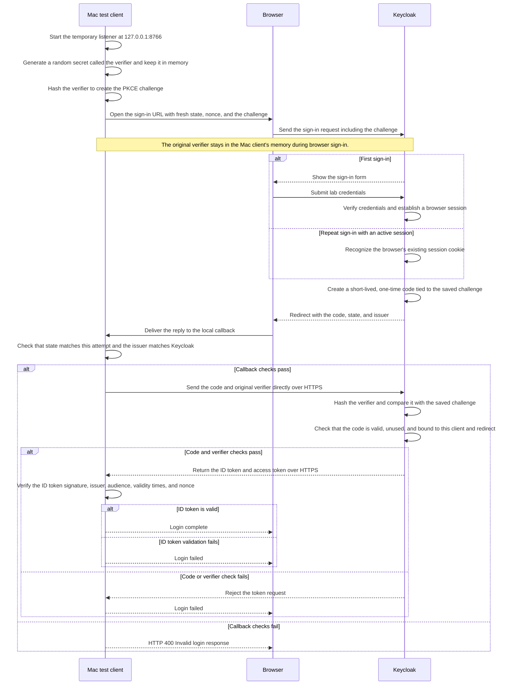
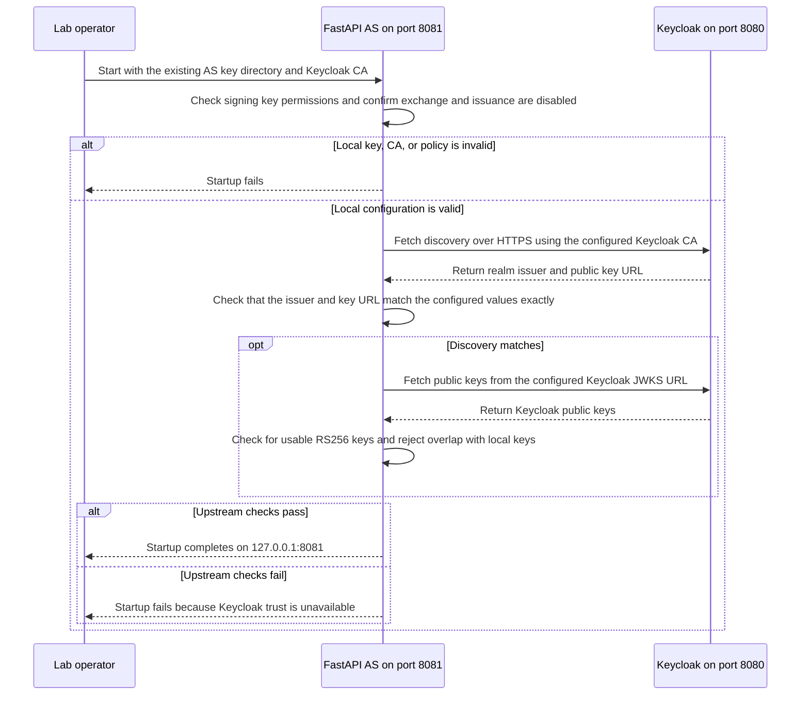
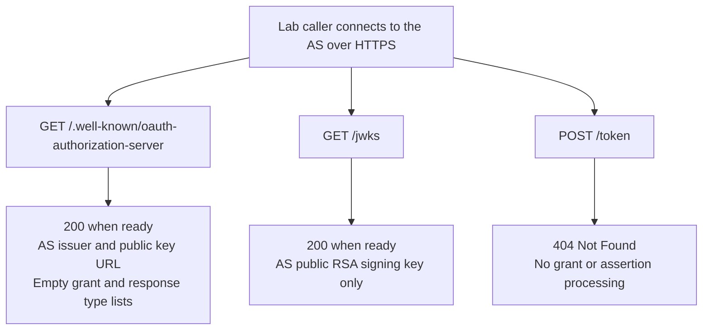
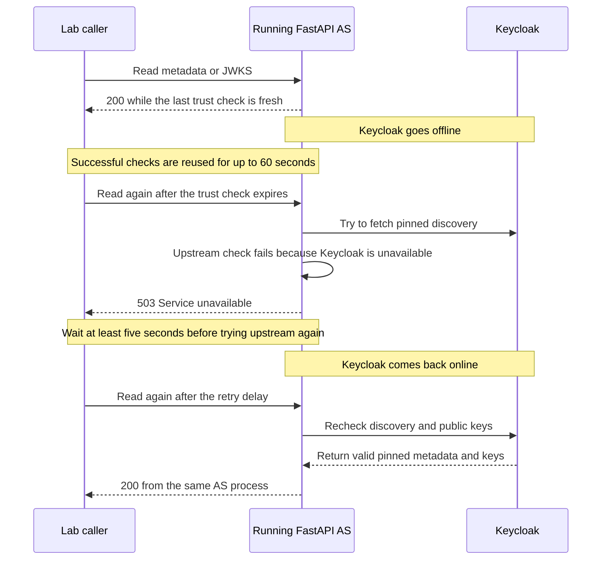

# Component 02 — Keycloak SSO and Independent OAuth Authorization Server

**Project:** Secure Claude Code – MCP & LLM Gateway  
**Version:** 1.0  
**Status:** Component 2 implemented and accepted for the synthetic lab  
**Platform:** macOS lab  
**Acceptance:** Gates 2A and 2B accepted for the synthetic lab. Off-device reachability remains pending. See the [2A report](acceptance-report-2a.md) and [2B report](acceptance-report-2b.md).

## 1. Scope and trust boundaries

Component 2A proves that a native macOS test client can authenticate a synthetic employee through Keycloak in the system browser and validate the returned identity. Component 2B runs a separate FastAPI authorization server (AS) at `https://127.0.0.1:8081` with a deny-by-default trust configuration. Its **issuer** is the exact URL that identifies the AS in metadata. When token issuance is implemented, this same URL will appear in the token’s `iss` claim, which the gateway will compare with its configured issuer while verifying the token signature with the AS public key. Keycloak has a different issuer and authenticates users.

The AS also has a **separate signing key pair**. The private key stays in the AS’s owner-controlled lab directory and will be used to sign future gateway access tokens. The matching public key is published at the AS’s `/jwks` endpoint so the gateway can verify those signatures. The AS fetches Keycloak’s discovery and public keys to check its configured upstream trust. Keycloak’s keys are separate from the AS key pair. Component 2B publishes metadata and public keys. Cross-issuer token submission and gateway token issuance start in Component 3.

| Boundary | Allowed crossing | Controls and residual exposure |
|---|---|---|
| System browser ↔ Keycloak | Synthetic login, Keycloak session cookie and authorization redirects | Keycloak owns passwords and SSO sessions. Use a dedicated lab browser profile and trusted local HTTPS. Browser extensions and compromised local processes remain in the threat model. |
| Browser → native test client | One-time authorization response at the IPv4 loopback callback | Use transaction-bound state, issuer, nonce and PKCE. Loopback limits remote reach, while another local process can still race, interfere with, or block the listener. |
| Test client ↔ Keycloak | Metadata, JWKS and authorization-code redemption | Exact issuer and pinned endpoint locations, TLS verification, in-memory verifier and tokens. The test client is public and holds no OAuth client secret. |
| FastAPI AS ↔ Keycloak | Read-only retrieval of configured discovery and JWKS | Trust is one-way, scoped and locally configured. Keycloak keys remain separate from AS signing keys. Treat remote metadata and key data as untrusted until validated. |
| AS signing boundary | Public AS keys leave through JWKS | Only the AS process can read its private signing key. An isolated acceptance test exercises signing against a non-token challenge. |
| Component 2 ↔ inference and enterprise | No identity or token path | Component 1 remains an isolated mock. Gateway authorization starts in Component 4, DPoP in 5, the macOS Credential Broker in 6, Secure Enclave in 7 and Bedrock in 8. |

Bind services and any container port publications to IPv4 loopback. Keep the Keycloak admin surface on loopback and use separate disposable admin credentials. The lab uses synthetic accounts and data, with no PHI, corporate credentials, production tokens or AWS secrets. Treat forwarded headers, browser input, JWT claims and network responses as untrusted. Exclude raw tokens, codes, query strings, state, nonce, verifier, cookies, authorization headers and credentials from logs, traces, diagnostics and error responses. Audit using event codes and independent correlation IDs.

## 2. Component 2A — Keycloak browser SSO

| Setting | Lab contract |
|---|---|
| Realm and issuer | `claude-security-lab` at `https://127.0.0.1:8080/realms/claude-security-lab` |
| OIDC discovery | Issuer plus `/.well-known/openid-configuration`. Pin the expected issuer and realm endpoint locations in client configuration. |
| Client | `macos-oauth-client`, public native client. Enable Standard Flow and require S256. Disable implicit, direct access grants, service accounts, device and exchange grants for this client. |
| Redirect | Register only `http://127.0.0.1:8766/callback` for the lab. Use the literal address and exact path. No wildcard, alternate host, or port fallback in the client. |
| Transport | Locally trusted TLS for issuer traffic, including a certificate valid for the literal IP. Plain HTTP is confined to the native loopback redirect. |
| Requested access | `openid` only. Remove unnecessary default scopes and mappers. Use a five-minute maximum ID/access token lifetime in the lab and a short authorization-code lifetime, at most 60 seconds after issuance. |

### Authorization flow and callback security

1. Bind the callback before launching the system browser. Bind exclusively to `127.0.0.1:8766` and abort if unavailable. Allow one in-flight login with a five-minute deadline. Generate independent cryptographically random state, nonce and verifier for each attempt. Use at least 128 bits for state and nonce and a 32-byte random verifier encoded as unpadded base64url. Keep the values, expected issuer, client ID and redirect URI together in memory.
2. Discover from the configured issuer and verify exact metadata issuer and allowed HTTPS authorization, token and JWKS locations. Disable endpoint redirects and certificate bypasses. Open the system browser with `response_type=code`, `response_mode=query`, `scope=openid`, client ID, exact redirect URI, state, nonce, `code_challenge_method=S256` and the base64url SHA-256 challenge. Credentials go to Keycloak in the browser.
3. Accept only loopback GET requests for the registered path and expected Host header. Require exactly one state and issuer parameter and exactly one of code or error. Reject duplicates, malformed or oversized parameters, unsolicited callbacks, wrong state, wrong issuer and expired transactions. Require Keycloak's RFC 9207 response `iss` and compare it with the stored issuer before contacting the token endpoint. Ignore uncorrelated requests without consuming a pending transaction. Atomically consume a correlated response once, even when it carries an authorization error. Reject a callback carrying front-channel tokens.
4. Redeem the code once at the pinned Keycloak token endpoint using a form POST with `grant_type=authorization_code`, code, original redirect URI, client ID and verifier. Avoid automatic retries after ambiguous redemption failures. Validate the response before establishing a local authenticated result.
5. Return a generic local page with `Cache-Control: no-store` and `Referrer-Policy: no-referrer`, with no scripts, external assets, redirect targets or reflected parameters. Close the listener and clear transaction data after completion, cancellation or timeout. Keep user tokens only in process memory and discard them when the test ends. Ignore and discard any refresh token Keycloak returns. Browser SSO cookies remain in the dedicated profile until session termination or profile cleanup.

The fixed port is a constrained lab registration. Revisit ephemeral loopback ports and registration behavior for the production native client. PKCE protects redemption of an intercepted code without the verifier. It leaves denial of service and compromise of the local client or browser in scope. [RFC 8252](https://www.rfc-editor.org/rfc/rfc8252.html) · [RFC 7636](https://www.rfc-editor.org/rfc/rfc7636.html) · [RFC 9207](https://www.rfc-editor.org/rfc/rfc9207.html) · [Keycloak Server Administration Guide](https://www.keycloak.org/docs/26.7.5/server_admin/index.html)

### Browser sign-in and PKCE sequence

The Mac client generates a random secret called the **verifier** and keeps it in memory. During browser sign-in, it sends Keycloak only a hash of that secret, called the **challenge**. The browser carries the one-time code back to the local callback. The Mac client sends the original verifier only in the direct HTTPS request to Keycloak that trades the code for tokens.

### 2A token contract

| Artifact | Intended use and validation |
|---|---|
| Authorization code | Opaque, short-lived, single-use. Bound by Keycloak to the original public client, redirect URI and S256 challenge. |
| Keycloak ID Token | Signed identity assertion for the native relying party. Require RS256 and a known `kid` from the configured issuer's JWKS. Require exact `iss`, nonempty `sub`, `aud` containing only `macos-oauth-client` (string or singleton array), and `azp` equal to that client if present. Require integer `iat` and `exp`, unexpired and in order, within the configured lifetime. Check `nbf` if present and allow at most 30 seconds of clock skew on current-time checks. Require exact transaction `nonce` and validate `at_hash` against the returned access token if present. Key the synthetic identity by `(iss, sub)`. |
| Keycloak access token | Initial bearer credential for Keycloak's own configured resource context. Require its presence and a successful token response with bearer token type and bounded positive lifetime. The native client treats it as opaque and does not derive identity, gateway audience or authorization from it. |
| Keycloak refresh token | Discard on receipt. No refresh flow, offline access or persistent user-token store. |

Use a maintained OIDC/JOSE library. Pin allowed algorithms separately from token headers. Reject unsigned tokens, unexpected algorithms, malformed or duplicate security-sensitive fields, ambiguous keys and key URLs or embedded keys supplied by JWT headers. Cache only validated issuer keys, with one bounded, rate-limited refresh on an unknown key ID. Reject when a matching trusted key remains unavailable. Use separate validation rules for ID Tokens and the future gateway access tokens. [OpenID Connect Core §3.1.3](https://openid.net/specs/openid-connect-core-1_0.html#TokenResponse) · [RFC 9700](https://www.rfc-editor.org/rfc/rfc9700.html)

## 3. Component 2B — Custom FastAPI OAuth AS foundation

**Issuer** is `https://127.0.0.1:8081`. Give the AS its own process, configuration and key material. The deployment exposes two read-only interfaces.

| Route | Contract |
|---|---|
| `GET /.well-known/oauth-authorization-server` | RFC 8414-shaped foundation metadata with the exact AS `issuer`, absolute AS `jwks_uri`, and explicit empty `response_types_supported` and `grant_types_supported` arrays. Omit authorization, token and registration endpoints and token endpoint authentication methods. This is an intentionally incomplete lab metadata document for inspecting the issuer and keys. Full operational AS metadata is a Component 3 deliverable. |
| `GET /jwks` | AS public signing keys only, initially one RSA key with unique `kid`, `kty=RSA`, `use=sig`, `alg=RS256`, `n` and `e`. Never serve Keycloak keys or private parameters. |
| `POST /token` and other grant or issuance routes | Absent in 2B. A request to `/token`, including an RFC 8693 request, receives HTTP 404 with a generic response. There is no public signing or fixture-minting endpoint. |

Generate an independent RSA key of at least 2048 bits with a maintained cryptographic library. Persist the disposable lab private key outside source control with an owner-only directory and file permissions. Retain the same key and `kid` across ordinary restarts and fail closed on missing, unreadable, invalid or overly permissive key material after provisioning. Verify key correspondence at acceptance by signing a non-token challenge in an isolated test and checking it with the published public key. Use new key IDs on rotation and design overlap for already-issued tokens before Component 3 issuance. [RFC 8414](https://www.rfc-editor.org/rfc/rfc8414.html)

### Trust and future exchange policy configuration

- Statically pin the Keycloak issuer above, its discovery URI, its expected realm JWKS URI ending in `/protocol/openid-connect/certs`, and RS256. Require discovery to agree with those pins. Fetch only configured loopback HTTPS locations with certificate checks, redirects disabled, timeouts and response size limits. Reject wrong issuer, mismatched or off-boundary URLs, malformed/ambiguous key sets and signing-key overlap with the AS. Invalid or unavailable trust material fails readiness and keeps the trust relationship unusable. Bound any cached keys by expiry. Runtime requests cannot register issuers, set a JWKS URI or select an arbitrary fetch destination.
- Store future policy as a disabled candidate allowlist entry for confidential client `lab-exchange-service`, separate from `macos-oauth-client`. Reserve `private_key_jwt` as its authentication policy, with separate client public verification keys and no shared secret in the desktop client. Component 2B checks policy/configuration only. Component 3 implements and tests proof of client identity, assertion audience, expiration and replay checks.
- The candidate entry explicitly associates the Keycloak issuer with `subject_token_type=urn:ietf:params:oauth:token-type:id_token`, source `aud=macos-oauth-client`, and matching `azp` if present. It identifies a source profile to evaluate. It grants zero exchange authority in 2B. A genuine Keycloak signature and a valid relying-party audience alone do not authorize the AS to exchange the assertion.
- Record one future target, `urn:lab:llm-gateway`, and one permitted scope, `llm:invoke`. Reject wildcard policy values, unregistered issuers and client identities, and configurations that enable issuance or exchange. Policy evaluation defaults to deny for missing or mismatched entries. No implicit scope expansion, cross-resource token or actor delegation is available.

### Startup and Keycloak trust

The AS uses Keycloak’s public information to check its configured trust relationship. It publishes its own signing key. In the acceptance test, a local signature verified with the AS public key and failed verification with every Keycloak RS256 signing key. Restarting with the same AS key directory preserved the key ID.

### What callers can get from 2B

The caller verifies the AS HTTPS certificate using the AS lab CA. The AS separately uses the Keycloak lab CA to verify its upstream HTTPS connection. The AS public JWT signing key returned by `/jwks` is separate from those TLS certificates. The disabled exchange policy is checked at startup. The 2B service has no route that accepts an assertion or issues a token.

### What happens when Keycloak goes offline

Your live outage test exercised this sequence against `/jwks`. The metadata endpoint uses the same readiness check. An eligible read triggers the recheck, so recovery needs neither an AS restart nor a background polling job. [Component 2B verification report](acceptance-report-2b.md)

### Reserved gateway access token contract

Component 3 will issue a distinct signed JWT access token only after exchange and authorization are separately approved. The target profile has protected header `typ=at+jwt`, `alg=RS256` and AS `kid`. Require `iss` equal to the AS issuer, `aud` restricted to `urn:lab:llm-gateway`, `sub` mapped from the upstream `(iss, sub)`, `client_id` identifying the authenticated exchanger, integer `iat` and `exp` with a maximum five-minute lifetime, unique `jti`, and `scope=llm:invoke` for an authorized invocation. No refresh token, identity profile claims, upstream bearer credentials or copied roles. Actor claims require an explicit delegation design. Component 4 validates the token against AS metadata and JWKS and enforces audience and scope. Initial tokens are bearer credentials. Component 5 adds proof validation and `cnf.jkt` binding. [RFC 8693](https://www.rfc-editor.org/rfc/rfc8693.html) · [RFC 9068](https://www.rfc-editor.org/rfc/rfc9068.html) · [RFC 9449](https://www.rfc-editor.org/rfc/rfc9449.html)

## 4. Implementation sequence and acceptance

1. Obtain explicit design approval before installing, configuring or implementing either stage. Record any prerequisites from Component 1's acceptance report.
2. Implement 2A alone. Run its browser, protocol and security cases and obtain explicit Gate 2A acceptance before starting 2B.
3. Implement 2B metadata, keys and configuration validation. Run the separate 2B cases and obtain explicit Gate 2B acceptance.
4. Begin Component 3 design and approval only after both acceptances. Cross-issuer assertion validation, replay controls, confidential client authentication and gateway token issuance are Component 3 acceptance evidence.

Each gate requires a separate acceptance record with versions, redacted configuration, test IDs and outcomes, known limitations and explicit reviewer approval. A failed, skipped or unrun required case leaves its gate pending. See the acceptance reports for executed cases and remaining verification gaps.

### Gate 2A — Keycloak SSO and callback security

Run 2A with the independent AS absent.

| ID | Test and pass condition |
|---|---|
| 2A-01 | Verify exact discovery issuer, expected endpoints and usable realm JWKS over trusted TLS. Wrong issuer, TLS failure and off-boundary endpoint each abort the flow. |
| 2A-02 | Sign in with a synthetic employee in the system browser. Complete code + S256 redemption and validate the ID Token and initial access token response. A fresh transaction in the same browser profile reuses the Keycloak session with fresh state, nonce and PKCE values. Wrong credentials and cancelled login yield no authenticated result. |
| 2A-03 | Omit the challenge, request plain PKCE, and redeem with a wrong or missing verifier, changed redirect URI, another client, expired code or reused code. Each attempt fails without tokens. |
| 2A-04 | Submit unregistered redirect variants covering host, port and path. Keycloak rejects them without redirecting to the supplied destination. A port conflict on the Mac aborts before browser launch. |
| 2A-05 | Inject wrong/missing/duplicate state, wrong/missing issuer, duplicate code, mixed code/error, unsolicited, expired and replayed callbacks, bad Host and wrong method/path. No token request follows any invalid callback. Concurrent valid duplicate callbacks cause at most one redemption. |
| 2A-06 | Substitute a token with wrong/missing nonce, wrong issuer/audience/authorized party, missing subject, invalid times or `at_hash`, bad signature, unknown `kid`, algorithm confusion, or a Keycloak access token presented as identity. Every case fails local authentication. |
| 2A-07 | Verify callback and error handling, listener teardown, log redaction, no token persistence and loopback-only reachability. Check the existing Component 1 local inference smoke path. |

### Gate 2B — Independent AS foundation

Use 2A's metadata/JWKS or controlled fixtures for fault injection. A browser login or ID Token is unnecessary for the 2B tests.

| ID | Test and pass condition |
|---|---|
| 2B-01 | Retrieve metadata and AS JWKS with exact independent issuer and URI. Confirm zero advertised grants or response types and no operational grant endpoints. |
| 2B-02 | Verify a non-token challenge signed in isolation with the AS key using its published JWK. Confirm public fields only, stable key across restart, distinct key material from Keycloak and verification failure with Keycloak's JWKS. Bad key material or permissions fail readiness. |
| 2B-03 | Load the exact pinned Keycloak trust profile. Inject wrong issuer, changed/off-loopback JWKS, redirects, invalid TLS, malformed or ambiguous JWKS, AS key overlap and upstream unavailability. Reject each failed trust setup. Confirm no fetch to an unapproved destination. |
| 2B-04 | Inspect the disabled candidate entry and validate client, source audience, target and scope restrictions. Reject wildcard or unknown values, attempts to use the public native client as exchanger, and attempts to enable exchange or issuance. |
| 2B-05 | Probe `POST /token` with RFC 8693, client credentials, authorization code and refresh requests. Check for generic 404, zero tokens and no handling of submitted assertions. Probe for login, dynamic registration and remote signing routes. Confirm those routes are absent and responses and logs contain no submitted secrets. |
| 2B-06 | Verify loopback-only reachability, no private key disclosure through metadata, JWKS, errors or logs, and no code path that issues an access token. |

Gate 2B confirms issuer and policy isolation. Any live test of an external token's exchange eligibility belongs to Component 3.

## 5. Production mapping

| Lab | Enterprise counterpart | Contract to verify |
|---|---|---|
| Keycloak OIDC realm | PingFederate as employee OIDC provider | Verify deployed issuer/discovery, JWKS rotation, native client redirect registration, S256, response issuer support, audience and authorized-party semantics, and any enterprise MFA/session requirements. |
| FastAPI AS | Separate enterprise OAuth authorization server | Verify trusted PingFederate key onboarding, authenticated exchanger, accepted RFC 8693 grant and external token type, audience and scope policy, subject mapping, signing and key lifecycle. Require an interoperability test before depending on this exchange contract. |
| Native macOS test client | Future macOS Credential Broker authentication module | Preserve system-browser login and public-client PKCE. Place confidential credentials at a separately secured service boundary. |
| Reserved gateway token profile | Enterprise AS-issued access token for the LLM Gateway | Gateway trusts the enterprise AS issuer/JWKS and authorizes resource and scope. Bedrock credentials remain on the gateway side. |

Use enterprise HTTPS and managed signing keys. PingFederate OIDC and JWKS documentation describes capabilities whose exact behavior must be verified against the enterprise deployment. [PingFederate OpenID Connect](https://docs.pingidentity.com/pingfederate/13.0/introduction_to_pingfederate/pf_openid_connect.html) · [PingFederate JWKS endpoint](https://docs.pingidentity.com/pingfederate/12.2/administrators_reference_guide/pf_jwks_endpoint.html)

## 6. ADR-02-06 — Custom Lab Authorization Server

**Status:** Approved for the synthetic lab.

**Decision.** Use a separate, purpose-limited Python/FastAPI AS for the synthetic lab. Keep browser authentication in Keycloak and defer every grant and external assertion evaluation until Component 3. This supersedes the provisional Athenz selection from the roadmap discussion.

**Rationale.** Independent issuers and keys preserve the enterprise trust boundary. The small Python service lets the project verify metadata, keys and policy before introducing token exchange. Reuse established JOSE and OIDC libraries. Athenz and WSO2 add platform integration work to the lab. A single issuer collapses the trust boundary the lab needs to exercise.

**Consequences.** The lab owns security review of configuration, policy and future grant logic. The custom AS is restricted to isolated synthetic development. Production maps to the enterprise AS and needs its own approved contracts and tests.

## 7. Unresolved security issues

| Issue | Required decision or evidence | Due |
|---|---|---|
| Exchange authority for an RP-audience ID Token | Establish an explicit issuer/client/AS agreement for the source assertion, or use a dedicated exchange-audience assertion. Verify the actual PingFederate and enterprise AS capabilities. | Before enabling Component 3 |
| Source assertion replay | Define freshness and atomic one-time-use controls across retries and concurrent attempts, including a stable replay key when `jti` is absent and behavior on replay-store outage. An OIDC nonce ties login to a client transaction. It does not enforce one-time exchange. | Component 3 design gate |
| Confidential client custody and delegation | Decide service placement, assertion key custody and rotation, subject mapping and whether impersonation or delegation is permitted. Verify audience/scope escalation and token substitution are rejected. | Component 3 design gate |
| Signing-key operations | Define rotation overlap, revocation, compromise recovery and behavior when cached upstream keys become stale. Document production custody and audit ownership. | Before token issuance and enterprise integration |
| Native callback and workstation exposure | Test local port preemption, browser history and extension exposure. Confirm the enterprise provider's native redirect and ephemeral-port behavior. A compromised workstation can read process memory or interfere with browser login. | 2A lab checks and before broker rollout |
| Downstream bearer replay and diagnostics | Gateway bearer tokens remain replayable before DPoP. Carry forward Component 1 LIM-002 on validation error disclosure and verify credential redaction before any real credential or sensitive data enters the path. | Components 4–5 and before enterprise testing |

## 8. Security backlog for downstream components

The Component 2 reports record the controls verified in the synthetic lab. These follow-ups carry the same requirements into token exchange, the gateway and the broker.

| ID | Work item | Acceptance evidence | First milestone |
|---|---|---|---|
| SEC-01 | Validate inputs at each trust boundary. Accept forwarded headers only from an explicitly configured trusted proxy. Validate browser callbacks, JWTs and upstream responses against their own expected formats and trust rules before using their values. | Negative tests cover spoofed forwarding headers, malformed or replayed callbacks, incorrect token issuer or audience, and unexpected or redirected upstream responses. Each case fails without granting access or making an unapproved upstream request. | Component 3 for exchange inputs. Extend at Component 4 for gateway and proxy traffic, and Component 6 for broker callbacks. |
| SEC-02 | Keep credentials and protocol values out of diagnostics. Use allowlisted log and trace fields and sanitized error responses across application, proxy and instrumentation layers. Carry forward Component 1 LIM-002 on validation errors. | Send distinctive synthetic canaries in tokens, codes, query strings, state, nonce, PKCE verifiers, cookies, authorization headers and credentials. Inspect logs, traces, diagnostics and error bodies for both successful and failed requests. No canary appears in any captured surface. | Component 3 before exercising the token endpoint. Repeat at each new boundary and before enterprise testing. |
| SEC-03 | Add structured audit events with stable event codes and independently generated correlation IDs. Keep correlation IDs separate from OAuth state, nonce, token identifiers, credentials and user identifiers. Define how approved correlation context travels between services. | A test follows a successful exchange and a rejected exchange through the relevant audit events. A forged incoming correlation ID cannot override the locally generated ID at an untrusted entry point. Neither trace exposes credential material. | Component 3 for AS events. Extend across the gateway in Component 4 and the broker in Component 6. |
