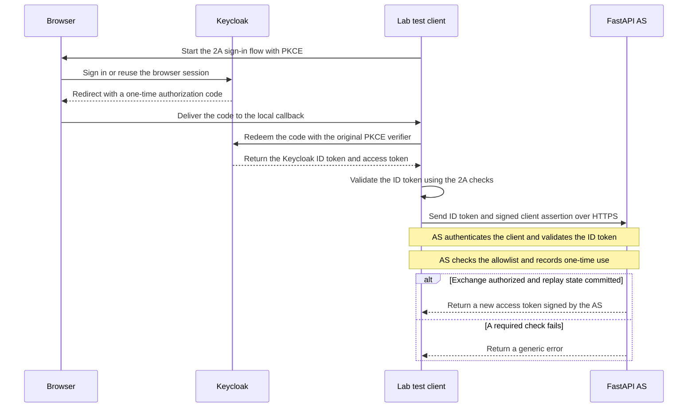

# Component 03 — RFC 8693 Token Exchange

**Project** Secure Claude Code – MCP & LLM Gateway  
**Status** Design approved for synthetic lab on November 9, 2026  
**Prerequisites** Gates 2A and 2B accepted for the synthetic lab. Off-device reachability remains pending.

## 1. Goal and boundaries

An authenticated lab exchange client presents a fresh Keycloak ID token to the independent FastAPI authorization server (AS). If the request matches one explicit policy, the AS issues a short-lived access token for the future LLM Gateway. Keycloak authenticates the employee. The AS authorizes the exchange and signs the new credential with its own key.

The lab uses synthetic identities on IPv4 loopback with verified HTTPS. The 2A browser sign-in contract remains the input. Component 3 tests issuance and independently verifies the resulting token using the AS public key. Gateway enforcement is Component 4, DPoP is Component 5, and the macOS Credential Broker is Component 6.

## 2. Exchange authority and custody

**Proposed lab decision.** Permit the existing Keycloak ID token with the exact relying-party audience `macos-oauth-client` only for the explicitly registered confidential exchanger `lab-exchange-service`. The AS must match the full tuple of authenticated exchange client, pinned Keycloak issuer, subject token type, source audience and authorized party, pre-enrolled synthetic subject, target, and scope. An ID token intended for a relying party proves identity under that relying party’s contract. It supplies no exchange authority by itself. Component 3 design approval records the lab-specific agreement to use this source profile.

Use an isolated lab test client to invoke the 2A browser flow and pass the validated ID token directly in process to the confidential exchange caller. Keep the public macOS OAuth client secretless. The lab test client is a disposable test fixture that exercises both roles without a token relay endpoint, clipboard transfer, shell argument, or persistent user-token store. Provision a real, separate lab client assertion signing key for the lab test client and register only its public key at the AS. The public placeholder from 2B grants zero authority. The AS key, Keycloak keys, client assertion key, and HTTPS certificate keys have separate roles. Store private lab keys outside source control in owner-controlled directories.

Map the exact validated `(iss, sub)` to a pre-enrolled opaque gateway subject using static synthetic configuration. Enroll from an operator-controlled Keycloak user record. Unknown or disabled subjects fail. Email, username, groups and roles carry no authorization in this profile. The authenticated client's ID is recorded separately in the output. This is a single-subject exchange profile without actor tokens or delegated chains.

**Residual risk.** A stolen fresh ID token can win the first-use race if the authorized exchanger is compromised or induced to submit it. One-time exchange controls repeat use. The incoming ID token and outgoing gateway access token are bearer material. Before enterprise use, verify an issuer-approved exchange contract with PingFederate and the enterprise AS. Prefer a dedicated audience-restricted assertion. Confirm where the confidential exchange client runs, how its signing key is managed, and how employee consent, delegation and account disablement affect authorization. [RFC 8693](https://www.rfc-editor.org/rfc/rfc8693.html) · [OAuth security best current practice](https://www.rfc-editor.org/rfc/rfc9700.html)

## 3. Wire contract

Enable only `POST https://127.0.0.1:8081/token` and advertise that endpoint, the token-exchange grant and `private_key_jwt` with RS256 in AS metadata when the profile is enabled. Keep the browser authorization and dynamic registration endpoints absent. Disabled mode preserves the Component 2B metadata and route behavior. An enabled instance fails startup for incomplete policy, key material or replay storage.

Accept an HTTPS form POST with a bounded body of at most 32 KiB. Require exactly one occurrence of each required field. Reject duplicate or unknown fields, invalid encoding, alternate content types, alternate client authentication methods and actor parameters. Use the configured URL for issuer and audience decisions. Ignore untrusted forwarded headers. Use an explicitly configured target via `audience`. This profile accepts one target and one exact scope.

| Form field | Value |
|---|---|
| `grant_type` | `urn:ietf:params:oauth:grant-type:token-exchange` |
| `subject_token` | Fresh Keycloak ID token |
| `subject_token_type` | `urn:ietf:params:oauth:token-type:id_token` |
| `audience` | `urn:lab:llm-gateway` |
| `scope` | `llm:invoke` |
| `client_assertion_type` | `urn:ietf:params:oauth:client-assertion-type:jwt-bearer` |
| `client_assertion` | Fresh JWT signed by the registered exchange client |
| `requested_token_type` | Optional. If supplied, require `urn:ietf:params:oauth:token-type:access_token`. |
| `client_id` | Optional. If supplied, require an exact match to the authenticated client. |

| Result | HTTP and response |
|---|---|
| Authorized exchange | `200` with `access_token`, `issued_token_type=urn:ietf:params:oauth:token-type:access_token`, `token_type=Bearer`, `expires_in` and `scope=llm:invoke`. |
| Missing or invalid client authentication | `400` with `invalid_client` for this form-based authentication profile. |
| Unsupported grant | `400` with `unsupported_grant_type`. |
| Malformed request or invalid, replayed or unauthorized subject assertion | `400` with `invalid_request`. |
| Unsupported target or scope | `400` with `invalid_target` or `invalid_scope`, respectively. |
| Unavailable trust, signing or replay dependency | `503` with a generic `temporarily_unavailable` error. |

Send `Cache-Control: no-store` and `Pragma: no-cache` on token responses. Error bodies contain a stable code only. Access tokens are returned only to the authenticated exchange caller. No refresh token is returned. [RFC 8693 §§2.1–2.2](https://www.rfc-editor.org/rfc/rfc8693.html#section-2) · [RFC 6749 §§5.1–5.2](https://www.rfc-editor.org/rfc/rfc6749.html#section-5)

## 4. Validation and issuance

1. **Authenticate the exchanger.** Verify the client JWT with its statically registered RS256 public key and `kid`. Require `iss=sub=lab-exchange-service`, the AS issuer identifier as the only audience, `aud=https://127.0.0.1:8081` (changed from the token endpoint URL after acceptance, following [RFC 10070](https://www.rfc-editor.org/rfc/rfc10070.html), which also led to the lab clients marking the assertion with the type `client-authentication+jwt`), a random unique `jti`, and integer `iat` and `exp`. Require a lifetime of at most 60 seconds. Check `nbf` if supplied. Allow five seconds of future clock skew for `iat` and `nbf`. Reject at or after `exp`. Record the authenticated assertion’s one-time use before further grant processing, even when the exchange later fails.
2. **Validate the Keycloak assertion.** Use only the configured Keycloak issuer, verified discovery and JWKS, pinned RS256, and a trusted `kid`. Refresh a key set only from its pinned HTTPS location, with a bounded, rate-limited refresh on unknown keys. Fail closed when current trust is unavailable. Require the exact issuer, nonempty `sub`, singleton audience `macos-oauth-client`, matching `azp` if present, and a signed, nonempty `nonce` in the 2A format. Require integer `iat` and `exp`, a maximum original lifetime of 300 seconds, and a maximum exchange age of 60 seconds. Use the same five-second future skew and reject at or after expiration. Require Keycloak’s signed ID-token type marker `typ=ID` in the claims and confirm it against the live lab version. The lab test client checks the nonce against its browser transaction using 2A. The AS uses the signed nonce for replay detection and has no browser session state.
3. **Apply exchange policy.** Check the full tuple and map the enrolled subject. Use distinct validators and key sets for client assertions, Keycloak ID tokens and gateway access tokens. Reject duplicate JWT fields, ambiguous keys, embedded keys and token-supplied key URLs. The request’s token-type label supplies no proof of what the JWT represents.
4. **Claim one-time use and sign.** Use a local owner-controlled SQLite replay store with unique constraints and durable transactions. Store only digests and expiration metadata. Reserve the client assertion by a digest of the canonical tuple `(client_id, jti)`. Reserve the subject assertion using `(Keycloak issuer, source client ID, signed nonce)`, independent of the exchanging client, JWT serialization or optional Keycloak `jti`. Keep records through their last possible acceptance time and purge only expired entries. Persist a replay-store clock high-water mark and fail closed on wall-clock rollback beyond the allowed skew. Retain records through the last acceptance time plus that skew so a small clock correction cannot reopen a spent assertion. Validate first, then insert the subject reservation and sign within one transaction. Commit before returning the response. On signing failure roll back the subject reservation. A lost response after commit leaves the subject spent, so the caller starts a fresh login. Use a fresh client assertion for every attempt. Reject duplicate requests, including simultaneous requests across AS processes sharing the lab store. Return no token on store failure. Check the time window again inside the transaction before issuing.
5. **Mint the gateway access token.** Sign with the AS key and publish its public counterpart through the AS JWKS. Protected header `typ=at+jwt`, `alg=RS256`, and AS `kid`. Require `iss=https://127.0.0.1:8081`, `aud=urn:lab:llm-gateway`, mapped opaque `sub`, `client_id=lab-exchange-service`, integer `iat` and `exp`, random unique `jti`, and `scope=llm:invoke`. Set expiration to the earlier of five minutes after issuance or the upstream ID token’s expiration. Copy no identity profile, roles, upstream credential, actor claim, or browser nonce. Component 4 must independently verify the signature, issuer, type, target, times and scope before authorizing gateway access. [RFC 7523](https://www.rfc-editor.org/rfc/rfc7523.html) · [RFC 8725](https://www.rfc-editor.org/rfc/rfc8725.html) · [RFC 9068](https://www.rfc-editor.org/rfc/rfc9068.html)

## 5. Security backlog carried into Component 3

| Item | Component 3 deliverable |
|---|---|
| SEC-01 | Bound and validate form input, JWT claims, request headers and upstream responses. Test spoofed forwarded headers, redirects, duplicate fields, token substitution and key overlap. |
| SEC-02 | Use allowlisted log and trace fields and generic error bodies. Disable raw access logging for the token path. Probe success and failure with distinctive synthetic canaries and verify that tokens, form data, credentials and protocol values do not appear in diagnostics. |
| SEC-03 | Generate an independent correlation ID at the AS. Record stable events for client rejection, subject rejection, replay, dependency failure and success. Keep correlation IDs separate from OAuth state, nonce, subject, JWT identifiers and incoming untrusted request IDs. Verify the request outcome can be traced without credential material. |

## 6. Implementation sequence and acceptance gate

1. Approve the lab authority, custody and replay decisions in this spec.
2. Add explicit enablement, registered client public keys, disabled-mode regression coverage, and strict request handling.
3. Add client and subject validation, deny-by-default policy, replay storage, and signing. Verify failure paths before enabling the live test profile.
4. Run automated and live acceptance tests and obtain explicit Gate 3 acceptance before advancing to Component 4.

| Gate case | Pass condition |
|---|---|
| 3-01 — Live exchange | Use 2A’s actual browser flow with Keycloak and the separate signed client assertion. The AS issues one access token. An independent verifier confirms its claims, lifetime and signature with the AS JWKS. Keycloak’s JWKS cannot verify it. |
| 3-02 — Client authentication | Missing, forged, expired, wrong-audience or replayed assertions fail. Public client, wrong key, unapproved authentication method and forged forwarding headers confer no authority. |
| 3-03 — Source validation | Reject incorrect issuer, audience, authorized party, signature, type, times, nonce and unknown keys. Reject live Keycloak access token substitution, an AS-issued token in the ID-token slot, and an unregistered subject. |
| 3-04 — Policy | Reject alternate target, broader or missing scope, duplicate fields, unsupported grants and actor parameters. Assert no token appears on failure. |
| 3-05 — Replay and dependency failure | Identical and fresh-client-assertion retries of a spent subject fail. Concurrent requests yield at most one token. Restart retains replay protection. Simulate signing failure, failed commit, store outage, clock rollback and a lost response after commit. Verify the defined retry behavior. Reject if current Keycloak trust is unavailable. |
| 3-06 — Diagnostics | Synthetic canaries never appear in logs, traces or errors. Both success and rejection are traceable using independent correlation IDs. |
| 3-07 — Regression and scope | Component 2A and 2B regression tests pass. Disabled mode serves no token route. Enabled mode exposes only the intended grant. Loopback binding is verified and any missing off-device evidence is recorded separately. |

**Acceptance status** Gate 3 accepted for the synthetic lab on November 15, 2026, with off-device reachability pending. See the [verification record](verification.md) for test results and diagrams.
