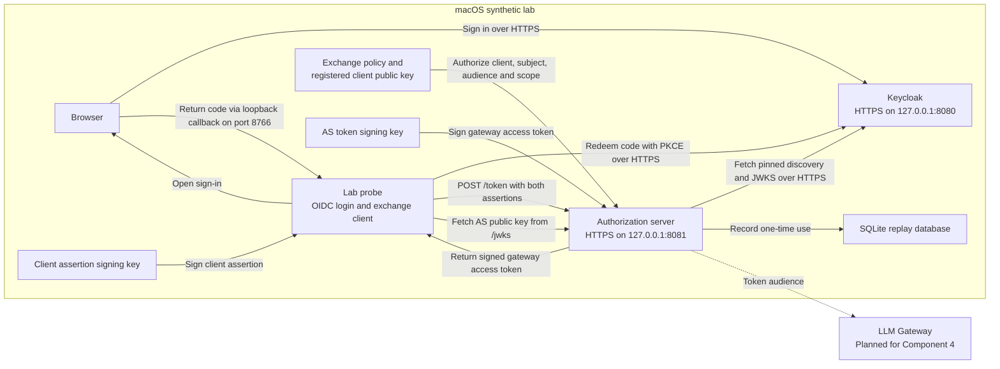
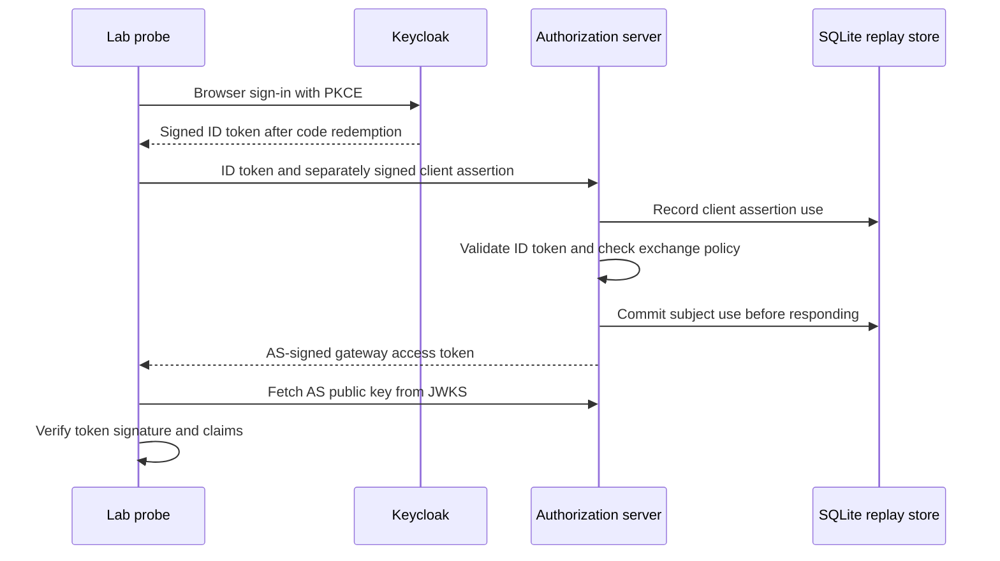
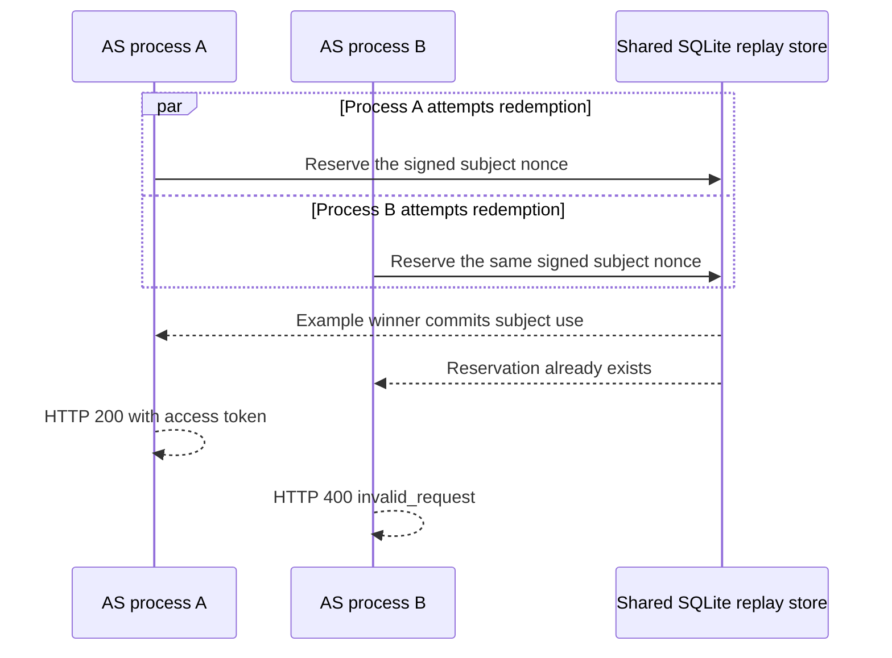
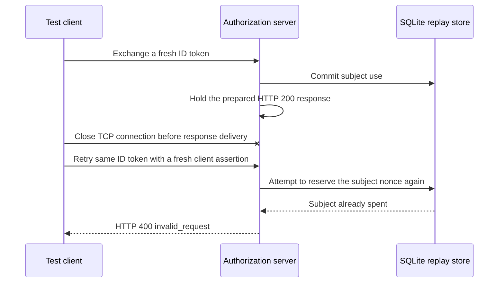

# Component 3 verification

**Status** Gate 3 accepted for the synthetic lab on November 15, 2026. The reviewer accepted with off-device reachability from a second device pending.

Verification ran November 9–15, 2026 against disposable synthetic lab data.

| Check | Result |
|---|---|
| AS suite, including Component 2B | 39 passed. The exchange tests use generated RSA keys, a pinned upstream fixture, and temporary SQLite databases. |
| Component 2A suite | 45 passed, including the 11 live Keycloak checks over verified HTTPS. |
| 3-01 | Fixture issuance and independent signature and claims verification passed. The reviewer completed the system-browser exchange against live Keycloak. The probe verified the gateway token with the AS public key and confirmed that the Keycloak keys could not verify it. |
| 3-02 through 3-04 | Automated client authentication, subject validation, policy, malformed form, and token substitution checks passed. The live exchange accepted the configured Keycloak ID-token profile, including the signed type marker, and rejected substitution of both the Keycloak and AS access tokens. |
| 3-05 | Automated concurrent redemption, restart, re-signed subject, signing failure, simulated commit failure, store outage, clock rollback, and trust-unavailability checks passed. The restart and post-commit retry checks show that a committed subject stays spent. The reviewer reran both additional tests. Independent AS processes using a shared temporary database returned one issuance and one rejection. A real loopback TCP disconnect after commit and before response delivery left the ID token spent. The disconnect test models HTTPS at the AS application boundary. |
| 3-06 | Captured AS audit events identified success and rejection with independent correlation IDs. The forged request ID and raw tokens were absent from captured logs. The reviewer observed one live success, one replay rejection and two subject rejections, each with a distinct correlation ID and no credential material in those entries. |
| 3-07 | The existing disabled-profile regression and enabled route and metadata checks passed. The reviewer confirmed the enabled metadata over verified HTTPS, the IPv4 loopback listener, and HTTP 404 on the token route in disabled mode. Off-device reachability remains pending. |

The enabled profile uses a separate client public-key registration file,
`exchange-client-jwks.json`. The disabled profile retains its placeholder
file. Replay state lives alongside the AS signing key in its owner-only
directory and is retained across enabled restarts. No private client key is
needed by the AS. The gateway token is a bearer credential pending DPoP in
Component 5.

## Component diagram

The lab probe uses the browser for Keycloak sign-in and the local callback
for the authorization code. Its exchange client keeps its own signing key.
The authorization server uses the registered client public key and Keycloak's
published keys to validate the two assertions.

The live probe verifies the issued token. Gateway enforcement is part of
Component 4.

## Live browser-to-exchange verification

Keycloak signs the identity assertion. The authorization server authenticates the
exchange client, validates the identity assertion, and applies the enrollment,
audience, and scope policy before issuing its own access token.

The probe also confirmed that Keycloak's keys could not verify the gateway
token and that either access token was rejected in the ID-token slot.

## One issuance across two server processes

The test starts two authorization-server processes and synchronizes their
requests near subject validation. Each request has its own client assertion.
Both present the same synthetic ID token and use the same temporary replay
database. Either process can win.

## Connection lost after commit

The test closes a real loopback TCP connection before the server sends the
response. It models HTTPS at the application boundary.

## Live rerun after publication changes — 2026-11-23

After acceptance, the client assertion audience changed from the token
endpoint URL to the AS issuer identifier, the replay database legacy filename
handling was removed, and all components moved to one `uv` environment. The
assistant provisioned a fresh lab under `~/secure-claude-lab` from the README
commands and ran the checks below. The owner completed each browser sign-in.

| Check | Result |
|---|---|
| Listeners | The mock, AS and gateway listened on IPv4 loopback only. |
| DPoP probe (`lab_invoke.py --dpop`) | Printed `component_05_succeeded`. The AS logged one nonce challenge and one successful exchange. The gateway logged one nonce challenge and two successful invocations (JSON and SSE). |
| Broker with the Secure Enclave signer and the installed Claude Code CLI | Exit 0 and `MOCK_OK`. The AS logged a nonce challenge and a successful exchange. The broker's two gateway request IDs matched the gateway's nonce challenge and success events. |

Not covered: the Bedrock backend, so the adapter's matched stop sequence
remains verified by offline tests only. The helper binary was the existing
local build and was not rebuilt.
