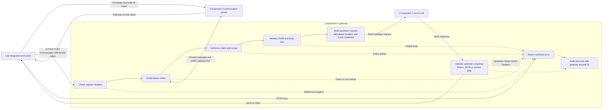

# Component 04 — LLM Gateway authentication and authorization

**Status** Design approved. Gate 4 accepted for the synthetic lab with second-device reachability pending.

Gate 3 was accepted for the synthetic lab. The second-device reachability
check remains pending. Component 4 verifies the access token at the point
where it authorizes a call to the Component 1 mock.

## Synthetic invocation probe

The proposed probe is a small integration-test client. It reuses the Component 3
browser sign-in and exchange flow with the synthetic Keycloak user, keeping
the resulting gateway token in process. It sends a text-only
`POST /v1/messages` request for each response mode and checks that the
gateway returns the mock's `MOCK_OK` in JSON and in streamed SSE events.
Component 3's probe verified token issuance. This probe verifies that the
issued token can authorize an inference request through the gateway.

The probe gives Component 4 an independent acceptance test while Claude Code
integration and the macOS Credential Broker are still under development.

The mock receives a request only after the gateway verifies the token,
authorizes the invocation, and validates the request. Once an SSE response
has started, a later failure ends the stream and produces an audit event.

## Gateway contract

- Bind the gateway to `https://127.0.0.1:8082` using disposable lab TLS.
  Accept `POST /v1/messages` and an optional exact `beta=true` query for
  Component 1 compatibility. Expose `GET /health` with a minimal status.
  Keep proxy headers disabled and upstream destinations fixed at startup.
### Request validation and limits

Accept a single `Authorization: Bearer <token>` header. Reject duplicate
headers, including combined credential values, and other credential carriers
such as `x-api-key`, cookies, or an `access_token` query or body parameter.
A single credential source gives each layer the same answer about which
credential to validate. URL credentials can also end up in access logs or
browser history. [OAuth bearer token usage](https://www.rfc-editor.org/rfc/rfc6750.html#section-2)

Require `application/json` for Messages and accept uncompressed request
bodies. This gives the gateway one input format and makes the size limit
straightforward to enforce. A small compressed body can expand into a large
allocation during decoding. Enforce the proposed 1 MiB limit on actual
bytes read, including requests without a declared length, and stop reading
when the limit is exceeded. The proposed 16 KiB ceiling bounds the
Authorization field value before JWT parsing. These are lab defaults chosen
for small text requests and compact JWTs. Configure the HTTP listener and any
future proxy limits consistently and test exactly at and above each boundary.

### Forwarding to the mock

After authentication, authorization and request validation, send the
supported request to the configured Component 1 mock on IPv4 loopback.
The client token grants access to the gateway. The gateway supplies its own
disposable mock credential to authenticate that second hop. This keeps the
client token out of mock requests and lets the two credentials be managed
independently.

Build upstream headers from scratch. Set `Content-Type` to JSON, select
`Accept` for JSON or SSE, supply the mock's `Authorization` value, and let
the HTTP client generate routing and framing headers. Cookies, client
credentials, forwarded headers and arbitrary caller headers stay at the
gateway boundary. The allowlist makes each forwarded field an explicit
decision. Forward only supported query parameters. The upstream URL comes
from configuration, with redirects and environment proxies disabled, so a
caller cannot steer the mock credential to a different destination.
The mock link uses loopback HTTP, and local processes holding the mock
credential can call it directly.

### Streaming and timeouts

Return successful JSON and deliver SSE incrementally. Backpressure means
the gateway waits for the downstream write to make progress before reading
more from the mock, keeping intermediate buffering bounded. A slow client
therefore slows the upstream reads. On client disconnect, cancel the
outstanding work and close the upstream connection. Cap total upstream
response bytes at 1 MiB for the text-only lab.

| Proposed lab timeout | What it measures and why |
|---|---|
| 2 seconds to connect | Bounds connection setup to the local mock. A loopback connection should establish quickly, so this detects an unavailable or unresponsive listener early. |
| 15 seconds of upstream read idle time | Bounds the wait for response headers or the next bytes while the gateway is waiting on the mock. Incoming bytes reset the idle timer. Time spent waiting on a slow downstream client is covered by the overall deadline. |
| 60 seconds overall | Bounds the inference hop from the start of forwarding through the last downstream write. It also stops a stream that trickles bytes indefinitely without hitting the idle timeout. |

These values are proposed lab settings, with no latency measurements for
Bedrock or Codex. Tune them against connection time, time to first event,
gaps between events, and total duration for the deployment.

## Error handling

Before committing response headers, return an Anthropic-shaped JSON error
with a stable error type, a short message, and the gateway request ID.
Validate upstream status and media type before starting a success response.
Map the failure to the layer where it occurred so callers can distinguish
credential, input, and dependency failures. [Claude API errors](https://platform.claude.com/docs/en/api/errors) · [HTTP status semantics](https://www.rfc-editor.org/rfc/rfc9110.html#section-15)

| Status | When to use it |
|---|---|
| 400 | Malformed JSON or ambiguous credential submission, such as duplicate Authorization fields. A malformed bearer submission can use the Bearer `invalid_request` challenge. |
| 401 | The bearer token is absent or invalid. Include `WWW-Authenticate: Bearer`. Add `error="invalid_token"` for an invalid or expired token. |
| 403 | A valid token lacks invocation permission. For insufficient scope, use the Bearer `insufficient_scope` challenge. A separate client-policy denial gets a generic permission error. |
| 413 | The request body exceeds the configured byte limit. |
| 415 | The request media type or content encoding is unsupported. |
| 431 | The Authorization field exceeds its limit, if the request reaches gateway handling. The HTTP listener may reject oversized headers earlier. |
| 502 | The mock connection fails, or the mock returns an unexpected status or response format. |
| 503 | Current authorization-server trust cannot be established. |
| 504 | The mock inference hop times out before response headers are sent. |

After committing SSE headers, the HTTP status is fixed. On a later failure,
end the stream without a successful terminal event and record a sanitized
failure. Correlate the response with an internal event using the gateway's
request ID. Keep credentials, request content, stack traces, and raw upstream
error bodies out of errors and diagnostics.
[Bearer challenges and error codes](https://www.rfc-editor.org/rfc/rfc6750.html#section-3) · [431 semantics](https://www.rfc-editor.org/rfc/rfc6585.html#section-5) · [Safe error details](https://www.rfc-editor.org/rfc/rfc9457.html#section-5)

## Token validation and invocation policy

**Discovery** is the authorization server's metadata document. It identifies
the issuer and advertises the location of its JSON Web Key Set (**JWKS**).
The JWKS publishes public signing keys. The gateway uses a token's `kid`
to select a public key from that trusted set and verify its signature.

**Pinned** means the gateway operator configures the expected issuer,
discovery URL, JWKS URL, and trusted CA. The metadata must agree with that
configuration. The gateway can discover rotated keys at the same trusted
endpoint. Caller-controlled URLs and keys embedded in tokens supply no
authority. [OAuth AS metadata](https://www.rfc-editor.org/rfc/rfc8414.html#section-2) · [JWT best current practices](https://www.rfc-editor.org/rfc/rfc8725.html#section-3)

Pin AS metadata to
`https://127.0.0.1:8081/.well-known/oauth-authorization-server` and JWKS to
`https://127.0.0.1:8081/jwks`. Validate both with the configured AS lab CA.
Check exact issuer and JWKS URL, bound the response size and fetch time, and
reject redirects. Load exclusively from the AS signing key set. Cache valid
trust for up to 60 seconds, serialize refreshes and rate-limit unknown-key
refreshes to one per five seconds. Reject unknown keys after refresh and fail
closed when trust expires and refresh fails.

Verify the RS256 signature and require protected `typ=at+jwt` and a known
`kid`. Reject duplicate JSON fields, ambiguous keys, and token-supplied keys
or key URLs. Require exact issuer `https://127.0.0.1:8081`, exact audience
`urn:lab:llm-gateway`, a nonempty opaque `sub` and `jti`, and integer
`iat` and `exp`. Limit original lifetime to 300 seconds, permit up to five
seconds of future skew for `iat`, and reject at or after expiry.

Authorize the Messages route only for `client_id=lab-exchange-service` and
the exact `llm:invoke` scope. The AS owns subject enrollment. Gateway audit
records omit subject identity and JWT identifiers. A valid bearer token can
authorize multiple requests until expiry. Component 3 one-time use applies to
assertion redemption. Component 5 adds sender-constrained invocation.

Generate a fresh correlation ID at the gateway for each request and return
it in a response header. Record stable events for authentication failure,
policy denial, trust failure, invocation result and stream cancellation.
Treat incoming request IDs as untrusted. The lab probe can associate AS and
gateway response IDs in memory for verification. Suppress raw access logs,
payloads, credentials and validation trace details.

## What carries into production

| Part | Production direction | Role in Component 4 |
|---|---|---|
| Gateway request handling | Carry forward the Messages interface, authentication before inference, request limits, streaming and cancellation, sanitized errors, and audit events. | Verify these behaviors against deterministic JSON and SSE from the mock. |
| Token trust and access policy | Carry forward signature and claims validation, bounded signing-key refresh, fail-closed behavior, and audience and scope enforcement. Configure the enterprise authorization server and production policy. Component 5 adds DPoP proof validation and token-to-key binding. | Trust the Component 3 lab AS and exercise bearer-token validation with its local issuer, audience, client and scope. |
| Sign-in and credential custody | Claude Code is the intended inference client. The macOS Credential Broker in Component 6 handles the production credential flow. The enterprise identity provider and authorization server supply identity and exchange services. | The probe performs both lab sign-in and exchange in one process, using the synthetic Keycloak user and a disposable exchange key. The lab identity services and probe stay in development and test. |
| Inference backend | Component 8 adds AWS Bedrock. The gateway owns backend authentication and the inference integration. | The Component 1 mock and its separate disposable credential let us verify authorization, JSON and streaming without AWS dependencies. |
| Deployment and configuration | Define production network boundaries, TLS trust, upstream endpoints, and operational limits for the enterprise deployment. | Use loopback ports, disposable CAs and certificates, and fixed lab endpoints. The proposed request limits and deadlines establish testable lab defaults. |

The production column describes the intended architecture. The approved design
covers Component 4 in the synthetic lab.

## Future Codex support

The gateway can reuse issuer and key validation, authorization, separate
upstream credentials, request limits, streaming flow control and audit
handling. Keep those controls independent of the Messages-specific request
and response format.

For a custom Codex provider, add a Responses API adapter for
`POST /v1/responses` and verify compatible models, streaming events and
completion, conversation continuation, tool calls and tool results, and
client-facing errors. Select and test the credential mechanism supported by
the deployed Codex version, including how it works with future DPoP and
credential brokerage. Measure payload sizes and latency before setting Codex
limits. Conversation history and tool output can exceed the lab's text-only
fixtures. [OpenAI Docs on gateway compatibility](https://learn.chatgpt.com/docs/enterprise/gateway-compatibility)

## Acceptance checks

| Case | Required evidence |
|---|---|
| 4-01 — Live invocation | Obtain a token through the Component 3 live flow. Use it to invoke the mock through the gateway and verify JSON and SSE both return the mock response. |
| 4-02 — Authentication | Reject missing, malformed, duplicate, expired, future-issued, wrong-issuer, wrong-audience and wrong-type tokens. Reject Keycloak token substitution and untrusted keys. Confirm zero mock calls for all rejects. |
| 4-03 — Authorization | A correctly signed token with a different client or scope receives 403 and causes zero mock calls. A valid token can authorize multiple invocations within its lifetime. |
| 4-04 — Dependencies | Verify rotation and bounded unknown-key refresh. Exercise AS outage, bad TLS, redirected trust responses, mock outage and timeout. Confirm trust failure after cache expiry causes zero mock calls. |
| 4-05 — Streaming and input boundaries | Verify incremental SSE delivery, bounded buffering with a slow reader, downstream cancellation, connect and read idle timeouts, the overall deadline, size boundaries, and prevention of forwarding to caller-selected destinations. |
| 4-06 — Diagnostics and scope | Confirm independent correlation IDs and no credential or content leakage using synthetic canaries. Inspect mock-bound headers, verify IPv4 loopback bindings and rerun Component 1 and 3 regressions. Record off-device evidence separately. |

Component 4 stops at gateway authorization and the synthetic mock. Claude Code
compatibility can be checked after the synthetic probe passes, using only
disposable lab credentials. DPoP, credential brokerage and Bedrock remain
later components. See the [verification record](verification.md) for the acceptance evidence and pending second-device check.
