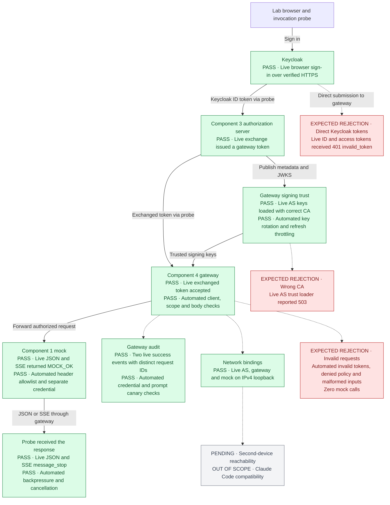

# Component 4 verification

**Status** Gate 4 accepted for the synthetic lab. Second-device reachability remains pending.

## End-to-end verification

Green marks successful behavior. Red marks an expected rejection that passed
its check. Gray marks pending or out-of-scope checks. Each marker identifies
whether the evidence came from the live lab or the automated suite.

| Check | Executed evidence |
|---|---|
| 4-01 | A loopback HTTPS smoke check loaded signing metadata and keys from a temporary signing fixture, authenticated to the gateway, and received `MOCK_OK` in JSON and SSE from the real Component 1 mock. SSE included `message_stop`. The fixture used temporary loopback ports. After refreshing Keycloak TLS, the reviewer completed the live browser sign-in and Component 3 exchange. The gateway returned `MOCK_OK` in JSON and SSE, and the probe verified the `message_stop` event. |
| 4-02 and 4-03 | Automated tests rejected missing, malformed and duplicate credentials, incorrect claims or protected headers, and a signature from a different key using the expected key ID. Wrong client and scope were denied. Rejections caused zero mock calls. JSON and SSE succeeded with the same valid token. The reviewer submitted live Keycloak ID and access tokens directly to the gateway. Both were rejected with HTTP 401 and the Bearer `invalid_token` challenge. |
| 4-04 | Tests verified signing-key rotation, unknown-key refresh throttling, failure with expired trust or changed metadata pins, rejection of redirects, and mock connection and read failures. The reviewer verified the gateway's trust loader against the live AS. The correct CA loaded public signing keys. The unrelated gateway CA caused the trust loader to return a 503 failure. |
| 4-05 | Tests checked actual body bytes, incremental streaming, slow downstream backpressure, cancellation and upstream closure, and deadline behavior before and after response headers. Unknown query parameters did not reach the mock. |
| 4-06 | Tests inspected allowlisted mock-bound headers and independently generated request IDs. Synthetic token, mock credential, prompt, and caller-supplied header canaries were absent from captured diagnostics. The reviewer observed two live invocation success events with distinct request IDs and no tokens, credentials or prompt content in those entries. The AS, gateway and mock listeners were confirmed on IPv4 loopback. Second-device reachability remains pending. |

Executed suites

- Gateway tests — **21 passed**, also rerun by the reviewer
- Component 1 mock tests — **8 passed**, with the existing Starlette TestClient deprecation warning
- Component 3 authorization-server tests — **39 passed**

The reviewer replaced the expired Keycloak TLS certificate in the existing
container mount and verified realm discovery over HTTPS before starting
the exchange-enabled AS. The [gateway lab walkthrough](../../components/gateway/README.md)
covers the browser-backed check. The invocation probe used disposable
synthetic credentials. Claude Code compatibility was outside this probe.
