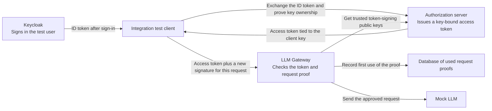

# Component 05 — DPoP sender-constrained access tokens

**Status** Gate 5 accepted for the synthetic lab. Second-device reachability remains pending.

Gate 4 was accepted for the synthetic lab with second-device reachability
pending. Component 5 binds each new gateway access token to a client-held
key and requires fresh proof when the token is used. Someone who obtains
only the access token lacks the private key needed to invoke the gateway.

## Components and key ownership

**Access token and fresh request proof.** The access token says the
authorization server granted the client permission to call the gateway.
The proof is a small signed message the integration test client creates
for each call. It covers the exact access token, HTTP method, and endpoint,
and includes a new proof ID. The gateway checks that the signature came
from the key named in the token. The client can reuse an unexpired access
token and signs a new proof for each request.

**Database of used request proofs.** The gateway uses SQLite to remember
which proofs it has already accepted. After validating the token, proof,
and request, the gateway tries to insert a record for the proof and commit
it before sending the request to the mock. The database permits only one
insert for that proof, even if two gateway processes receive copies at
the same time. A duplicate is rejected before it can trigger another mock
call. If the database is unavailable, the gateway also stops before
sending the request. This is what *reserving the proof* means in this design.

**Three separate keys.** Each private key signs a different kind of
message, and the service that verifies it uses the corresponding public key.

| Key | Who holds it | What it signs and why |
|---|---|---|
| Exchange client key | Integration test client | Signs an assertion the authorization server checks to identify the registered client allowed to request an exchange. |
| DPoP key | Integration test client | Signs proofs at exchange and invocation. The client generates this temporary P-256 key for each exchange session and keeps it in memory. The token binds to its public key. |
| Access-token signing key | Authorization server | Signs the issued access token. The gateway verifies the signature using the authorization server's published public key. |

## Issuance and invocation

The [authorization-server code walkthrough](auth-server-walkthrough.md) follows
the nonce challenge, retry, and token issuance in the implementation. The
[gateway code walkthrough](gateway-walkthrough.md) follows token and proof
validation, replay recording, and forwarding to the mock.

| Step | Contract |
|---|---|
| Exchange | Send the existing RFC 8693 form and one `DPoP` header to `POST https://127.0.0.1:8081/token`. The proof has protected `typ=dpop+jwt`, `alg=ES256`, and a P-256 public `jwk`. Claims include `jti`, `htm=POST`, `htu` for the token endpoint, `iat`, and the AS nonce. The token endpoint profile omits `ath`. |
| Bind the token | After the client, proof, subject and exchange policy pass, the AS signs a gateway access token with its existing RS256 key. It adds `cnf: {"jkt": "..."}`, where `jkt` is the base64url SHA-256 RFC 7638 thumbprint of the validated public JWK. The response declares `token_type=DPoP`. Component 3's issuer, gateway audience, scope and expiration rules still apply. |
| Invoke | Send `Authorization: DPoP <access-token>` and one fresh `DPoP` proof to `POST https://127.0.0.1:8082/v1/messages`. In addition to method, URI, issuance time, proof ID and the gateway nonce, the proof includes `ath`, the base64url SHA-256 digest of the exact ASCII access token. The gateway verifies the usual access-token claims, verifies the proof, compares the proof key thumbprint to `cnf.jkt`, compares `ath`, enforces invocation policy and records the proof as used before sending the request to the mock. |
| Repeat | Each request gets a fresh proof and proof ID, including separate JSON and SSE calls using the same unexpired token. The mock receives the existing separate lab credential. DPoP headers and access tokens stay at the gateway boundary. |

`cnf.jkt` ties the access token to a key. `ath` ties a particular proof to
the exact token being presented. `htm` and `htu` tie the proof to its HTTP
method and endpoint. The token and its proof have separate `jti` values.
The proof's ID is the one used for request replay detection.
[RFC 9449 proof validation and token binding](https://www.rfc-editor.org/rfc/rfc9449.html#section-4) · [RFC 7638 thumbprints](https://www.rfc-editor.org/rfc/rfc7638.html#section-3)

## Proof validation and nonce challenges

- Accept only ES256 and P-256. Verify the signature using the embedded
  public key. Validate canonical base64url coordinates, their lengths and
  the curve point. Reject private JWK material, duplicate JSON members,
  unsupported critical headers, remote key references, duplicate or combined
  proof headers, and proof values above 8 KiB. Keep the existing access-token
  size limit. Use separate proof and access-token validators.
- Treat `htu` as the absolute configured endpoint URI, excluding query and
  fragment. For the fixed lab routes, require the configured canonical
  string and the actual POST route. Ignore forwarded host and scheme
  headers. Preserve the gateway's independent query and body checks.
- Require an integer `iat` within the previous 30 seconds and allow five
  seconds of future skew. Require an opaque proof ID generated with at
  least 128 bits of random input by the integration test client and bound its encoded length
  at the verifier. Both endpoints require a server nonce to limit how far
  ahead proofs can be created.
- Each endpoint issues an opaque authenticated nonce with fresh randomness
  and a 60-second lifetime. Bind it to the endpoint and proof key thumbprint.
  Use independent server-side nonce keys. Permit reuse of a valid nonce with
  distinct proofs so parallel requests can succeed. Nonce keys are
  disposable in the lab. A restart with a fresh key requires a new nonce.
  Multiple replicas of the same endpoint require shared nonce key material
  and shared replay state.
- Issue a nonce challenge only after verifying the presented proof signature
  and endpoint binding. At the AS, also authenticate the exchange client.
  At the gateway, also verify the bound access token and `ath`. A missing,
  expired or mismatched nonce on an otherwise valid request can trigger one
  retry with a fresh proof. The exchange retry uses a fresh client assertion
  and can reuse the unspent subject token. The integration test client retries only explicit
  nonce challenges. A lost exchange response can leave the subject spent.

[RFC 9449 authorization-server and resource-server nonces](https://www.rfc-editor.org/rfc/rfc9449.html#section-8)

## Replay state and failure behavior

Use durable, owner-controlled SQLite state in the single-host lab. Store a
digest of the verifier namespace, proof key thumbprint and proof ID. Reserve
it atomically under a unique constraint, and retain it through the full
proof acceptance window plus rollback tolerance. Persist a clock high-water
mark and fail closed if the clock rolls back beyond the allowed skew.
Recheck proof freshness and nonce expiry inside the reservation transaction.
Clean up expired records and reject requests if the store is unavailable.

At the AS, consume authenticated client assertions under the existing
rules. A nonce challenge leaves the subject reservation untouched. On a
valid request, commit the proof reservation, subject reservation and token
issuance outcome together using the Component 3 transaction. At the
gateway, validate the request before reserving the proof, recheck access-token
expiry before dispatch, and commit proof use before the mock call. A mock
failure or client disconnect after reservation leaves the proof spent. A
fresh proof authorizes a fresh request. Inference idempotency is separate.

| Condition | AS token endpoint | Gateway |
|---|---|---|
| Invalid or replayed proof | HTTP 400 `invalid_dpop_proof` | HTTP 401 with `WWW-Authenticate: DPoP error="invalid_dpop_proof"` |
| Nonce challenge | HTTP 400 `use_dpop_nonce` and one `DPoP-Nonce` header | HTTP 401 with `WWW-Authenticate: DPoP error="use_dpop_nonce"` and one `DPoP-Nonce` header |
| Missing or invalid access token | Existing exchange validation applies | HTTP 401 with a DPoP challenge and `invalid_token` for an invalid presented token |
| Authenticated request denied by policy | Existing exchange errors apply | HTTP 403 with the existing invocation policy semantics |
| Replay store or trust unavailable | HTTP 503 with a generic OAuth error | HTTP 503 with a sanitized Messages error |

Send no-store on credential and challenge responses. Audit using stable
event codes and independently generated request IDs. Exclude tokens, proofs,
nonces, key thumbprints, proof IDs and payloads from diagnostics. Preserve
Component 4's upstream failure and streaming behavior.
[RFC 9449 resource access and errors](https://www.rfc-editor.org/rfc/rfc9449.html#section-7)

## Rollout and production boundaries

Add explicit DPoP-required lab settings at the AS and gateway. The AS
advertises `dpop_signing_alg_values_supported: ["ES256"]` when this profile
is enabled. Each configured route accepts one authentication mode.
DPoP-required mode rejects bearer requests and tokens without a valid
binding. The existing bearer profile remains available for Component 3 and
4 regression tests in separately configured runs. The gateway checks the configured mode against the AS metadata at trust
refresh. Restart both services when switching profiles to clear cached
trust. The DPoP-required gateway rejects bearer requests independently of
metadata caching.

The integration test client provides an end-to-end test without depending on Claude Code
or Codex support for proof generation. Component 6 designs the broker and
client integration, Component 7 adds hardware-backed key custody, and
Component 8 connects the inference backend. Production also needs shared
replay state across replicas and verified enterprise issuer support.

DPoP limits reuse of a stolen access token. A stolen private key, control of
the signing process, or a captured valid proof that wins a first-use race
remains a risk. A proof covers the method and URI without query or fragment.
TLS still protects the request body, query and credentials in transit.
The Keycloak ID token used as exchange input remains governed by Component 3.
[RFC 9449 security considerations](https://www.rfc-editor.org/rfc/rfc9449.html#section-11)

## Gate 5 verification plan

| Case | Required evidence |
|---|---|
| 5-01 — Live bound invocation | Use the browser-based integration test client to complete the nonce challenges, exchange the Keycloak ID token, verify the issued token's thumbprint binding, and invoke the real mock through the gateway in JSON and SSE. |
| 5-02 — Key and token substitution | Reject token-only requests, bearer downgrade, a different proof key, mismatched `ath`, an unbound token and proof reuse across endpoints. Confirm zero mock calls for each rejection. |
| 5-03 — Proof validation | Reject malformed and oversized proofs, duplicate fields or headers, invalid signatures or keys, method and URI mismatches, stale and future proofs, and missing or invalid nonces. Confirm nonce retry uses fresh proofs and preserves the unspent subject. |
| 5-04 — Replay and availability | Confirm at most one exchange or mock dispatch for a replayed proof under concurrency, including separate verifier processes sharing state. Verify persistence after restart, clock rollback, unavailable replay storage, and retry behavior after a lost response or upstream failure. |
| 5-05 — Regression and diagnostics | Run the existing bearer profile suites and the DPoP suite. Verify loopback TLS, unchanged JSON and SSE behavior, request ID correlation and absence of synthetic credential and proof values in diagnostics. Keep second-device evidence separate. |

See the [verification record](verification.md) for executed checks and remaining Gate 5 evidence.
