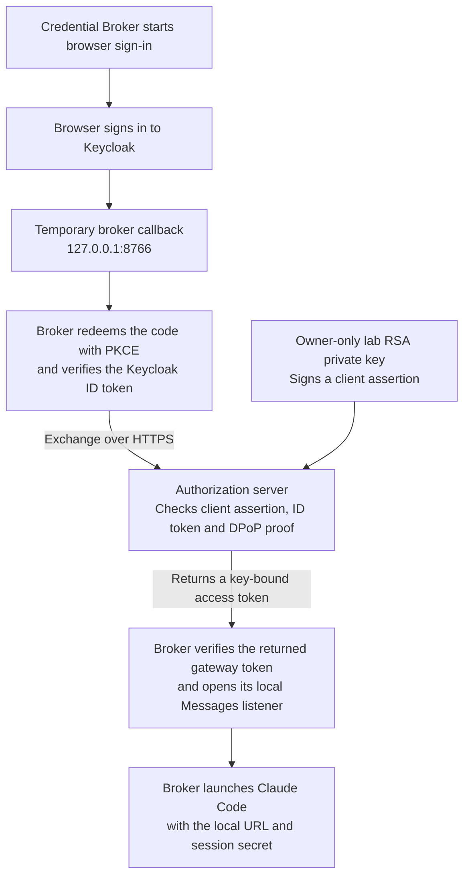
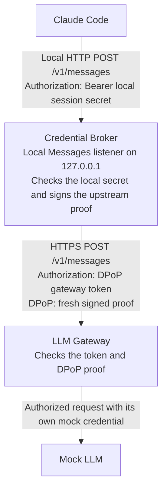

# Component 06 — macOS Credential Broker

**Status** Gate 6 accepted for the synthetic lab. Gateway invocation with debugger-recovered credentials and second-device reachability remain pending.

Gate 5 was accepted for the synthetic lab with second-device reachability
pending. Component 6 connects the real Claude Code CLI to the existing
DPoP-required gateway and Component 1 mock. The broker handles sign-in,
token exchange, key custody, and request signing. Claude Code receives
a disposable credential scoped to its local broker session.

## Architecture and responsibilities

### Session setup

### Inference request

JSON or an SSE stream returns along the same path. The broker keeps the
gateway token and DPoP private key in memory during the session.

### What the local Messages listener does

The listener is a small HTTP server inside the foreground broker process.
To Claude Code, it looks like a Messages-compatible API server. It accepts
the CLI's local `POST /v1/messages` requests over HTTP on IPv4 loopback.
On that hop the application protocol is the Anthropic Messages API. The
client sends JSON over HTTP with the local Bearer header. The broker checks
the local credential,
and hands approved requests to the broker's upstream client. It returns
the gateway's JSON or streams its SSE response. The gateway still makes
the upstream inference authorization decision.

The temporary OAuth callback serves only the browser sign-in. It listens
on the registered port `8766` and closes when sign-in completes. After
the broker has verified the gateway token, it binds a separate listener
to an OS-assigned port on `127.0.0.1`. It keeps that socket open and gives
Claude Code its actual URL through `ANTHROPIC_BASE_URL` before launching
the child. The Messages listener lives for that launch. Reuse the existing
Python login and DPoP client logic where their contracts match.

### The credentials on the two connections

| Connection | HTTP credentials | What they authorize |
|---|---|---|
| Claude Code → local listener | `Authorization: Bearer <local-session-credential>` | The broker generates a random secret per launch and gives it to the CLI through `ANTHROPIC_AUTH_TOKEN`. The broker checks possession of the secret and limits it to this local session. |
| Broker → LLM Gateway | `Authorization: DPoP <gateway-token>` plus `DPoP: <fresh-signed-proof>` | The authorization server issues the gateway token. The broker signs a new proof for each upstream request. The gateway checks token claims and that the broker holds the key bound to the token. |

The local credential is an opaque secret generated by the broker. It is
independent of the OAuth tokens and valid only at that broker. A Bearer
credential authorizes whoever presents it, so this check authenticates
possession of the session secret. Caller process identity is a separate
control. The launcher sets both environment variables only for the child
session. Gate 6 verifies the installed CLI's actual routing, headers and
streaming. [Claude Code environment variables](https://code.claude.com/docs/en/env-vars#variables) · [Gateway compatibility guide](https://code.claude.com/docs/en/llm-gateway-protocol)

## Sign-in, exchange and credential lifetime

1. Verify the pinned Keycloak, AS and gateway endpoints using their
   configured lab CAs. Use the existing system-browser flow, PKCE S256,
   state, OIDC nonce, issuer checks and bounded login deadline. Bind the
   short-lived callback to `127.0.0.1:8766` before launching the browser.
   Require the registered Host and path, consume a valid callback once,
   and release the listener on success, denial, cancellation or timeout.
   [Component 2 design](../component-02/design-spec.md) · [RFC 8252](https://www.rfc-editor.org/rfc/rfc8252.html#section-7.3)
2. Generate a fresh software P-256 DPoP key for the broker session. Exchange
   the validated ID token immediately using Component 5. The lab broker
   uses a separately provisioned, owner-only disposable RSA exchange
   client key and fresh client assertions. On an explicit AS nonce
   challenge, retry once with a new assertion and proof. Independently
   check the returned AS-signed token against pinned AS signing keys,
   expected issuer, audience, lifetime, scope and key thumbprint. Discard
   references to the Keycloak tokens after exchange.
   [Component 5 design](../component-05/design-spec.md) · [RFC 9449](https://www.rfc-editor.org/rfc/rfc9449.html#section-5)
3. Keep the OAuth material within the broker as described below.
   Launch Claude Code with the local URL and random session credential.
4. Tie the local session credential to the broker's lifetime and the
   gateway token expiry. Reject new invocations after expiry and give
   the operator a clear signal to relaunch and sign in. An already
   authorized stream may finish within its request deadline. Closing
   the CLI or interrupting the broker shuts down listeners, cancels
   active work and drops references to credentials. Component 6 uses
   explicit relaunch for renewal because the current lab AS issues
   short-lived tokens without refresh tokens. Memory cleanup is best
   effort in the lab runtime.

### Where the credentials live

| Material | Where it lives and how it is used |
|---|---|
| Local URL and session credential | The broker keeps the expected values and passes them to the Claude Code child environment. Treat the secret as readable by code that inherits or can inspect that environment. It expires with the session. |
| Gateway access token and software DPoP private key | The broker holds both in memory. It sends the token to the gateway over verified HTTPS and uses the private key locally to sign proofs. Claude Code receives neither. |
| AS and gateway DPoP nonces | The broker caches these short-lived server challenges separately in memory by endpoint and includes the appropriate value in the next signed proof. |
| Synthetic RSA exchange key | The private key file stays in the existing owner-only lab directory outside the workspace. If the current lab setup stores it under the repository, provision or relocate it into an owner-only directory outside that tree for this component. Only the broker loads it and signs the AS client assertion. The CLI receives neither the file path nor the key. |

The **RSA exchange client key** authenticates the broker to the
authorization server in the lab. The broker uses the private key to sign
a short-lived JWT client assertion and sends that assertion as the
`client_assertion` form field on `POST /token`. The authorization server
checks the signature with the registered RSA public key for the lab
exchange client. This is the `private_key_jwt` authentication method.
A separate P-256 key signs DPoP proofs and is the key bound to the gateway
token. The RSA private key stays on the broker side of the connection.
[Authorization-server signing and verification walkthrough](../concepts/authorization-server-walkthrough.md#who-signs-and-who-verifies)

The software key lives in the broker's process and the RSA file is protected
by file ownership. Other code running as the same OS user may have access
to that file or to the broker process, depending on OS and deployment
controls. The RSA key is a synthetic lab fixture. Production places
confidential exchange authority at a separate service boundary.

### Why refresh tokens would be a later design

The lab gateway token is short-lived and the current exchange issues no
refresh token. When it expires, relaunch the broker and perform a fresh
exchange. A browser SSO session may make that sign-in quick.

If real coding sessions need to run beyond one access token without browser
interaction, evaluate refresh under the enterprise issuer's session policy.
A refresh token can obtain a new short-lived access token by calling the
issuer's token endpoint. It is a longer-lived credential and belongs at
that endpoint. An upstream identity-provider refresh token, if available,
would renew upstream credentials under that provider's contract. It would
not by itself refresh the downstream gateway token.

One candidate is an enterprise AS that supports a DPoP-bound refresh
token for this exchange profile. The broker would renew before expiry
with a fresh token-endpoint proof for the same key and whatever client
authentication the AS requires. Allow one renewal in flight, verify the
new token and its binding before installing it, and update any rotated
refresh token atomically. Define expiry, replay handling, revocation,
logout, device loss, key rotation and whether credentials survive broker
restart before enabling storage. On failure, stop admitting new calls
once the current token expires and prompt for sign-in. Browser-based
re-exchange remains an option if the issuer or security policy does not
support refresh. [OAuth refresh-token protection](https://www.rfc-editor.org/rfc/rfc9700.html#section-4.14) · [DPoP token requests](https://www.rfc-editor.org/rfc/rfc9449.html#section-5)

## Local request boundary

- Bind the inference listener to an OS-assigned port on `127.0.0.1`.
  Bind first and pass the actual port directly to the child to avoid a
  port-selection race. Require the exact local Host and a single
  `Authorization: Bearer` header carrying at least 256 bits of per-launch
  randomness. Compare it in constant time. Reject browser origins,
  cookies, conflicting credential headers and forwarded host or scheme
  overrides. The loopback binding restricts direct network access from
  other devices. A same-user process that obtains the local credential
  can invoke the broker during the session.
- Accept `POST /v1/messages` and the existing optional `beta=true` query.
  Validate content type, JSON, and byte limits using the gateway's lab
  contract. Reject arbitrary URLs and unsupported routes. Disable
  environment proxies and redirects on broker-owned upstream clients.
  Use a dedicated lab working directory and isolated Claude Code
  configuration with a synthetic prompt. Remove conflicting provider,
  credential and proxy environment settings from the child, and verify
  the effective route. Preserve the user's global settings.
- The broker constructs new outbound headers. It forwards supported
  Messages data to the fixed gateway URL over verified HTTPS and
  generates a fresh DPoP proof for each attempt. Retry once only on a
  well-formed gateway `use_dpop_nonce` challenge before response headers
  reach Claude Code. Start with serialized upstream invocations in the
  lab so concurrent nonce changes and stream lifetimes are predictable.
  Carry forward incremental SSE, bounded buffering and deadlines.
  Close upstream work on cancellation. Treat a lost response as an
  ambiguous invocation and surface it to the client.
- Return sanitized Messages errors with independently generated request
  IDs. Keep upstream nonce challenges internal to the broker. Record
  allowlisted events for login, exchange, local authentication, expiry,
  invocation and cancellation. Never log tokens, session credentials,
  proofs, nonce values, callback URLs, payloads, or child environment
  variables.

### Linking broker and gateway audit events

The broker generates its own request ID at ingress and returns it to
Claude Code. The gateway generates a different `request-id` for its
handling of that request. If the broker receives one well-formed gateway
request ID on the configured, TLS-verified upstream connection, it may log
both as `broker_request_id` and `gateway_request_id` in the same event.
An operator can look up the broker request first and then find the
matching gateway event. Treat the upstream ID as diagnostic metadata.
Ignore caller-supplied IDs, malformed IDs and duplicates. If a nonce
challenge causes two upstream attempts, record their IDs in separate
attempt events under the same broker ID. If an attempt returns no headers,
log the broker ID and outcome alone.

### Future options for local caller isolation

| Option | What it would add | What to verify |
|---|---|---|
| HTTPS on loopback | Encrypt the local hop and let the CLI authenticate the broker endpoint when it trusts the certificate. | Validate local CA provisioning and CLI support. A copied local bearer credential still grants access. |
| Mutual TLS on loopback | Require a client certificate and its private key alongside server authentication. | Verify actual Claude Code certificate support and whether the key is isolated from same-user processes. |
| Unix domain socket behind a local adapter | Apply filesystem permissions and OS peer checks to the broker's socket. | Verify the adapter and socket permissions. A user ID check alone cannot distinguish processes owned by that user. A CLI-facing HTTP adapter still has its own caller boundary. |
| Signed macOS helper and XPC | Let a broker enforce an OS-backed peer requirement at the IPC boundary, such as a signing identity. | Verify signing and packaging, the peer checks, and how an HTTP-only CLI reaches the helper. A helper exposed to any local caller would defeat the intended isolation. |

These are separate deployment choices. Component 6 uses the documented
CLI endpoint and local bearer header to validate the gateway path.
[Apple XPC peer requirements](https://developer.apple.com/documentation/xpc/xpcpeerrequirement)

## Lab decisions and production direction

| Decision | Component 6 lab | Production direction |
|---|---|---|
| Local client boundary | Per-launch loopback endpoint and local session credential | Review stronger OS-backed caller isolation, child process inheritance and managed deployment for the chosen client transport. |
| Exchange authority | The broker uses the existing synthetic exchange client key to exercise the approved lab AS contract. | Keep any shared confidential exchanger key at an enterprise service boundary. Define how that service authenticates the broker and binds exchange to its device-held DPoP key under the enterprise AS contract. |
| DPoP key custody | Ephemeral software key private to the broker process | Component 7 designs Secure Enclave signing and key lifecycle. |
| Inference | Existing gateway and text mock | Component 8 connects Bedrock on the server side. |
| Renewal | Explicit relaunch when the lab token expires | Design renewal, logout, revocation and concurrent session policy for the enterprise issuer. |

The lab local credential and the software signing process remain exposed to
a compromised user context. DPoP protects the gateway against use of an
intercepted access token by itself. It does not establish which local
process supplied the request. The launcher uses one non-interactive Claude Code prompt with isolated
configuration and no session persistence. The installed CLI sent an inline
system message in a single user turn. The broker moves that text to the
top-level `system` field for the existing mock. Other inline-system
conversations are rejected. The text-only smoke test covers the installed
Claude Code CLI and the lab Messages route. Tool use, token counting, or
additional endpoints require a deliberate compatibility decision if the
CLI depends on them.

## Gate 6 verification plan

| Case | Required evidence |
|---|---|
| 6-01 — Claude Code smoke | Start the broker on macOS, complete synthetic browser sign-in and exchange, and run a real Claude Code text prompt through the broker. Verify `MOCK_OK`, an appropriate completed response, the live DPoP gateway audit event, and the intended loopback routing. Verify non-streaming and incremental SSE separately through the broker. |
| 6-02 — Credential separation | Inspect child environment, arguments and outbound headers using synthetic canaries. Only the local session credential reaches Claude Code. The broker generates proofs and the gateway receives DPoP credentials. The mock receives its own separate credential. Direct gateway use of the local credential fails. |
| 6-03 — Local and callback checks | Reject missing or wrong local credentials, duplicate headers, unexpected Host or Origin, wrong routes, oversize requests and invalid callbacks before forwarding. Confirm loopback binds and temporary callback teardown. |
| 6-04 — Lifecycle and dependency failures | Verify cancellation, browser denial, token expiry, nonce retry, ambiguous-response handling, provider TLS failure and child exit. Verify no accidental replay on failure and no listener left after shutdown. |
| 6-05 — Diagnostics and regressions | Verify request correlation without credential or content leaks. Rerun Component 2A sign-in, Component 3 exchange, Component 4 gateway and Component 5 DPoP regressions. Record off-device evidence separately. |
| 6-06 — Compromised-context baseline | Use controlled synthetic fixtures for two tests. Give a second local test client the session secret and confirm it can invoke while the session is active, then loses access at shutdown. Separately, use a test-only software signer to verify that its private key is exportable and a second in-memory signer can use that key. Keep raw key bytes in memory for the test. |

Component 7 should repeat the key-custody test with a Secure Enclave key.
The intended result is successful authorized signing while raw private key
export fails. This addresses extraction of the DPoP key. A process that
already has permission to ask the broker to sign or invoke may still use
that ability. The second-client test remains a baseline for future
local caller isolation. [Apple CryptoKit Secure Enclave](https://developer.apple.com/documentation/cryptokit/secureenclave)

See the [verification record](verification.md) for acceptance evidence, carried-forward limitations and pending checks.
