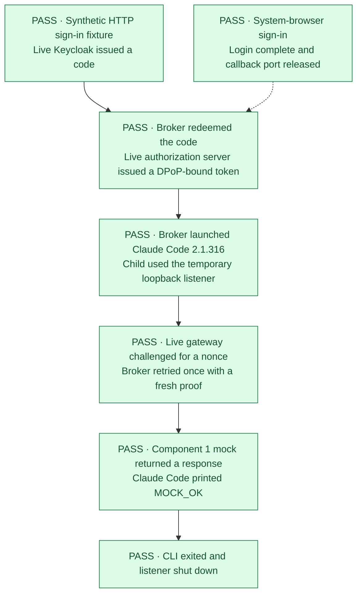
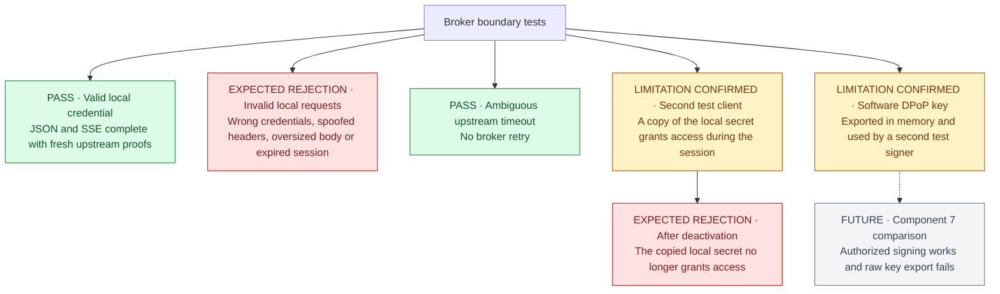

# Component 6 verification

**Status** Gate 6 accepted for the synthetic lab. The reviewer accepted with gateway invocation using debugger-recovered credentials and second-device reachability pending. The documented local-session credential and software-key limitations carry forward.

## Live Claude Code smoke result

Green marks observed success. The system-browser path was independently completed by the reviewer.
The successful run used the installed Claude Code 2.1.316 and the running
Keycloak, authorization server, DPoP gateway, and mock.

The broker recorded two distinct gateway request IDs under the same
broker request ID for the nonce challenge and successful retry.

## Automated boundary and key custody results

Green marks observed behavior that matched the test expectation. Red
marks expected rejection. Amber marks an observed security limitation.
Gray marks the future hardware comparison.

## Verification detail

| Case | Evidence |
|---|---|
| 6-01 — Claude Code smoke | Claude Code 2.1.316 printed `MOCK_OK — Local inference working` through the foreground broker, live DPoP gateway and actual mock. The smoke test obtained the Keycloak authorization code using the existing synthetic HTTP sign-in fixture, then used the broker's normal token redemption, exchange, verification and CLI launch path. The reviewer then completed actual system-browser sign-in through the broker, observed Login complete and MOCK_OK, and confirmed the callback port was released after shutdown. Broker tests checked JSON and SSE completion. The shared streaming relay's slow-reader and cancellation tests passed in the gateway suite. |
| 6-02 — Credential separation | Tests confirmed the child environment receives the local URL and local credential, strips conflicting environment values, and keeps the AS and gateway credentials in the broker. Outbound tests verified independently generated proofs, the gateway token hash, and allowlisted headers with no local credential. The reviewer sent a fresh random Bearer credential in the local-session format directly to the live gateway and verified HTTP 401 with the DPoP invalid_token challenge. |
| 6-03 — Local and callback checks | Tests rejected wrong hosts, origins, duplicate or wrong authorization headers, cookies, forwarded headers, unsupported routes and oversized bodies. Live Keycloak protocol and temporary callback regression tests passed. |
| 6-04 — Lifecycle and failures | Tests confirmed expiry before forwarding, one explicit nonce retry, no broker retry after an ambiguous transport timeout, and listener cleanup on child exit and cancellation. The live smoke showed listener shutdown. The reviewer cancelled actual browser sign-in with Ctrl+C and observed session_cancelled with the callback listener released. A separate live run supplied the AS CA for the gateway connection, observed login_succeeded followed by session_failed before CLI launch, and confirmed callback cleanup. |
| 6-05 — Diagnostics and regressions | The successful live smoke recorded separate gateway IDs for its challenge and retry under one broker request ID. The reviewer matched both IDs to the live gateway nonce and success events. The live AS also recorded its nonce challenge and successful exchange. Automated canaries verified that broker audit events omit credentials and content. An initial diagnostic run recorded synthetic OAuth query fields through HTTP client logging. The launcher now suppresses request-level HTTP client logs, and those fields were absent in the successful rerun. Second-device reachability remains pending. |
| 6-06 — Compromised-context baseline | A second synthetic client holding the session secret could invoke the local listener during the session. Access was rejected after deactivation. A separate test exported a synthetic software DPoP key into memory and used it to sign with a second in-memory signer. The reviewer additionally recovered a synthetic software key using LLDB and verified independent signing with the recovered key. This required Developer Tools authorization. The [debugger extraction record](debugger-extraction-verification.md) documents the conditions, recovered-token checkpoint, remaining gateway invocation and cleanup. The hardware key comparison belongs to Component 7. |

Executed suites

- Broker — **12 passed**
- Keycloak and callback — **45 passed**, including live Keycloak checks
- Authorization server — **57 passed**
- Gateway — **26 passed**

The installed CLI sent a single inline system message that the mock rejected.
The broker now adapts that single-turn text input into the mock's top-level
`system` field and rejects multi-turn inline-system input. The real CLI smoke
passed after that change. No Component 1 schema change was needed.

Use the [broker walkthrough](../../components/broker/README.md#browser-to-claude-code-check)
to verify the complete system-browser path.
