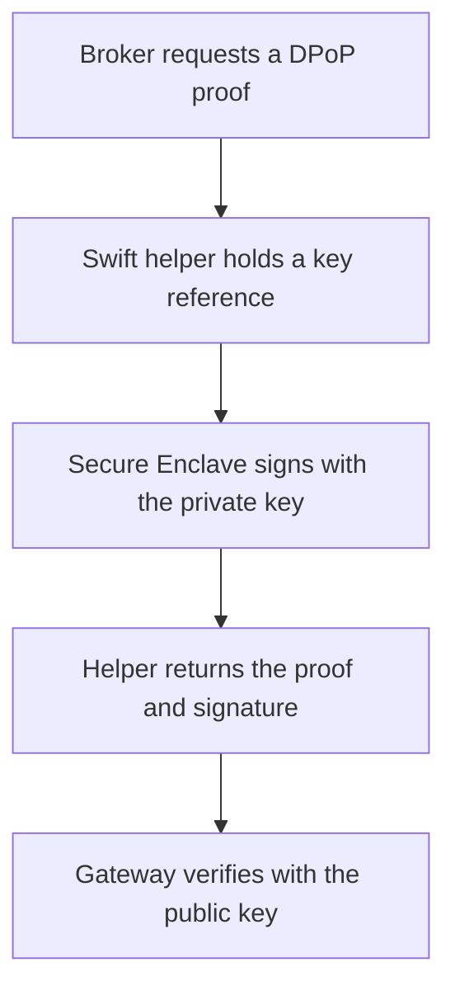
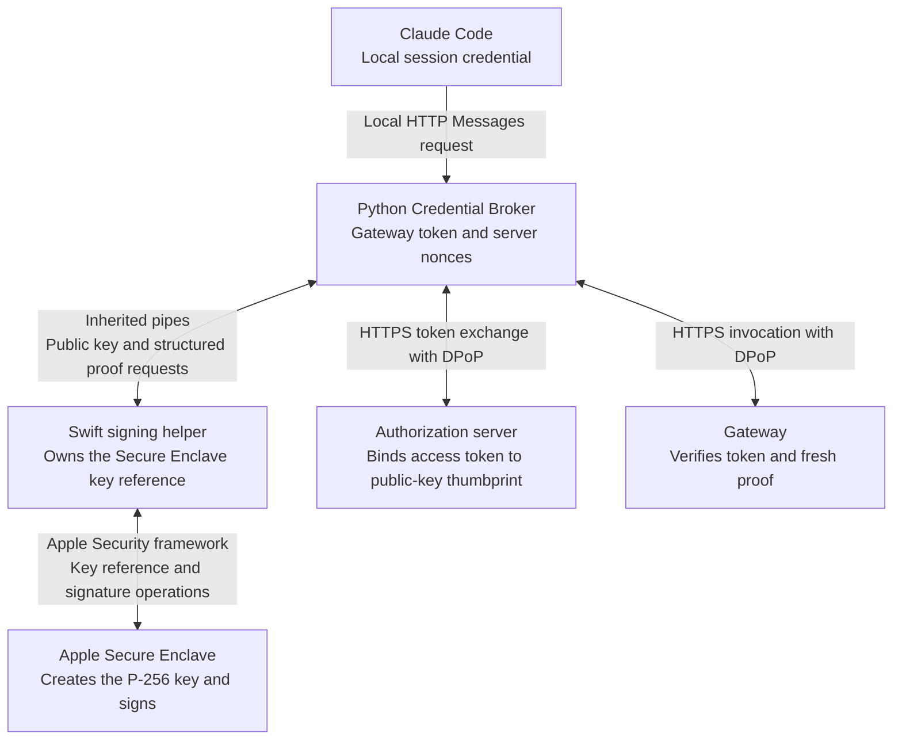
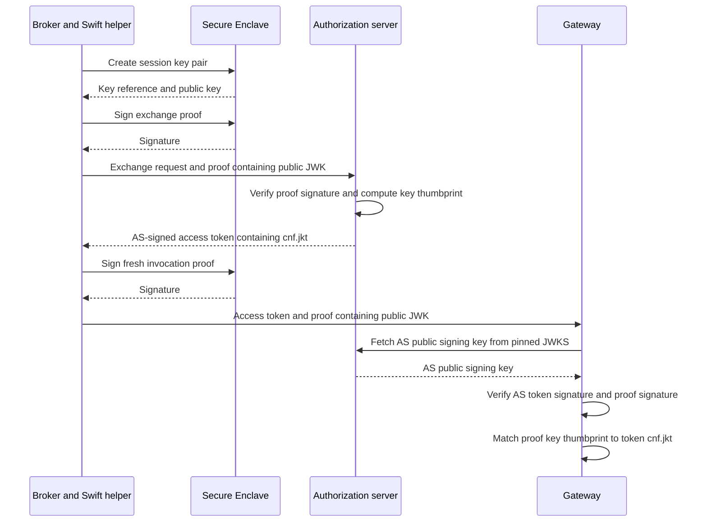
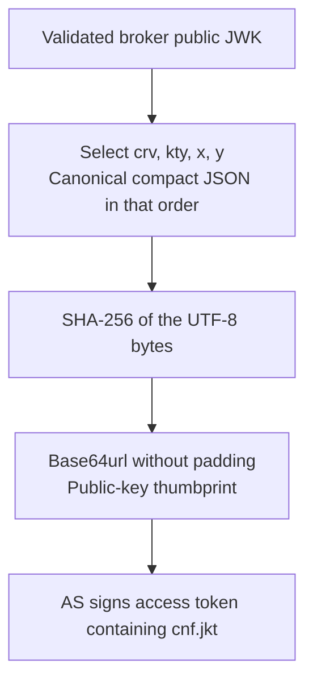
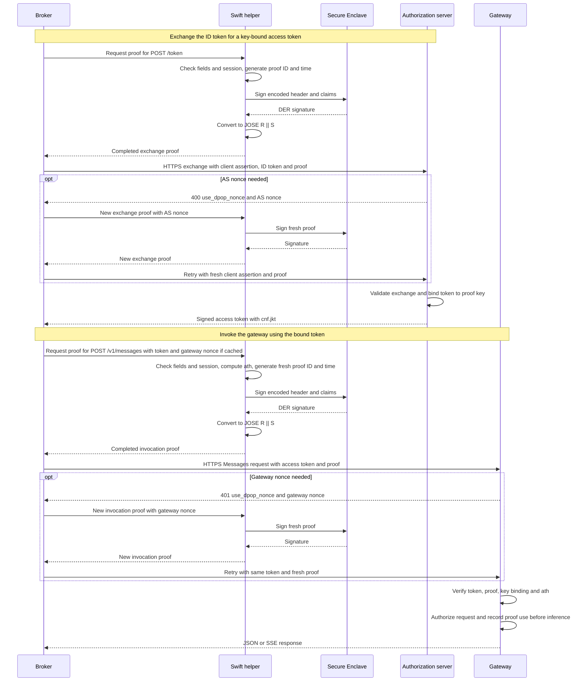

# Component 07 — Secure Enclave key custody

**Status** Gate 7 accepted for the synthetic lab. See the verification record for accepted limitations and pending checks.

Component 6 is accepted for the synthetic lab. This component replaces the
broker's in-memory software DPoP private key with a P-256 key generated inside
Apple Secure Enclave. The existing authorization server, gateway and mock
provide the protocol acceptance path.

## Secure Enclave overview

Secure Enclave is a dedicated security subsystem integrated into Apple's
chip. Its isolated processor, protected memory and operating system provide
a separate environment for sensitive operations. Applications request those
operations through supported Apple APIs.
[Apple Platform Security](https://support.apple.com/guide/security/the-secure-enclave-sec59b0b31ff/web)

For this broker, Secure Enclave creates the P-256 key and signs messages
without returning raw private-key material to Python or Swift. The Swift
helper holds an opaque key reference, submits the bytes to sign, and receives
a signature. The public key is available for distribution and verification.



Keychain and Secure Enclave have complementary responsibilities. Keychain
manages credential storage, references and access controls; Secure Enclave
performs protected private-key operations. Persistent keys can use protected
representations outside the Enclave while raw private-key material remains
protected. This lab requests a new, nonpermanent key each session and stores
no reusable private-key representation.
[Apple key-protection guide](https://developer.apple.com/documentation/security/protecting-keys-with-the-secure-enclave)

| Control | Responsibility in this design |
|---|---|
| Key custody | Generate and use the private key through Secure Enclave, with no raw private-key export through the supported API. |
| Key access policy | Specify the conditions under which signing may proceed. The default lab uses unlocked-session signing; a separate diagnostic requires user presence. |
| Broker caller authorization | Decide who may ask the broker to invoke inference. The local session secret supplies the current lab boundary. |

Touch ID prompts depend on the selected access policy. Hardware-backed
signing alone does not require a prompt for every proof. The helper's
lock-detection policy additionally terminates its session on observed lock.
A caller that can invoke the broker or control its signing channel may
still request operations, so key custody and caller authorization require
their own controls.

## Architecture



The broker continues to hold tokens and manage browser sign-in, nonce retries,
HTTP requests and Claude Code lifecycle. A small Swift child helper holds the
Secure Enclave key reference and constructs and signs DPoP JWTs. It communicates
only through inherited stdin and stdout pipes. Diagnostic output goes to stderr
using fixed, sanitized codes. No network listener is added to the helper.

## Where the keys live and how verifiers receive them

At broker startup, the Swift helper asks Apple's Security framework to create
a P-256 key pair inside Secure Enclave. The private key remains protected by
the Enclave; the helper holds an opaque reference for signing operations.
The helper retrieves the public key and supplies its JWK representation to
the Python broker. This lab requests a new, nonpermanent key for each session
and releases the key reference when the helper exits.

| Public key | How a verifier receives it | What it verifies |
|---|---|---|
| AS token-signing public key | The gateway fetches it from the configured AS JWKS endpoint over verified HTTPS. | The signature on the gateway access token, including its `cnf.jkt` claim. |
| Broker DPoP public key | The broker includes it in the protected `jwk` header of every DPoP proof. | The proof signature. The gateway also requires its thumbprint to match the AS-signed token's `cnf.jkt`. |



### Key pairs, storage and use

| Key pair | Private key location and use | Public key location and use |
|---|---|---|
| Broker DPoP key | Created inside Secure Enclave for each broker session. The Swift helper holds an opaque reference and requests signatures for exchange and invocation proofs. | Retrieved by the helper and supplied to the broker as a public JWK. Included in each DPoP proof so the AS and gateway can verify the signature and compute the key thumbprint. |
| AS token-signing key | Stored in the AS's owner-only lab key file. Signs gateway access tokens, including their `cnf.jkt` binding. | Published through the configured AS JWKS endpoint. The broker and gateway fetch it over trusted HTTPS to verify access-token signatures. |
| Exchange client RSA key | Stored in an owner-only lab file outside the workspace and loaded by the broker. Signs short-lived client assertions that authenticate the registered exchanger to the AS. | Registered at the AS. Used to verify the exchange client's assertion. |
| Keycloak signing key | Managed inside the Keycloak lab service. Signs the ID token returned after sign-in. | Published through the configured Keycloak JWKS endpoint. The broker and AS use it to verify the ID token. |

The AS signature protects the access token's authorization and key-binding
claims. The DPoP signature proves possession of the private key matching
the public key named by that binding. The gateway verifies both signatures
and compares the proof key's thumbprint with the token's `cnf.jkt`.

HTTPS certificates use additional TLS key pairs to authenticate server
connections and protect traffic in transit. These have separate roles from
the token and proof signing keys listed above.

### What the AS verifies and hashes

The AS reads the public JWK from the proof's protected header, checks that
it is a valid P-256 public key, and verifies the ES256 signature over the
exact encoded header and payload. This demonstrates possession of the
matching private key. The registered exchange client assertion separately
authenticates the client. Nonce, time, method, endpoint and replay checks
also apply before issuance.

For the validated JWK, select exactly `crv`, `kty`, `x` and `y`, in
lexicographic order. Serialize them as compact UTF-8 JSON without extra
whitespace. Compute SHA-256 over those bytes, then encode the 32-byte
digest using base64url without padding. This deterministic result is the
JWK thumbprint.

For example, the canonical input has this shape. Coordinate values below
are placeholders.

```text
{"crv":"P-256","kty":"EC","x":"<base64url-X>","y":"<base64url-Y>"}
```



The thumbprint identifies the public key. It provides no signature or
identity authority on its own. The AS binds the key to its authorization
decision by placing the thumbprint in the access token and signing that
token. At invocation, the gateway independently repeats the thumbprint
calculation from the proof's public JWK and compares the result to the
validated token's `cnf.jkt`. A different key produces a different binding.
The AS learns no hardware-attestation evidence from this calculation.
[RFC 7638 thumbprints](https://www.rfc-editor.org/rfc/rfc7638.html#section-3) · [Shared AS proof verifier](../../components/oauth-as/dpop.py)

## Apple APIs and access control

Use the Security framework from Swift to create the key with
`SecKeyCreateRandomKey`. Require ECSECPrimeRandom, 256 bits and
`kSecAttrTokenIDSecureEnclave`. Create access control with
`kSecAttrAccessibleWhenUnlockedThisDeviceOnly` and `.privateKeyUsage`.
Handle every API error. Export the public key using `SecKeyCopyPublicKey`
and its public external representation. The private key is created in hardware.
The signer receives an opaque reference used to request signatures.
[Apple Secure Enclave key protection](https://developer.apple.com/documentation/security/protecting-keys-with-the-secure-enclave)

The proposed lab profile creates a nonpermanent key per broker session.
It stores no private-key representation or reusable key reference on disk.
The lab uses unlocked-device access without a biometric prompt per proof.
Requiring `.userPresence` is a separate profile decision because repeated
proofs and nonce retries may require interactive authentication. Production
must define its authentication-context reuse and user interaction policy.
[Apple access-control flags](https://developer.apple.com/documentation/security/secaccesscontrolcreateflags/privatekeyusage) · [Apple user presence](https://developer.apple.com/documentation/security/secaccesscontrolcreateflags/userpresence)

A runtime hardware capability check may use `SecureEnclave.isAvailable`;
successful hardware key creation and signing remain required evidence.
Secure Enclave mode fails closed when unavailable. Explicit software mode
remains available in separate regression runs, with its mode identified in
sanitized startup events.
[Apple availability API](https://developer.apple.com/documentation/cryptokit/secureenclave/isavailable)

## Public key, thumbprint and signature encoding

The public P-256 key is represented as an uncompressed X9.63 point,
65 bytes consisting of the 0x04 prefix followed by 32-byte X and Y coordinates.
Validate lengths and the point before forming the public JWK with exactly
`kty=EC`, `crv=P-256`, `x` and `y`. Coordinates use unpadded base64url.

Calculate the JWK thumbprint with SHA-256 over UTF-8 canonical JSON containing
the four required members in lexicographic order, without extra whitespace.
Encode the digest as unpadded base64url. This must match the existing AS
`cnf.jkt` and gateway proof-binding checks.
[Apple public-key representation](https://developer.apple.com/documentation/cryptokit/p256/signing/publickey/x963representation) · [RFC 7638](https://www.rfc-editor.org/rfc/rfc7638.html#section-3)

For each proof, build the protected header with `typ=dpop+jwt`, `alg=ES256`
and the public JWK. Encode the header and claims separately using base64url
and join them with a period. Sign those exact ASCII bytes using
`SecKeyCreateSignature` with `.ecdsaSignatureMessageX962SHA256`.
The message variant hashes with SHA-256 as part of signing.

That Apple API returns an ASN.1 DER ECDSA signature. Parse it through
CryptoKit's `P256.Signing.ECDSASignature(derRepresentation:)` and use
`rawRepresentation` to obtain the JOSE 64-byte R || S representation,
including leading zero padding in each 32-byte integer. Append its base64url
encoding as the JWT signature segment. Verify the assembled proof locally
with the public key and independently with the existing Python verifier.
[Apple signing algorithm](https://developer.apple.com/documentation/security/seckeyalgorithm/ecdsasignaturemessagex962sha256) · [Apple ECDSA signatures](https://developer.apple.com/documentation/cryptokit/p256/signing/ecdsasignature) · [ES256 encoding](https://www.rfc-editor.org/rfc/rfc7518.html#section-3.4)

## Signing flow

A nonce is a short-lived server challenge included in the next signed proof.
The AS and gateway issue independent nonces for their respective endpoints.



The helper supports only initialization/public-key retrieval and proof
generation for the two existing POST endpoints. AS proofs omit `ath`;
gateway proofs include the SHA-256 hash of the exact access token. Apply the
existing nonce and size limits. The helper generates proof IDs and times
internally and rejects unknown operations, endpoints, methods, duplicate JSON
members and oversized messages. It provides no arbitrary-byte signing command.

Use bounded newline-delimited JSON over private inherited pipes, one request
in flight, and independent request IDs to match replies. The broker validates
response size, type and ID. A signer timeout, malformed reply or premature
EOF terminates the session. Close unrelated descriptors in both child launches.
Claude Code inherits neither helper pipes nor key references. Build and start
the helper before login, and verify its public key remains stable throughout
the session. Reuse the existing nonce retry and token-binding validation.

## Key lifecycle and failure behavior

| Event | Required behavior |
|---|---|
| Session starts | Create a new hardware key and verify a local test signature before login and exchange. |
| Token issued | Verify AS signature, claims and binding to the helper's public-key thumbprint before admitting inference. |
| Device locks | Stop admitting new calls and signing. Observe the macOS session lock state in the native helper and terminate the broker session on lock. Treat unknown lock state as unavailable. Test OS key restrictions with the retained reference as well as application lock handling. A stream already dispatched may finish within the existing deadline. |
| Signing denied or user cancels authentication | Return a sanitized failure, stop dispatch and end the session. |
| Helper dies, key reference is lost, or key is invalidated | End the session. Start with a new hardware key and browser exchange on explicit relaunch. The old token remains bound to its original key. |
| Hardware unavailable or key creation fails | Report hardware signing unavailable and exit the selected hardware profile. |
| Broker or CLI exits | Close pipes, terminate and reap the helper, release key references and token material, and close local listeners. |
| Token expires | Apply Component 6 relaunch behavior. Refresh remains outside this component. |

Session lock observation must be verified on the supported macOS version
during implementation. Screen-lock notifications and actual signing denial
are separate evidence. If the selected ephemeral key's access controls permit
signing after lock, the helper's fail-closed session policy must still stop
operations. Record the observed API behavior explicitly.

## Private-key protection and caller authorization

Hardware signing protects raw private-key material from application-level
export. The broker still holds the gateway token, and a caller with access
to the broker can ask it to make requests. A compromised broker may also
request signatures through its existing helper channel. Private pipes limit
accidental exposure of the signing interface and do not authenticate every
process running under the same user.

Component 6's local Bearer credential remains the lab caller boundary.
Production needs a separate decision on signed helpers, XPC peer requirements,
Keychain access policy, hardened runtime and managed installation. Any use
of an entitlement permitting debugger attachment must be documented for the
deployed build. The synthetic RSA exchange client key remains a separate
lab fixture and needs the enterprise service boundary already identified
in Component 6.
[Apple XPC peer requirements](https://developer.apple.com/documentation/xpc/xpcpeerrequirement)

The earlier debugger-assisted export and independent signing established a
software-key limitation under Developer Tools authorization. Further credential
extraction and reuse testing stays pending. Component 7 evaluates supported
API behavior and protocol interoperability, with no additional debugger
extraction experiment included in this approval.
[Recorded Component 6 experiment](../component-06/debugger-extraction-verification.md)

## Lab and production decisions

| Area | Proposed lab | Production review |
|---|---|---|
| Signing | Swift helper using Apple Security and CryptoKit | Signed, managed installation with reviewed IPC and runtime policy |
| Key lifetime | Fresh hardware key per foreground session | Decide persistence, recovery, rotation and device-loss handling |
| User interaction | Unlocked-device signing with session termination on lock | Decide user-presence policy and authentication-context lifetime |
| Storage | Ephemeral key reference and in-memory token | If persistence is required, separately design Keychain storage, access controls and cleanup |
| Protocol | Existing ES256 DPoP AS and gateway | Enterprise AS interoperability and any requirement for hardware attestation |
| Caller boundary | Existing local session secret | Separate OS-backed caller authorization design |

The ordinary DPoP public JWK and signature give the server proof of key
possession. They supply no hardware attestation. The AS and gateway cannot
infer Secure Enclave custody from an ES256 proof alone.

## Gate 7 acceptance criteria

| Case | Functional and security evidence |
|---|---|
| 7-01 — Hardware key creation | On supported hardware, create an Enclave key, report the selected mode and verify a local signature. Record macOS, architecture, build and API outcomes. |
| 7-02 — Encoding interoperability | Independently validate public coordinates, thumbprint and exactly 64-byte JOSE signatures. Test leading-zero integer cases with deterministic signature-conversion fixtures. Verify the proof with the existing Python verifier. |
| 7-03 — Live end to end | Complete actual browser sign-in, DPoP exchange and JSON/SSE invocation through the broker and real CLI. Confirm token binding matches the helper key and retain sanitized audit correlation. |
| 7-04 — Export boundary | Confirm supported APIs provide the public key and signatures while raw private-key export is unavailable. Interpret opaque or wrapped representations according to Apple documentation. Record evidence without claiming all memory attacks were tested. |
| 7-05 — Access and lifecycle | Exercise hardware absence, locked session, denied signing, helper death, malformed IPC, pipe timeout, expiry and shutdown. Verify no new gateway dispatch after failure and no surviving helper or listener. |
| 7-06 — Key replacement | A new session uses a new thumbprint. Demonstrate that a proof from the replacement key cannot use a token bound to the old key. |
| 7-07 — Credential separation and regressions | Verify Claude Code inherits only its local credential and endpoint, inspect descriptor separation, test malformed and unapproved signing requests, and run relevant Component 3–6 regression suites. Confirm sensitive values stay out of diagnostics. |
| 7-08 — Carry-forward limits | Record that local-secret theft and authorized signer misuse require caller controls. Leave recovered-credential gateway invocation and second-device reachability pending unless separately completed. |

See the [verification record](verification.md) for executed hardware checks, implementation decisions and pending acceptance evidence.
