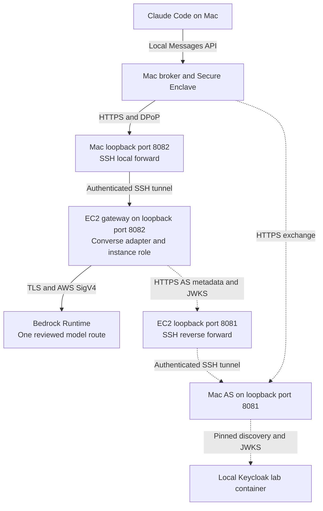

# Component 8B — Proposed AWS deployment and cost plan

**Status** Gate 8B accepted for the lab on 2026-11-23; final billed-cost reconciliation and budget-alert email delivery remain pending. Deployment and paid lab testing were explicitly approved and executed.
The host was terminated and principal AWS cleanup verified. See [verification](verification.md)
for actual Haiku 4.5 results, the Haiku 5.5 account restriction, and pending cost
reconciliation. The proposal below is retained as the original plan.

## Proposed first live lab

Run one gateway process on one isolated EC2 host with a temporary instance
role. Keep Keycloak, the synthetic AS, Claude Code and the Secure Enclave
broker on the Mac. Use authenticated SSH forwarding in both directions and
verified TLS inside the tunnels.

The reviewer approved a $5 total spending ceiling. The two-hour runtime
and six inference attempts remain proposed operational defaults. The AWS account,
Region, model access and resource availability remain unverified.

### Why use both tunnel directions

| Path | Forwarding and TLS identity |
|---|---|
| Broker → gateway | Bind a local forward to Mac `127.0.0.1:8082`, targeting EC2 `127.0.0.1:8082`. The TLS connection ends at the gateway; the broker trusts the gateway lab CA. |
| Gateway → AS | Bind a reverse forward to EC2 `127.0.0.1:8081`, targeting Mac `127.0.0.1:8081`. TLS ends at the AS; the gateway trusts the AS lab CA. |

Both hosts interpret their own loopback addresses. The authenticated tunnel
connects those two local listeners. The gateway remains a remote AWS workload
even though the broker's canonical gateway URL stays
`https://127.0.0.1:8082/v1/messages`.

This topology refines the original remote-endpoint option. It preserves
the current AS issuer, client-assertion audience, DPoP proof URI and native
signer endpoint allowlist for this lab. The existing local gateway must be
stopped before binding the Mac forward.

Verify the SSH host key using a trusted provisioning channel. Use a dedicated
forwarding identity with loopback-only permitted destinations and listeners.
Disable public remote-forward binding, agent forwarding, X11 and PTY access
for that identity. Separate host administration from the tunnel identity.
Require successful bind before starting the test and stop on tunnel failure.
Loss of the AS tunnel fails trust refresh after the existing cache expires.
Local users on either host still have their usual access to local listeners.

## Resource plan

| Resource | Proposed configuration |
|---|---|
| Account | Dedicated non-production AWS account; owner to confirm |
| Region | Proposed us-east-1 (N. Virginia); verify account access and organizational policy |
| EC2 | One Linux x86_64 t3.small candidate, 2 vCPU and 2 GiB RAM; recheck availability and hourly price for the selected Region |
| CPU credits | Standard credit mode for the burstable lab host; review performance if throttled |
| Root volume | 8 GiB encrypted gp3, default performance, delete on termination; confirm the selected AMI fits before launch |
| OS | Current official Amazon Linux 2023 AMI for the chosen Region/architecture, recorded in the deployment review |
| Network | One approved public subnet and internet route, one auto-assigned public IPv4 address |
| Security group | SSH only from the operator's reviewed public IPv4 /32; gateway port stays on host loopback |
| Workload identity | Instance profile containing a dedicated Bedrock inference role |
| Instance metadata | Require IMDSv2; use hop limit 1 for the host process |
| Application | Unprivileged service account, owner-only replay directory and nonce key, one gateway process and one inference worker |
| Logs | Sanitized service events with a small rotation/retention policy; review existing account-level Bedrock invocation logging before use |

The public-subnet route avoids introducing a NAT Gateway for this short lab.
If organization policy requires private networking, revise the resource and
cost table for the approved administrative path and any interface endpoints.
Public IPv4, compute and disk charges must all be counted.
[EC2 pricing](https://aws.amazon.com/ec2/pricing/on-demand/) · [IPv4 pricing](https://aws.amazon.com/vpc/pricing/) · [EBS pricing](https://aws.amazon.com/ebs/pricing/)

Keep an operator-held host manifest with resource IDs and tags. Proposed tags
are project, owner, purpose and expires-at, without user or prompt data.
Tag expiry is bookkeeping; it does not automatically terminate an instance.

## IAM and model selection

Separate the provisioning identity from the inference role. The operator can
use the AWS browser console or an approved administration environment to create
the host and narrowly scoped role. The Mac broker needs no AWS API credentials.

The instance role trusts EC2 and grants `bedrock:InvokeModel` and
`bedrock:InvokeModelWithResponseStream` on the exact resources required for
one reviewed model route. These actions authorize Converse and ConverseStream.
The role has no infrastructure administration permissions.

Before drafting the final IAM policy, record:

| Selection | Required review |
|---|---|
| Model | Exact Claude model ID or inference-profile ARN, with text and Converse streaming support |
| Region | Source Region and verified account access |
| Resources | Exact profile and model ARNs evaluated for this route |
| Destinations | For cross-Region inference, review every possible destination and applicable organizational controls |
| Route | Alias `lab-claude-text`, route revision, supported parameters, 128 output-token limit |

Prefer a permitted single-Region route for a simpler initial review. Some
models require inference profiles. Determine this from actual availability
before selecting the route. Cross-Region destinations and IAM requirements
must be reviewed together.
[Converse permissions](https://docs.aws.amazon.com/bedrock/latest/APIReference/API_runtime_Converse.html) · [Inference-profile Regions](https://docs.aws.amazon.com/bedrock/latest/userguide/inference-profiles-support.html)

The SDK provider added in 8A uses refreshing instance-role credentials,
requires IMDSv2, and excludes shared credential files and environment
credentials. Verify this behavior on the actual host. Require IMDSv2 in
the instance settings as well as the application provider.
[EC2 IMDS configuration](https://docs.aws.amazon.com/AWSEC2/latest/UserGuide/configuring-instance-metadata-service.html)

## Recommended model for this activity

Recommend Claude Haiku 5.5, with `us-east-1` as the source Region and
`us.anthropic.claude-haiku-5-5` as the candidate geographic inference profile.
The documented destinations from that source are us-east-1, us-east-2 and
us-west-2; recheck the actual profile before finalizing IAM. Its short text
and streaming capabilities suit the integration checks.
[AWS Haiku model card](https://docs.aws.amazon.com/bedrock/latest/userguide/model-card-anthropic-claude-haiku-5-5.html)

Haiku's adaptive thinking is on by default but can be disabled. The current
adapter removes a disabled client thinking field and does not send the
provider-specific setting. Before invoking this model, add and test a
server-controlled route option that sends
`additionalModelRequestFields={"thinking":{"type":"disabled"}}` for this
reviewed route. Verify the exact Converse support with AWS documentation
and offline fixtures. Preserve rejection of caller-selected advanced fields.

Sonnet 5.5 is a future comparison candidate. Its documented thinking behavior
differs and disabled thinking is unsupported, which complicates the initial
text-only response profile.
[AWS Sonnet model card](https://docs.aws.amazon.com/bedrock/latest/userguide/model-card-anthropic-claude-sonnet-5-5.html)

This recommendation does not establish account entitlement or final pricing.
The published pricing table did not expose numeric rates through the retrieved
text. Capture the selected service-tier and geographic-route rates in the
AWS pricing interface before computing the final cost estimate. Include
Anthropic Marketplace charges in cost review; the model cards describe
provider-attributed billing.

## TLS, files and deployment preparation

1. Check all lab certificate expiration dates before the session. The existing
   Keycloak and gateway certificates were dated November 22, 2026; their
   validity must be rechecked for the actual test time.
2. Generate gateway TLS material on the EC2 host for the loopback IP SAN.
   Transfer only the gateway public CA certificate to the broker through
   the authenticated administration channel. Generate the host's nonce key
   and replay database there. The remote gateway receives the Mac AS public
   CA certificate.
3. Deploy only the gateway and the shared modules it imports, plus pinned
   dependencies. Exclude repository lab directories, private keys, tokens,
   local configuration, tests and extracted artifacts. Review the exact file
   manifest before transfer.
4. Fill the route configuration with reviewed values and verify the role has
   effective permission. The configured ARN list documents intended resources;
   IAM enforces them.
5. Start the DPoP-required Bedrock backend on EC2 loopback. Establish both
   forwards, verify TLS and metadata through them, and run authentication
   rejection checks before any model invocation.

Mac Keycloak and AS services stay on their existing lab paths. The synthetic
RSA exchange key stays in its owner-only Mac directory. The AWS host receives
neither the broker's session secret nor the private Secure Enclave key.

## Cost worksheet

Final prices must be filled from the selected Region, model, service tier and
account terms immediately before approval. Free-tier credits are excluded
from the estimate so the plan remains understandable without them.

Let `H` be host hours, `Pec2` the EC2 hourly rate, `Pdisk` the gp3
GiB-month rate, and `Pin`/`Pout` the model's USD per million input/output
tokens. Use the actual monthly proration basis in the selected price quote.

| Item | Planning formula |
|---|---|
| EC2 | `H × Pec2` |
| Public IPv4 | `H × 0.005 USD` at the published current rate; two hours is $0.01 |
| gp3 | `8 GiB × Pdisk × retained-hours / monthly-hours` |
| Inference | `total_input_tokens × Pin / 1,000,000 + total_output_tokens × Pout / 1,000,000` |
| Other | Review data transfer, existing log capture, tax and account-specific charges |

For the proposed six inference attempts, output is limited to 768 tokens
total if every attempt reaches the 128-token cap. For planning only, allocating
20,000 input tokens per attempt gives 120,000 total input tokens, so the
inference estimate is `0.12 × Pin + 0.000768 × Pout`. The 20,000 figure
is an estimate, not an enforced input-token cap. The existing 1 MiB request
limit does not provide a token-price guarantee.

Before the first actual CLI prompt, estimate its full input including system
content. Bedrock CountTokens can count the matching Converse input when
supported by the selected model. Confirm its permissions, model support and
pricing before adding it to the concrete runbook. If the expected input or
price exceeds the reviewed allocation, stop and revise the test plan.
[Bedrock pricing](https://aws.amazon.com/bedrock/pricing/) · [CountTokens](https://docs.aws.amazon.com/bedrock/latest/APIReference/API_runtime_CountTokens.html)

**Proposed allocation within the approved $5 ceiling** $1 infrastructure,
$3 inference and $1 contingency. AWS does not enforce this project ceiling
automatically. Complete the rate worksheet and resource controls before launch.

Use a two-hour infrastructure lifetime and at most six explicit model
attempts for the initial plan. The operator records every attempt. A
scheduled host shutdown and a gateway process deadline reduce unattended
compute use. A stopped host can still incur storage charges. Delete the
resources during cleanup and verify remaining charges.

The existing gateway and CLI text profile disable automatic inference
retries. Connection loss can still leave a billable request running.
AWS Budgets alerts are delayed and must supplement runtime and attempt
limits rather than serve as a real-time cutoff.
[AWS Budgets update behavior](https://docs.aws.amazon.com/cost-management/latest/userguide/budgets-managing-costs.html)

## Proposed live verification sequence

| Order | Check and expected evidence |
|---|---|
| 1 | Review account, Region, model, role, exact resource manifest and completed price estimate; obtain deployment approval. |
| 2 | Provision the host with its expiry plan and IMDSv2-only role. Verify host identity, gateway TLS and the loopback binds. |
| 3 | Establish both forwards. Verify AS metadata/JWKS and gateway health over TLS. Check direct unauthenticated gateway rejection with zero inference. |
| 4 | Run one bounded JSON request and one SSE request with a valid DPoP token. Record the alias, route revision, actual AWS request IDs, usage and successful completion. |
| 5 | Run one actual Claude Code text invocation through browser sign-in and the Secure Enclave broker with `--text-only`. Expect a real model response; the fixed MOCK_OK fixture string is no longer the success criterion. |
| 6 | Match audit IDs, verify effective route and role, test a rejected alias and proof without billable inference, review resource and usage evidence. Stop before exceeding the reviewed attempt allowance. |
| 7 | Tear down resources and forwards, record cleanup, reconcile costs when billing data arrives, then review Gate 8B acceptance. |

Full coding-agent tool use remains outside the approved text-only adapter.
The live response must demonstrate actual Bedrock routing and completed JSON
and SSE. The model's generated self-description is not routing evidence.

## Cleanup checklist

- Stop the broker and forwards, then verify Mac ports and helper exit.
- Stop the remote gateway before deleting its replay and nonce state together.
- Terminate the EC2 instance and verify root-volume deletion.
- Verify public IPv4 release and remove any separately allocated address.
- Remove only the lab-created instance profile, role policy and security group
  after checking dependencies.
- Remove temporary SSH keys, copied CA files and reviewed deployment artifacts.
- Verify that logging configuration and retained logs match the agreed policy.
- Record actual inference requests and token usage, resource termination time
  and later billed charges. Investigate any surviving tagged resource.

## Decisions needed before deployment

| Decision | Current status |
|---|---|
| Non-production account and administrative channel | Awaiting owner selection |
| Region and existing subnet/host | Proposed us-east-1 and a new isolated lab host; verify existing resources |
| Exact Claude model/profile and model access | Recommend Haiku 5.5 through the US geographic profile; account access and destination ARNs await verification |
| Budget and runtime | $5 ceiling approved; two-hour maximum proposed |
| TLS and forwarding topology | Proposed dual SSH forwards for review |
| Final IAM policy and price quote | Can be completed once account, Region and model are selected |

This document authorizes no provisioning. It provides the reviewable plan
needed before implementation and billable stage 8B testing.
