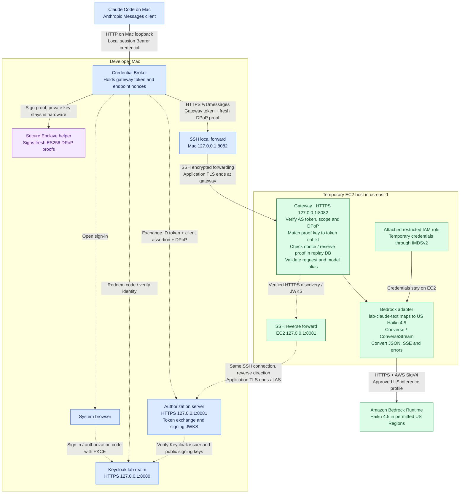
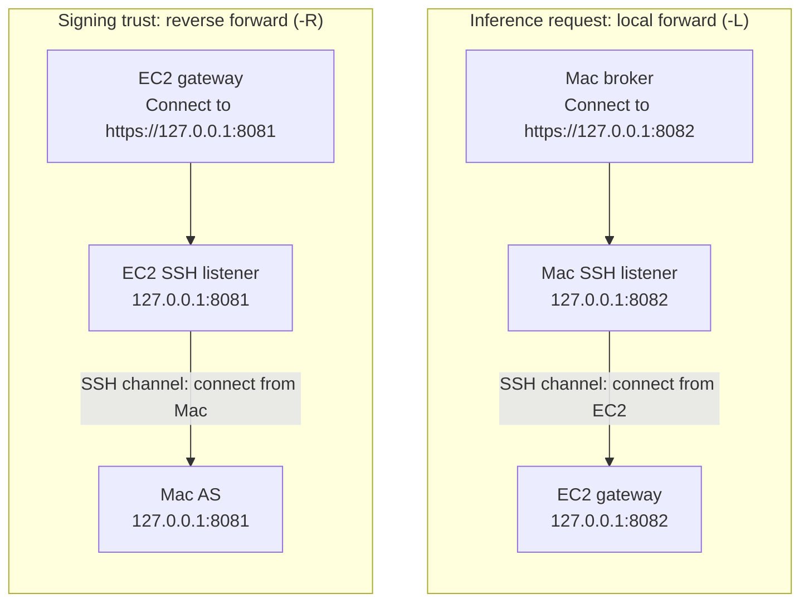
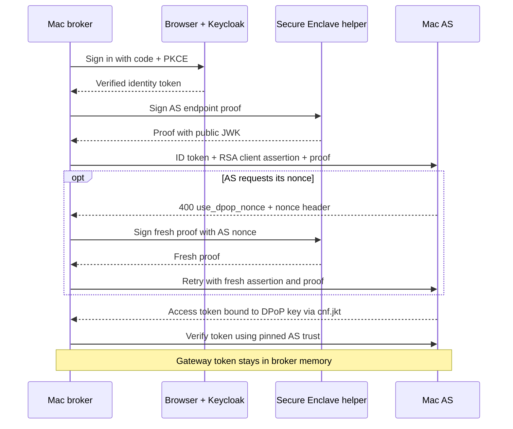
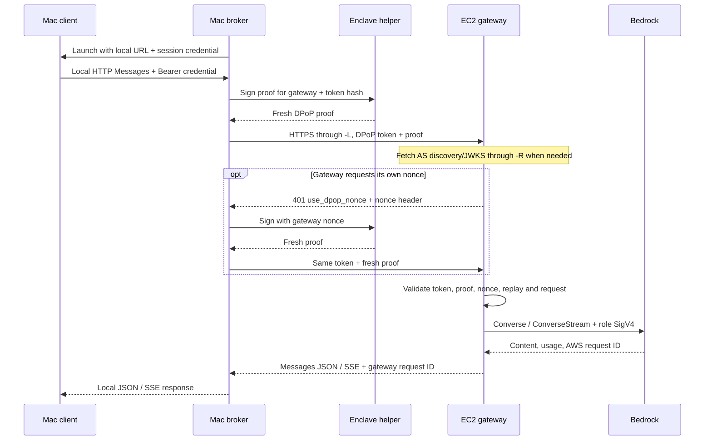

# Component 08 — AWS Bedrock inference integration

**Status** Gates 8A and 8B accepted for the synthetic lab. The live 8B deployment used US Haiku 4.5 on 2026-11-23 UTC and was cleaned up. Final billed-cost reconciliation and budget-alert email delivery remain pending. This is lab acceptance, not production readiness.

Component 7 is accepted for the synthetic lab. Component 8 adds a Bedrock
backend to the existing DPoP-authorizing gateway. The broker continues to
hold the gateway token and use Secure Enclave signing. The first release
supports the existing text-only Messages contract, JSON responses and SSE.

## Live 8B architecture: what runs where

Read this diagram from the client at the top. The Mac runs the user-facing
client and identity services. EC2 runs the gateway and Bedrock adapter.
Only the gateway obtains AWS inference credentials.



Responses return on the same request connections. The broker relays Messages
JSON or SSE to Claude Code. Neither Keycloak nor the AS carries inference
content to Bedrock. Their role is identity and authorization; the gateway's
AWS role authorizes the separate Bedrock call.

## SSH forwarding, HTTPS and mTLS: separate responsibilities

**The verified lab used authenticated SSH forwarding with server-verified TLS
inside it. It did not use mutual TLS (mTLS).** mTLS would also require the TLS
client to present a certificate checked by the TLS server. No such TLS client
certificate was configured. The SSH client key and DPoP signatures serve
separate authentication purposes.

| Layer | What it establishes | Keys / credentials used |
|---|---|---|
| SSH connection | Encrypted transport between Mac and EC2; authenticates the login and remote host | Disposable ED25519 SSH login key on Mac; EC2 SSH host key checked against console fingerprints |
| Broker → gateway HTTPS | Broker verifies the gateway certificate and loopback IP identity | Gateway TLS private key on EC2; gateway public CA copied to Mac |
| Gateway → AS HTTPS | Gateway verifies the AS certificate and issuer metadata | AS TLS private key on Mac; AS public CA copied to EC2 |
| OAuth + DPoP | Gateway checks authorization and possession of the token-bound signing key for this request | AS-signed access token; broker Secure Enclave DPoP key; public JWK inside proofs |
| Gateway → Bedrock | AWS authorizes a signed API request under the gateway role | Temporary EC2 role credentials, AWS SigV4 and AWS service TLS |

TLS server authentication continues to matter inside SSH: reaching a forwarded
port does not by itself establish the application server's identity. Public CA
certificates are trust material, not private signing keys. We transferred only
public CAs across the Mac/EC2 boundary. A DPoP-bound token also does not replace
TLS: it constrains request authentication, while TLS protects content in transit.

### Two forwards over one SSH connection

`127.0.0.1` always means the machine making the connection. On EC2 it does not
mean the developer Mac. Forwarding deliberately connects the two machines'
loopback endpoints without publishing application ports on the EC2 public IP.



| Forward | Listener and destination | Why needed |
|---|---|---|
| `-L 127.0.0.1:8082:127.0.0.1:8082` | Mac listener → EC2 loopback gateway | Broker reaches the remote gateway while keeping its canonical URL |
| `-R 127.0.0.1:8081:127.0.0.1:8081` | EC2 listener → Mac loopback AS | Gateway fetches AS discovery and public token-signing keys |

The AS verifies the user token during exchange. The gateway subsequently
verifies the AS-issued access token locally with the AS public JWKS; it does
not call the exchange endpoint or Keycloak on every inference request.
The reverse forward provides trust-document reachability, not a new issuer.

The existing URLs stayed unchanged: AS issuer `https://127.0.0.1:8081`,
AS token endpoint `/token`, gateway proof target
`https://127.0.0.1:8082/v1/messages`. Therefore the helper's endpoint allowlist,
DPoP `htu`, client-assertion audience, and existing token audience did not need
a remote-hostname migration. A new public canonical URL would require a
coordinated change to those contracts.

The browser callback is a separate temporary Mac HTTP listener on port 8766.
It receives the authorization code during sign-in and is closed afterward.
The broker's local Messages listener uses a different OS-assigned port.
Neither listener is one of the SSH forwards. Keycloak remained the existing
local lab service accessed at 8080; no gateway-to-Keycloak tunnel was added.
The existing environment's SSH transport on 8080 was not created by 8B.

### Tunnel startup and failure behavior

The Mac initiated SSH to the EC2 public address on port 22. The security group
allowed only the operator's public IPv4 `/32`; gateway port 8082 and AS port
8081 were not public ingress rules. Host-key checking used a fingerprint
obtained through the EC2 console. Agent forwarding was disabled. `-N -T`
created forwarding without a command or pseudo-terminal; keepalives helped
detect an unavailable SSH connection.

`ExitOnForwardFailure=yes` detects failed listener setup. It does not prove
that the ultimate application is healthy. We separately fetched AS metadata
from EC2 over verified HTTPS and sent a credential-free gateway request from
Mac, which returned 401 over verified HTTPS. Runtime socket inspection showed
8081/8082 bound only to 127.0.0.1. Closing SSH removes the forwarded listeners.
An unavailable AS trust path can use only the gateway's still-valid bounded
trust cache; after expiry it fails closed. Tunnel interruption and cache-expiry
fault injection were not newly tested live in 8B.

The lab tunnel used `ec2-user`, which also had administrative shell access.
A dedicated tunnel account with forwarding restrictions was proposed in the
cost plan but was not demonstrated. Production needs reviewed managed
reachability, service identities and availability; mTLS may be one additional
service-authentication choice, subject to its own certificate lifecycle design.
[OpenSSH forwarding](https://man.openbsd.org/ssh) ·
[EC2 host fingerprint verification](https://docs.aws.amazon.com/AWSEC2/latest/UserGuide/connection-prereqs-general.html)

## End-to-end sign-in and inference flow

A nonce is a short-lived server challenge included in the next signed proof.
The AS and gateway issue separate nonces for their own endpoints. Receiving
a nonce challenge is an expected protocol step, not a failed Bedrock attempt.

### Sign-in and token exchange



### Authenticated inference and response




The two key pairs used in exchange have different jobs: the synthetic RSA
exchange-client key authenticates the broker's lab client to the AS; the
Secure Enclave P-256 key binds the resulting access token to subsequent DPoP
requests. The AS signs access tokens with another key pair. Its public key
comes from the AS JWKS. The broker's DPoP public key travels in its proofs.
`cnf.jkt` is the access token's confirmation claim containing the DPoP public
JWK thumbprint. The gateway computes the proof key's thumbprint and compares
it with the AS-signed value, then checks the proof's signature and request
binding under the validation contract. See Component 7 for detailed key custody.

| Material | Location / use during 8B |
|---|---|
| Gateway access token | Broker memory; sent to gateway, never to Claude Code or Bedrock |
| P-256 DPoP private key | Secure Enclave; helper requests signatures; raw private bytes are not exported |
| DPoP public JWK | Proof header; AS and gateway use it to verify signatures and compute the binding |
| RSA exchange-client private key | Owner-only lab file copied into a temporary external directory for broker startup; cleaned afterward |
| AS token-signing private key | Existing Mac AS key directory; gateway receives only public JWKS |
| TLS server private keys | Gateway key generated on EC2; AS/Keycloak keys on Mac; trust CAs copied as public certificates |
| SSH login private key | Disposable owner-readable Mac file; deleted after the host was terminated |
| AWS temporary credentials | EC2 SDK metadata provider; never copied to the Mac, broker or CLI |
| Gateway nonce key and replay DB | Owner-only EC2 directory; separate from the Mac AS replay DB; destroyed with the lab disk |

The SSH login key used file-based custody. Secure Enclave custody applied to
DPoP signing, not to all keys on the machine. Hardware key protection also
does not authorize local callers by itself; the broker's session credential
and caller controls remain a separate boundary.

The [8B deployment and cost plan](deployment-cost-plan.md) retains the original
proposal; the [verification record](verification.md) records what was actually
executed, cleaned up, and accepted with pending items.

## Two implementation stages

1. **8A — Offline adapter.** Implement and test model mapping, request
   validation, AWS SDK invocation, response conversion and error handling with
   synthetic SDK fixtures. Keep the existing mock profile available for
   regression runs. These checks run locally with no AWS credential provider
   lookup or network calls.
2. **8B — Isolated live inference.** Run the gateway on the AWS host.
   Keep Keycloak and the synthetic AS on the Mac for the first lab.
   The broker exchanges tokens locally and calls the remote gateway over
   verified HTTPS. Provide the remote gateway controlled access to the
   local AS discovery and JWKS as described below.

Gate 8A requires review of offline results before the live stage. The AWS
account, approved Region, model identifier or inference profile, host,
TLS names, Keycloak reachability and spending limit must be supplied and
reviewed before provisioning or billable invocation. Design approval covers
the adapter implementation. Deployment details and live costs require a
concrete reviewed plan.

## Where Keycloak runs

Yes. Use the existing local Keycloak container and synthetic realm for this
lab. No replacement identity provider or new synthetic realm is required.

| Stage | Identity services | Inference service |
|---|---|---|
| 8A offline tests | Fixtures for isolated adapter tests; existing local Keycloak and AS for regression tests | Local SDK fixtures and existing mock |
| 8B first live lab | Keycloak and the synthetic AS remain on the Mac | Gateway and Bedrock adapter run on the isolated AWS host |
| Production | Enterprise identity provider and AS at managed service boundaries | Managed gateway workload with reviewed AWS identity |

The accepted 8B lab used an authenticated SSH reverse forward exposing the
Mac AS to the gateway host only on remote IPv4 loopback.
The gateway fetches AS discovery and JWKS through that tunnel with end-to-end
TLS verification against the existing AS CA. Keep the AS issuer and its
canonical metadata URLs consistent. For example, a loopback forward on
remote port 8081 can reach the Mac AS on 8081 without changing its issuer.
A tunnel outage causes trust failure after the existing cache expires.
Disable non-loopback tunnel publication and review tunnel ownership,
authentication and cleanup in the live deployment plan.

This kept Keycloak's existing browser redirect and AS-to-Keycloak trust
local. The paired local gateway forward preserved the existing canonical
gateway URL for both broker and signer. Production uses explicitly reachable
enterprise trust endpoints and a separately reviewed canonical URL contract.

## Remote trust and DPoP configuration

Make the AS issuer, discovery URL, JWKS URL, token endpoint and gateway
Messages endpoint explicit operator-owned configuration. Require HTTPS,
exact expected metadata and bounded retrieval. Tokens and caller headers
cannot override these locations. Update client-assertion audiences, access
token issuer validation, DPoP proof endpoints and nonce namespaces together.
Keep the existing logical gateway audience and invocation scope.

The lab accepts only explicitly configured canonical endpoint URLs.
Ignore untrusted forwarded headers. If a TLS proxy is used, verify its
routing, header behavior and SSE flushing against that canonical external
URL. Use isolated test CAs or an approved certificate authority. Never
disable certificate verification. Keep one gateway process with durable
owner-only replay storage for the first live host. Preserve the Component 5
database and nonce-key lifecycle. Configure the synthetic AS exchange key
outside the workspace; production enterprise exchange authority remains
subject to the Component 6 service-boundary decision.

## API choice and request translation

Use the official Python AWS SDK with Bedrock Runtime's `Converse` and
`ConverseStream`. AWS recommends this interface for message-based inference.
The gateway remains Anthropic Messages-compatible on its client-facing side
and translates requests and responses at the Bedrock boundary. A shared
Bedrock interface supports future model routes, subject to each model's
capabilities and a separately verified client contract.
[AWS Claude Messages guidance](https://docs.aws.amazon.com/bedrock/latest/userguide/model-parameters-anthropic-claude-messages.html)

This choice adds an explicit translation layer, especially for streaming.
Acceptance must verify content-block ordering, usage and stop reasons rather
than forwarding provider events unchanged. Claude Code routes continue to
target approved Claude models.

### Model mapping contract

The client supplies a logical model alias. The gateway resolves it using
operator-owned configuration before contacting Bedrock. An alias is a routing
name, with no embedded AWS credential or endpoint.

| Mapping field | Meaning and validation |
|---|---|
| `alias` | Exact client-facing name, verified as `lab-claude-text`. Configure the broker's `--model` to this alias and verify the actual value sent by the installed CLI. Register any required CLI-resolved name explicitly. |
| `region` | One approved AWS Region used to construct the SDK client. The request cannot override it. |
| `model_id` | Exact approved Claude model ID or inference-profile ARN passed to Bedrock as `modelId`. Confirm access, availability and streaming in the selected Region. |
| `resource_arns` | IAM resources needed for the chosen route. Review the actual inference profile and any destination model resources before granting access. |
| `capabilities` | Require text input, text output, Converse and ConverseStream for this profile. Model capabilities must be verified, not inferred from the alias. |
| `max_output_tokens` | At most 128 for initial live probes. Reject a larger requested value before invocation. |
| `allowed_parameters` | The subset of sampling parameters supported by the chosen model, including permitted combinations. |
| `route_version` | Operator-defined revision recorded in audit events to identify the route used. |
| `additional_model_request_fields` | Optional server-owned provider setting, restricted to `{"thinking":{"type":"disabled"}}`; sent as Converse `additionalModelRequestFields`. |

Illustrative configuration shape follows. The angle-bracket values must
be replaced with reviewed account-specific choices before live startup.
They are documentation placeholders.

```json
{
  "lab-claude-text": {
    "region": "<approved-region>",
    "model_id": "<approved-Claude-model-ID-or-inference-profile-ARN>",
    "resource_arns": ["<reviewed-IAM-resource-ARN>"],
    "capabilities": ["text_input", "text_output", "converse", "converse_stream"],
    "max_output_tokens": 128,
    "allowed_parameters": ["max_tokens", "stop_sequences"],
    "route_version": "lab-route-1"
  }
}
```

For a request with `model="lab-claude-text"`, `max_tokens=32` and
`stream=true`, select this route, construct the SDK client in its Region,
and call `converse_stream(modelId=configured_model_id, ...)` with
`inferenceConfig.maxTokens=32`. The response's Messages `model` field
and SSE message-start model field report `lab-claude-text`. Audit the
alias, route revision and AWS request ID so routing can be verified
independently of the model's generated text.

Reject unknown aliases, caller-supplied model ARNs, unsupported capability
requests and invalid route configuration. Choose the backend profile
explicitly at startup. A failed Bedrock request never triggers a silent
fallback to the mock or a different model. Apply route changes on restart
for the first lab, and hold one resolved route throughout an invocation.
If an inference profile can route across Regions, review and record its
permitted destinations before enabling it.
[Bedrock modelId contract](https://docs.aws.amazon.com/bedrock/latest/APIReference/API_runtime_Converse.html)

Accept only user and assistant text messages, text system content,
`max_tokens`, a stream flag and explicitly supported sampling parameters.
Bound output tokens to 128 for initial live probes. Reject enabled tools, images,
documents, thinking, unknown fields and unsupported beta features before
inference. The existing broker's narrow inline-system compatibility rule
still applies to its single-turn CLI test. Real Claude Code compatibility
must pass this reduced contract or trigger a separate reviewed compatibility
change.

Map `model` through the configured alias to the SDK's `modelId`, and select
`converse` or `converse_stream` using the client's `stream` flag. Convert
text to Converse `content: [{"text": "..."}]` blocks and system content to
Converse system blocks. Map `max_tokens`, `temperature`, `top_p` and
`stop_sequences` to `inferenceConfig.maxTokens`, `temperature`, `topP`
and `stopSequences` where the selected model supports them. Validate
model-specific parameter combinations. Provider-specific additional fields
require an explicit allowlist before support is added.

The existing `beta=true` query carries no authority to enable provider
features. Build SDK arguments from validated fields. Converse does not
require the native Claude `anthropic_version` body field.
[Converse request contract](https://docs.aws.amazon.com/bedrock/latest/APIReference/API_runtime_Converse.html)

## Response, streaming and cancellation

For JSON, map the Converse output message, stop reason and token usage into
the Anthropic-compatible response. Generate a gateway message ID and return
the client-facing model alias. Map `end_turn`, `max_tokens` and
`stop_sequence` explicitly; unexpected stop reasons fail the text-only profile.

For streaming, decode ConverseStream events with the SDK. Translate
`messageStart`, content-block events, `messageStop` and `metadata`
into the corresponding Anthropic SSE lifecycle. Usage metadata may arrive
after the provider message stops. Emit the final Messages usage update
and `message_stop` only after the required provider metadata and successful
stream completion. Preserve event order, usage, stop reason and
successful message completion. Treat EventStream exceptions, malformed events
and missing completion as failures. Cap response bytes using the existing
1 MiB text-lab bound.

Run blocking SDK calls outside the async event loop with bounded concurrency.
Use one in-flight inference per live lab gateway initially. Transfer stream
events through a bounded queue to preserve backpressure. Close the SDK body
or EventStream on cancellation. A worker must finish or remain counted against
the concurrency limit before capacity is released. A cancellation can stop
local consumption while remote inference or charges may continue.

Propose a 2-second connect timeout, 15-second upstream read-idle timeout and
60-second end-to-end lab deadline, coordinated with broker limits. Disable
automatic inference retries, including SDK and application retries, to avoid
duplicate generation after an ambiguous response. Configure the SDK explicitly
and verify attempt counts. The selected short probe is subject to these lab
limits; longer generation needs a separate latency and timeout review.
[AWS timeout guidance](https://docs.aws.amazon.com/bedrock/latest/userguide/model-parameters-anthropic-claude-messages.html) · [Bedrock streaming API](https://docs.aws.amazon.com/bedrock/latest/APIReference/API_runtime_InvokeModelWithResponseStream.html)

## Errors and audit

| Condition | Gateway behavior before response headers |
|---|---|
| Invalid token, proof or invocation policy | Preserve existing 401 or 403 and cause zero SDK calls |
| Unsupported model alias or request content | HTTP 400 with a stable Messages error |
| Gateway concurrency limit or provider throttling | HTTP 429 with sanitized rate-limit information |
| Missing workload role, denied IAM operation or unusable provider configuration | HTTP 503 with a dependency/configuration error |
| Invalid response or provider stream failure | HTTP 502 |
| Provider connection/read timeout or overall deadline | HTTP 504 |

After SSE begins, terminate failed streams without a successful terminal
event. Audit the gateway outcome and an allowlisted AWS request ID when
available. Suppress raw SDK request/response logging, AWS signing headers,
role credentials, OAuth tokens, proofs, prompts and responses. Review lab
CloudWatch and Bedrock invocation logging before testing, including content
capture, access and retention settings. Use synthetic prompts only.
[AWS data-protection guidance](https://docs.aws.amazon.com/bedrock/latest/userguide/data-protection.html)

## Lab and production choices

| Area | Proposed lab | Production review |
|---|---|---|
| AWS identity | One workload role on an isolated host | Managed workload identity, separation of duties and reviewed IAM policy |
| Networking | Fixed HTTPS lab endpoints and one gateway process | Private networking, ingress control, TLS ownership, shared replay state and availability |
| Model route | One explicit alias and model/Region | Approved model catalog, data-location constraints and inference-profile destinations |
| Data | Synthetic text only, content logging reviewed | Organization retention, access, export and regulated-data requirements |
| Cost | Offline fixtures first, bounded live prompts and reviewed spend limit | Quotas, budgets, attribution and operational monitoring |

## Acceptance criteria

| Case | Evidence required |
|---|---|
| 8A-01 — Mapping and schema | SDK fixtures verify model selection, Converse parameter mapping, request allowlist, token limits and rejection before invocation. |
| 8A-02 — JSON and SSE | Validate response mapping, incremental ordered events, successful completion, malformed response handling and bounded buffering. |
| 8A-03 — Failures | Exercise throttling, denied IAM, absent credentials, stream exceptions, timeouts and cancellation. Verify one invocation attempt and retained worker capacity until cleanup. |
| 8A-04 — Security regression | Unauthorized calls cause zero SDK calls. Keep mock, bearer and DPoP profile tests passing. Verify header and audit canaries. |
| 8B-01 — Live role and inference | Verify the workload role on the AWS host and effective model permissions. Run bounded synthetic JSON and SSE probes through the gateway. |
| 8B-02 — Actual Mac client | Complete browser sign-in, hardware-backed exchange and Claude Code invocation through remote HTTPS endpoints. Match gateway and AWS request IDs. Verify client environments and configurations contain only the local broker credential and endpoint. |
| 8B-03 — Trust and routing | Reject wrong CAs, wrong endpoints, proof URI mismatch, disallowed aliases and cross-mode tokens. Confirm configured network reachability and remote replay durability. |
| 8B-04 — Costs and cleanup | Record actual request counts and usage, remove temporary infrastructure and lab credentials as planned, and review results before Gate 8 acceptance. |

See the [verification record](verification.md) for both offline and live evidence.
Gates 8A and 8B are accepted for the lab. Acceptance does not mean every
planned fault scenario was repeated on AWS; the record distinguishes offline
coverage, live evidence, and checks not newly executed live.

## Approved actual CLI text profile

The reviewer approved a narrow compatibility change after the offline manual
check with Claude Code 2.1.316 found a 32,000-token request and fields outside
the original text-only profile.

The broker's explicit `--text-only` profile configures only its isolated
child. It sets `CLAUDE_CODE_MAX_OUTPUT_TOKENS=128`, disables thinking and
prompt caching, omits effort and structured outputs, and sets
`CLAUDE_CODE_MAX_RETRIES=0`. The existing broker launch still disables tools.
Normal broker runs retain their existing environment behavior.
[Claude Code environment settings](https://code.claude.com/docs/en/env-vars)

The Bedrock adapter validates and removes only these additional fields.

| Optional CLI field | Accepted form and behavior |
|---|---|
| `tools` | Exactly an empty array. Omit it from the Converse request. |
| `thinking` | Exactly `{"type":"disabled"}`. Normalize away the client field; provider thinking is controlled by the server route below. |
| `context_management` | Exactly `{"edits":[]}`. Omit it from the Converse request. |
| `output_config` | Exactly an empty object. Omit it from the Converse request. |
| `metadata` | An object containing only an optional string `user_id` of at most 4096 characters. Discard this untrusted client attribution value before the provider call and exclude its content from logs. Gateway authentication and audit IDs supply the security attribution. |

Enabled or malformed feature fields, unknown fields and requests above the
route's token cap remain rejected. The real CLI smoke check used 128 tokens,
an empty tools list and client metadata. It produced MOCK_OK through the
real broker and gateway applications with offline signing metadata and
Converse fixtures. This proves single-turn text streaming compatibility
under that configuration. It does not verify tool use or actual Bedrock.

## Approved server-controlled provider thinking setting

The operator approved this scoped extension during the 8B lab setup. A route
may optionally contain `additional_model_request_fields` with exactly
`{"thinking":{"type":"disabled"}}`. The adapter sends this as
`additionalModelRequestFields` to both Converse and ConverseStream. This
explicitly disables the provider's default thinking for the text-only lab.
Routes without the option preserve their existing behavior. Any other provider
fields or values fail route validation. Neither spelling of the provider-field
container is accepted in client requests; clients cannot override the setting.
The option is selected only for a model whose documented API supports it.

## Live model routing and AWS authorization lessons

The accepted route was `lab-claude-text` →
`us.anthropic.claude-haiku-4-5-20251001-v1:0`, revision
`aws-haiku45-lab-1`, SDK source Region us-east-1. The profile listed model
resources in us-east-1, us-east-2 and us-west-2. That list describes permitted
routing destinations; the reported request IDs do not establish which Region
served a particular invocation.

The alias is the client contract; the inference profile is AWS routing
configuration. `resource_arns` documents the resources requiring permissions;
it is not an IAM policy by itself. The attached EC2 role granted only
`bedrock:InvokeModel` and `bedrock:InvokeModelWithResponseStream` on the
reviewed profile and its three destination model ARNs. Destination-model
statements required `bedrock:InferenceProfileArn` to match that profile.
The gateway role had no Marketplace subscription or administrator permissions.
The operator used a separate IAM Identity Center administrator for setup.
[Inference profile permissions](https://docs.aws.amazon.com/bedrock/latest/userguide/inference-profiles-prereq.html)

The SDK retrieves temporary role credentials through IMDSv2 and refreshes them
on the host. Requiring IMDSv2 was verified with a tokenless metadata request
returning 401; STS confirmed the expected assumed role. This establishes the
credential source, not complete protection against a compromised process on
EC2. Host workload isolation remains necessary.
[IMDSv2](https://docs.aws.amazon.com/AWSEC2/latest/UserGuide/configuring-instance-metadata-service.html)

Haiku 5.5 was the initial selection. Its catalog entry, active inference
profile, AVAILABLE agreement and allowed IAM simulation did not prove that
the account could invoke it. A bounded runtime diagnostic returned an explicit
account-level denial. After owner approval, the route and restricted IAM
resources were replaced with Haiku 4.5. There was no automatic model fallback.
An IAM simulator checks supplied policy context, not every model/provider
eligibility requirement. Distinguish discovery, subscription/agreement,
authorization, and actual runtime access in future verification.
[AWS account-level access requirements](https://docs.aws.amazon.com/bedrock/latest/userguide/model-access.html)

### Diagnosing failures at the correct hop

The live denial appeared as 502 to Claude Code, while the adapter mapped AWS
AccessDeniedException to 503 at the gateway boundary. The existing broker
relay sanitized non-success upstream responses to 502. Therefore the CLI's
502 alone did not identify the AWS cause. Diagnostic logging added an
allowlisted exception category and AWS code without raw SDK messages,
prompts, tokens, proofs, or credential headers. Generated SDK exception types
can appear as `UnexpectedError` while the allowlisted AWS code still identifies
the service error. A controlled direct SDK diagnostic with synthetic content
revealed the account-access explanation. It bypassed the gateway and must be
recorded as a diagnostic, not an authenticated end-to-end success.

Correlate the broker request ID to gateway response IDs, then to the AWS
request ID logged by the adapter. A nonce retry can create two gateway IDs
under one broker invocation; only the accepted inference request should be
matched to the Bedrock response. Request IDs support tracing; the model's
self-description or a particular answer string cannot prove routing.

## Live verification and lifecycle rationale

The live JSON test used a small integration client launched by the normal
broker in place of Claude Code. It received only the local broker URL and
credential. Browser login, Secure Enclave signing, AS exchange, gateway
authentication and actual Converse conversion all remained in the path.
A separate direct-on-EC2 adapter JSON check was useful but insufficient for
that authenticated evidence. The actual Claude Code test exercised the
streaming path and completed with exit code 0. Offline tests provide detailed
SSE event-order and completion assertions; the supplied live evidence did not
retain a raw SSE transcript or the CLI request's token-usage total.

Negative tests used a fresh legitimately acquired synthetic session, not an
extracted credential: unknown alias returned 400; malformed proof returned
401 invalid_dpop_proof. They verify rejection paths alongside the positive
JSON and CLI cases. Further credential-extraction/reuse work remains deferred.

The temporary host used Standard CPU credits to avoid surplus-credit charges,
encrypted 8 GiB gp3 storage with delete-on-termination, and a two-hour scheduled
shutdown as an unattended-runtime safeguard. A stopped host can retain paid
storage. Termination plus explicit volume-deletion and IP-association checks
provided cleanup evidence. The shutdown was scheduled and inspected, but the
host was manually terminated before its timer fired. The shell user-data
shutdown command was a first-boot lab safeguard, not a persistent expiry
controller guaranteed across later stop/start sessions.

The $5 recurring account budget included the pre-existing $0.50 Route 53
baseline, with $1 and $4 actual-cost email alerts. A monthly budget is an
alert threshold, not a hard lab-session spending cap. Input-token estimates,
output caps and disabled retries reduce expected spend but cannot establish
final cost; failed/ambiguous attempts require accounting too. Final bill
reconciliation and alert-email delivery remain the two explicit acceptance
pending items. The existing VPC/internet gateway was retained at owner request;
temporary EC2, disk, security group, IAM role/profile and SSH key registration
were removed. Local service/helper listeners and disposable file removal were
checked. Production requires separate deployment, availability, caller
authorization, logging/retention and budget-enforcement review.
