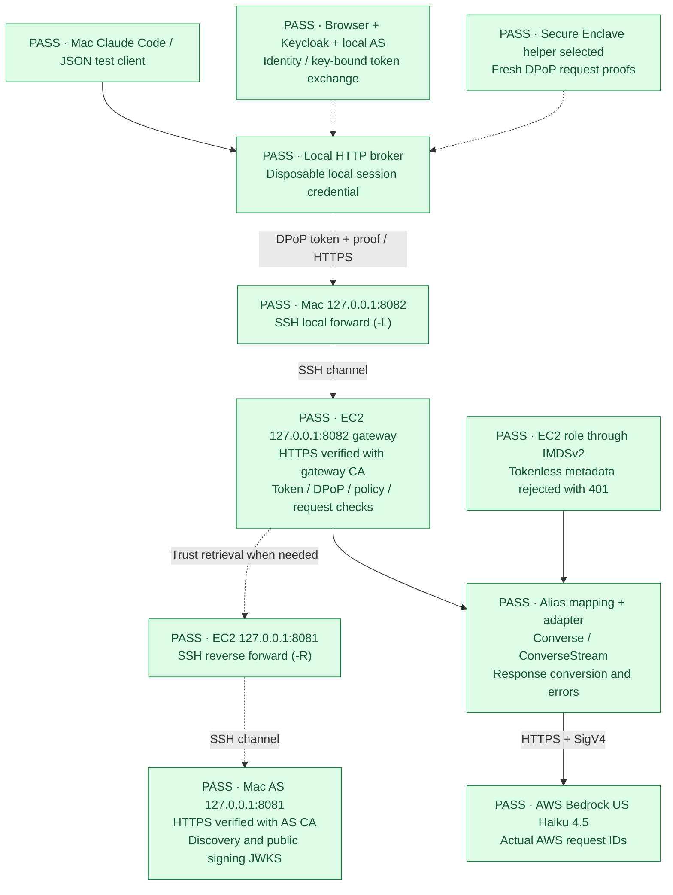
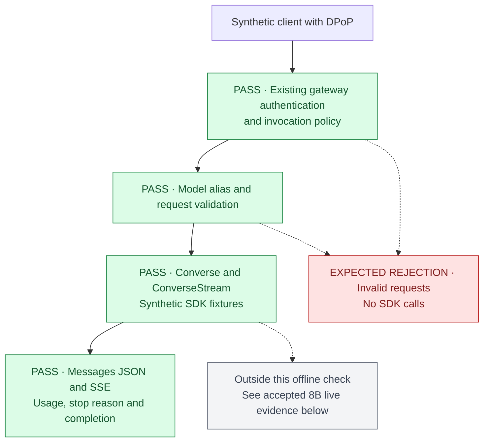
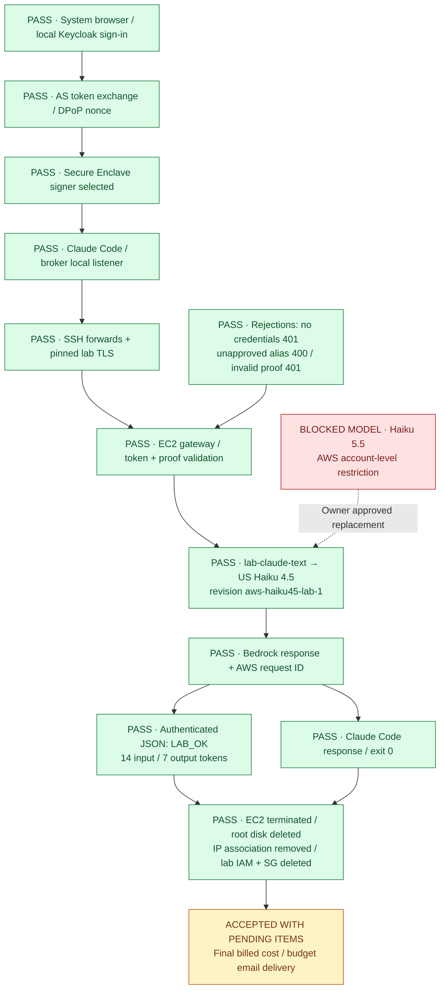
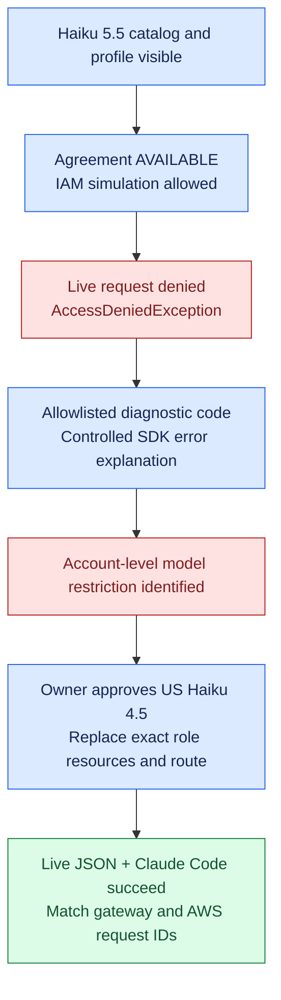
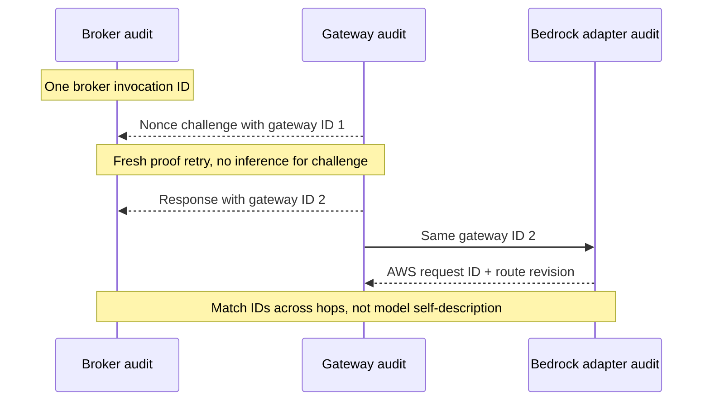
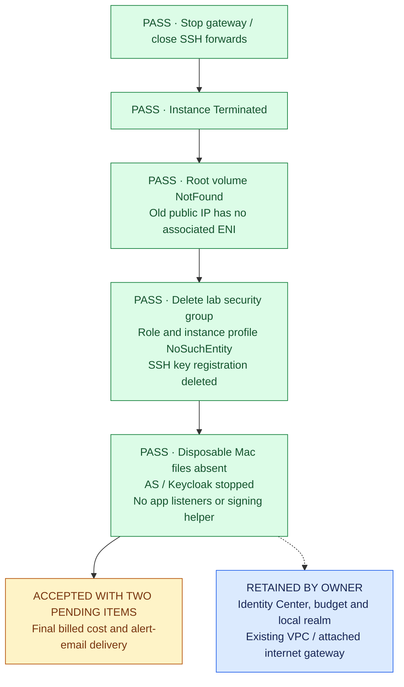

# Component 8 verification

**Status** Gate 8A accepted for the synthetic lab after reviewer verification of the offline adapter suites and actual Claude Code invocation.
Stage 8B live functional/security checks and reported resource cleanup completed
on 2026-11-23 UTC. The owner explicitly accepted Gate 8B for the lab with final billing
reconciliation and budget-alert email delivery pending. The 8B evidence below supersedes earlier prospective statements.

## Read the results by verification boundary

The live reviewer ran the AWS and Mac commands and supplied their outputs.
The assistant edited the adapter and executed its local test suite. These are
separate evidence sources. All live timestamps below use UTC; the session
crossed the November 22/23 local-date boundary on the developer Mac.

| Boundary | What we established | Evidence limit |
|---|---|---|
| 8A offline | Request translation, response/event validation, failure mapping, buffering/cancellation and security fixtures | No real AWS or hardware in the isolated SDK fixture checks |
| 8B infrastructure | Restricted EC2 role, IMDSv2, loopback listeners, encrypted/deleted root disk, Standard credits | Scheduled poweroff was inspected, not allowed to execute |
| 8B identity | Real browser sign-in, local Keycloak, AS exchange, hardware signer selected and accepted DPoP requests | Does not attest hardware custody to AWS or independently re-test Component 7's internal key properties |
| 8B JSON | Browser → hardware broker → gateway → actual Converse → Messages JSON | Separate direct adapter JSON check did not include gateway authentication |
| 8B Claude Code | Actual CLI → broker → remote gateway → Bedrock response, matching IDs, exit 0 | No retained live raw SSE transcript or CLI usage total; text-only, single invocation |
| 8B negative paths | No credential 401, unsupported alias 400, malformed proof 401 | Logs plus inspected rejection path, not independent AWS billing-side call counting |
| Cleanup | Host terminated; disk absent; public IP unassociated; lab SG/IAM/key registration removed; local listeners/files removed | Existing VPC/attached internet gateway and local realm intentionally retained |
| Accepted pending items | Final billed-cost reconciliation; budget-alert email delivery | Neither is represented as completed |

### The live transport was SSH plus HTTPS

The Mac initiated one authenticated SSH connection to EC2. Two forwarded
channels carried application HTTPS in opposite directions. **No TLS client
certificates were used, so this was not mTLS.** SSH authenticated the host
and login; HTTPS verified the application server; OAuth/DPoP authorized the
inference request; AWS IAM/SigV4 authorized Bedrock.

The browser callback on 8766 and OS-assigned local Messages listener were
separate from the SSH forwarding ports. The application TLS endpoints
remained `https://127.0.0.1:8081` and `https://127.0.0.1:8082`; therefore the
hardware helper's canonical endpoint allowlist stayed unchanged. Keycloak
stayed at the existing local lab endpoint on 8080. The AWS gateway needed
AS public signing trust, not direct access to Keycloak or the AS signing key.
See [the design's transport walkthrough](design-spec.md#ssh-forwarding-https-and-mtls-separate-responsibilities)
for the forwarding diagram, credential table and complete signing flow.

## 8A historical offline results

The following records describe 8A at the time it was executed. They do not
supersede the accepted 8B evidence later in this file.

| Case | Executed evidence |
|---|---|
| 8A-01 — Mapping and schema | Tests validated exact model aliases, route configuration, Region selection, text conversion, sampling fields, token limits and rejection of unsupported content and caller routing. The real boto3 Converse client also passed an offline botocore Stubber contract test using explicit synthetic credentials. |
| 8A-02 — JSON and SSE | The DPoP gateway route returned translated JSON and completed SSE using SDK fixtures. Tests checked text deltas, block ordering, usage, stop reason, model alias and absence of successful terminal events after malformed or incomplete streams. Oversized and nontext output were rejected. |
| 8A-03 — Failures | Tests mapped throttling, denied permissions, unavailable credentials, timeout types and provider failures to sanitized statuses. Each fixture recorded one SDK call. A cancelled request retained the single inference slot while its SDK call was blocked, then closed the stream and client before releasing capacity. A stalled consumer limited provider reads through a two-item queue. |
| 8A-04 — Security regression | Missing authentication and unsupported aliases caused zero SDK calls. Provider audit metadata included a validated AWS request ID and gateway request ID without prompt canaries. A configuration test verified the EC2 instance-role provider selection, one total SDK attempt, disabled proxies and disabled configured endpoint overrides. Existing bearer and DPoP gateway tests passed. |

## Executed suites

- Gateway — **66 passed**, including 40 Bedrock adapter cases and 26 existing gateway cases.
- Authorization server — **57 passed**.
- Broker — **12 passed, 6 skipped**. The six opt-in Secure Enclave cases were skipped because this run did not select a hardware-test binary.
- Mock — **8 passed**, with the existing Starlette TestClient deprecation warning.

The gateway environment installed boto3 1.44.5 and botocore 1.44.6.
All new inference tests were offline. No actual AWS credential discovery,
infrastructure provisioning or Bedrock request was performed.

## Reviewer verification

The reviewer stopped the Component 7 lab services and signing helper, installed
the pinned Bedrock test dependencies, and independently ran both suites.

| Command | Observed result |
|---|---|
| `python -m pytest -q tests/test_bedrock.py` | 40 passed in 0.67 seconds |
| `python -m pytest -q` from the gateway directory | 66 passed in 1.87 seconds |

These were offline fixture tests. Live AWS credentials, model access, remote
routing and real Bedrock responses were outside these 8A fixture checks;
see the 8B results below.

## Implementation choices and remaining limits

The adapter uses one blocking SDK worker at a time and a two-item async
queue. Output limits apply to converted response bytes. The SDK has already
decoded provider JSON and individual events before conversion, so this
does not establish an independent raw-wire allocation limit inside the SDK.

The EC2 credential factory uses botocore's instance metadata provider and
refreshing credentials, with IMDSv1 disabled. Actual instance-role retrieval
and IAM inference were subsequently verified in 8B below. The role's effective IAM
policy is the enforcement boundary for configured resource ARNs.

The text-only adapter rejects unsupported model features and simultaneous
temperature and top-p controls. The chosen route must explicitly allow
supported parameters. Bedrock errors never trigger fallback to another model
or the mock. A deployment selects either backend at startup.

The 8B SSH forwards preserved the established canonical loopback endpoints.
No hardware-signer remote-URI allowlist change was needed. Actual CLI
compatibility with live Bedrock was subsequently verified with the approved
text-only profile. That result does not cover enabled tool use or other models.

The account, Region, model/profile, IAM resources, host, TLS names, tunnels
and spending limit were reviewed and deployment was explicitly approved
before the 8B provisioning and paid checks recorded below.

[Offline test instructions](../../components/gateway/README.md#component-8a-offline-converse-verification)

## Real Claude Code offline compatibility check

After the reviewer verified the 40 adapter and 66 gateway tests, a bounded
manual smoke harness launched the installed Claude Code 2.1.316 through
the real broker listener, DPoP gateway application and synthetic signing
metadata. The SDK factory used the existing offline Converse fixtures.

The CLI sent the configured alias but requested 32,000 output tokens. Its
request included `context_management`, `metadata`, `output_config`,
`thinking` and `tools`. These exceed the approved text-only 128-token
profile. The gateway completed the nonce challenge and then rejected the
request with HTTP 400 before any SDK call. The broker mapped that upstream
error to its existing sanitized dependency error. Claude Code retried until
the 15-second harness deadline ended the session and released the listener.

This check did not produce a successful Claude Code invocation. The initial `manual_claude_check.py` diagnostic reported that check as
incomplete. The updated harness now uses the approved profile described below.
No AWS request was performed. Review a narrow client compatibility profile
before changing validation or claiming a successful actual-CLI 8A check.

## Approved CLI profile result

After approval of the compatibility adjustment, the actual Claude Code
2.1.316 check printed MOCK_OK and exited successfully. The broker completed
the gateway nonce challenge using a fresh proof. The gateway invoked the
synthetic ConverseStream fixture through the adapter and returned completed
SSE to the CLI. Matching broker/gateway audit IDs were observed.

The harness uses a temporary local broker HTTP listener. Gateway calls and
AS signing-metadata requests use in-process test transports with synthetic
keys and token issuance. It uses a software DPoP fixture. Browser sign-in,
remote TLS, Secure Enclave and actual AWS inference are outside this check.

The profile reduces the CLI request to 128 output tokens and omits enabled
thinking, effort, structured outputs and prompt-cache directives. The adapter
removes only validated empty/disabled feature fields and bounded user metadata.
Tests verify that enabled features and malformed metadata still fail.

Post-change verification

- Gateway — **77 passed**, including 51 adapter cases and 26 existing cases.
- Broker — **13 passed, 6 opt-in hardware cases skipped**.
- The actual CLI manual harness printed **Offline Claude Code adapter check passed**.

[Manual invocation instructions](../../components/gateway/README.md#actual-claude-code-offline-text-check)

## Reviewer actual CLI result

The reviewer independently ran `manual_claude_check.py`. Claude Code
printed MOCK_OK, the harness reported success, and the broker shut down.
The nonce challenge and successful gateway response IDs matched the two
attempts under one broker request ID. The adapter recorded the configured
alias and route revision with the fixture AWS request ID.

The CLI warned that it did not recognize the synthetic model alias and
assumed a 200k context window. This warning did not prevent the verified
single-turn smoke invocation. The AWS request ID and Converse responses
were synthetic; actual Bedrock routing and model capabilities were outside this offline check
and were subsequently exercised with Haiku 4.5 in 8B.

## 8B provider thinking compatibility — local verification

After explicit operator approval, the optional server route setting for disabled
provider thinking was implemented. The complete gateway suite was executed:
`86 passed in 2.23s`. New checks cover actual synthetic SDK arguments for JSON
and streaming, startup rejection of unsupported provider settings, and rejection
of client-supplied provider-field containers. Existing routes remain covered by
the regression suite. These are local offline results, not live Bedrock evidence.
The updated adapter was subsequently transferred to EC2 and used in the
successful 8B Haiku 4.5 invocations below.

## Gate 8B live reviewer evidence — 2026-11-23 UTC

These live checks were executed manually by the reviewer and reported in the
chat. They were not independently executed by the assistant. The assistant
executed the updated local gateway suite: **87 passed in 2.21s**, including
provider-setting constraints and sanitized error-code logging.

### Live request evidence

| Check | Gateway request ID | AWS request ID / result |
|---|---|---|
| No credentials | `885b08c34c3540deb7f10d84c47cf62a` | 401 authentication error |
| Claude Code through browser + hardware broker | `d7b51579a9974fe0966c39ade9b9f0a8` | `77add2aa-cfe0-4376-8234-5174714cd503`; real model text; exit 0 |
| JSON adapter directly on EC2 | Not gateway-authenticated | HTTP 200; LAB_OK; 14 input / 7 output tokens; end_turn |
| Authenticated JSON through browser + hardware broker | `e58d6f35a99148fc9ac0270b3c305aff` | `154815fc-767a-4c27-bcb4-9296a91d3118`; HTTP 200; LAB_OK; 14 input / 7 output; end_turn |
| Unapproved alias | `f09c359c23f245c2a58fc157027c80fe` | 400; bedrock_request_rejected |
| Malformed proof with fresh test-session token | `a5bdf2ccd5634c5d813a9124e5312096` | 401; DPoP invalid_dpop_proof; dpop_rejected |

The negative requests were rejected before the SDK by the validated gateway
paths; matching rejection logs were reported. This is not an independent AWS
billing-side proof of zero invocations. The Claude Code live path exercised
streaming, but no raw SSE transcript or token-usage total for that invocation
was retained in the supplied evidence. The direct JSON adapter check did not
replace the subsequent authenticated JSON check.

### Model access and configuration

Haiku 5.5 agreement activation returned AVAILABLE, and IAM simulation returned
allowed. Runtime still returned AccessDeniedException: model unavailable for
this account, with AWS Sales as the access path. Those administrative checks
did not establish actual model eligibility. The owner explicitly approved the
replacement with `us.anthropic.claude-haiku-4-5-20251001-v1:0`, replacing the
role resources and route, rather than broadening permissions. Destinations:
us-east-1, us-east-2, us-west-2. Route output cap: 128 tokens; tools and thinking
disabled; automatic inference retries disabled. The custom alias warning did
not prevent successful Claude Code completion.

The reviewed Haiku 4.5 geographic rates were $1.10/M input and $5.50/M output
from the owner's AWS pricing screenshot. The two reported 14/7-token JSON
requests cost an estimated $0.0001078 combined at those rates, not a final bill.
Claude Code token usage and final service charges still require reconciliation.
Several Haiku 5.5 denied attempts occurred during diagnosis; an exact attempt
ledger was not retained, and the initial six-attempt proposal must not be
represented as a verified enforced cap. Further extraction/reuse experiments
remain pending and were not performed in this stage.

### Infrastructure and cleanup evidence

- Region us-east-1; instance `i-0ec6372324220186a`, t3.small, Amazon Linux 2023 x86.
- Existing default VPC `vpc-061ac973302b605fb`, subnet `subnet-0cc3f3dc51996ddc1`.
  Existing detached internet gateway `igw-0f7ae7baba88d7b31` was attached by the
  owner; the existing main route recovered from Blackhole to Active. This
  existing-network change is intentionally retained: the owner chose to leave
  the internet gateway attached for future labs.
- SSH restricted to owner public IPv4 /32; host ED25519 fingerprint compared
  against EC2 system log before SSH trust. Both tunnels bound IPv4 loopback.
- Runtime `ss` showed 8081/8082 only on 127.0.0.1. Tokenless metadata returned
  401. STS identity matched the restricted EC2 role. AWS API confirmed Standard
  CPU credits and encrypted 8 GiB gp3 volume, DeleteOnTermination true.
- Two-hour shutdown scheduled for 05:51 UTC; scheduled state inspected. Manual
  termination occurred before expiry, so automatic poweroff execution was not tested.
- Gateway stopped cleanly; tunnels closed; EC2 state Terminated confirmed.
- `vol-0de2c529a63494d04`: InvalidVolume.NotFound. Old public IPv4 query: no ENIs.
- Security group `sg-073f6ea4e9be4db61`: deletion returned true after no-ENI check.
- Role/profile `llm-gateway-lab-ec2-role`: both NoSuchEntity after deletion.
- EC2 SSH key registration deletion returned true. Mac downloaded SSH private key, transfer archive, and copied gateway public CA
  were each subsequently checked and confirmed absent. The retired host entry
  was removed from known_hosts.
- Mac AS stopped; Keycloak stopped with realm retained. Final lsof and secure-signer
  pgrep checks returned no output. Existing SSH Keycloak transport on 8080 was
  outside the final listener query.
- IAM Identity Center administrator/MFA and $5 recurring account-wide budget
  were created. Alerts: $1 and $4 actual costs. Existing $0.50 Route 53 baseline
  included. Alert email delivery and final cost remain unverified.

### Acceptance and carried pending items

Local disposable-file removal is verified. The owner explicitly chose to retain
the existing internet gateway attachment. New lab charges have not yet appeared
in billing; final billed cost reconciliation and budget email delivery remain
unverified. The owner explicitly accepted Gate 8B for the lab with these two items pending.
Existing identity/budget setup and pre-existing account resources are retained.

**Gate 8B acceptance:** Explicitly accepted by the owner on 2026-11-23. Scope: synthetic lab using Bedrock Haiku 4.5, with final billed-cost reconciliation and budget-alert email delivery pending. This does not establish production readiness.

## What the live exercises taught us

### Establish the path before paying for inference

We first checked the TLS certificates and replaced the expired Keycloak
certificate while its container was stopped. Discovery then returned 200
with verification enabled. The AS retained its existing valid certificate.
The gateway TLS key/certificate were generated on EC2; only its public CA
was copied to Mac. The AS public CA was copied to EC2 and its SHA-256
fingerprint compared with the original. No verification bypass was used.

The existing VPC's internet route initially showed Blackhole because its
internet gateway was detached. Attaching that existing gateway restored the
route to Active. A public subnet and IPv4 address supplied host connectivity;
they did not require exposing application ports. The EC2 security group
admitted only SSH from the operator's `/32`. The gateway still listened on
loopback. The owner chose to retain the existing gateway attachment afterward.

EC2 system-log SSH fingerprints were compared before the first SSH connection.
The server's SSH host key identifies the host; the disposable Mac SSH key
identifies the login. These are different from the TLS server keys and
Secure Enclave DPoP key. SSH printed a non-post-quantum key-exchange warning;
this session did not demonstrate a post-quantum-protected transport.

The stock host had Python 3.9 and no pip. We installed Python 3.12 alongside
it and created an isolated venv. Dependency compatibility and imports passed.
This installation check was not an inference test. SDK construction and
operation-shape checks also passed without invoking a model.

### A working tunnel needs application checks

| Probe | Observed result | Meaning |
|---|---|---|
| EC2 → AS metadata through reverse forward with AS CA | Valid JSON, issuer https://127.0.0.1:8081, JWKS URI, ES256 DPoP advertised | Reverse path and application TLS worked |
| Mac → gateway through local forward with gateway CA, no credentials | 401, WWW-Authenticate: DPoP | Forward path and TLS worked; request was not authorized |
| EC2 listener inspection | 8081 and 8082 only on 127.0.0.1 | App/trust listeners were not directly bound to public interfaces |
| Tokenless metadata request | 401 | Instance required IMDSv2 |
| STS identity | Expected lab assumed role | Host obtained the intended workload identity |

An SSH command waiting silently after connection is consistent with `-N`;
it is not by itself proof of healthy forwards. These probes supplied the
application evidence. The host runtime role did not need Mac AWS credentials.
AWS CloudShell used the operator's administrator context for read-only setup
and cleanup checks, separate from the EC2 inference role.

### Distinguish an access problem from a protocol problem

The first symptom in Claude Code was a generic 502. Gateway diagnostics
identified AWS AccessDeniedException; the direct synthetic diagnostic then
identified the account-level model restriction. The gateway's dependency
503 was sanitized to 502 by the existing broker relay, so the client status
alone was insufficient. We did not solve this by granting administrator
permissions to EC2. The operator approved changing the model, and the role
and route were narrowed to the new profile. No fallback occurred automatically.

The adapter separately gained the approved server-owned disabled-thinking
setting. That is a request-compatibility control, not the solution to AWS
account eligibility. Tests verified it for both JSON and streaming and
rejected caller overrides. Safe audit logging excluded raw SDK messages and
credentials. Local suites progressed from 77 to 86 and then 87 passing cases
as these two scoped changes were added; these are different runs, not a
single simultaneous multi-suite result.

### Prove inference rather than a specific generated sentence

The fixed CLI lab prompt elicited a clarification response from the live
model. That was still a successful transport/inference result: broker and
gateway reported success, AWS returned an actual request ID, Claude Code
showed the text, and the process exited 0. MOCK_OK was an offline fixture
expectation, not the live acceptance string. The smaller JSON requests
explicitly requested LAB_OK and returned it with usage and end_turn.

The authenticated JSON test deliberately used a small client in place of the
CLI while keeping browser sign-in and hardware broker acquisition. It did
not read another process's memory or reuse an extracted token. The malformed
proof was constructed by that fresh authorized test session and rejected.
A first test harness raised on the expected 400 alias rejection and aborted;
that was a harness issue. The corrected harness completed both rejection
checks and matched their gateway IDs.

### Acceptance coverage and deliberate limits

| Planned case | 8B disposition |
|---|---|
| 8B-01 role and real JSON/SSE inference | Live role, authenticated JSON and actual CLI streaming path passed; detailed stream assertions remain offline evidence |
| 8B-02 actual Mac client | Browser + Secure Enclave broker + real CLI completed; earlier child-environment tests cover credential isolation, not a new exhaustive live environment inspection |
| 8B-03 trust and routing | Positive TLS/trust and loopback binds passed; no credentials, unknown alias and malformed proof rejected live |
| Broader 8B-03 fault list | Wrong CA, wrong endpoint/htu, cross-mode token, replay across a remote process restart, tunnel outage and trust-cache expiry were not all repeated live on EC2; earlier component/offline coverage must not be relabeled live |
| 8B-04 costs and cleanup | Principal AWS and local cleanup verified; exact total usage/attempt ledger incomplete; final bill reconciliation explicitly pending |
| Budget alert delivery | Alert configuration healthy; no delivered email test evidenced; explicitly pending |
| Host expiry | Two-hour shutdown scheduled and inspected; manual termination preceded expiry, so timer execution untested |
| Production readiness | Outside lab acceptance; same-user caller risk, host compromise, managed networking and operational controls need separate review |

## Cleanup proof and retained configuration

The shutdown command was a safeguard, not the cleanup proof. Root storage can
remain billable after stop, so we checked termination and absence of the
specific volume. The former auto-assigned public IP no longer had an account
ENI association. The lab did not allocate a separate Elastic IP. Removed role
and profile were queried and returned NoSuchEntity. Local removal checks
confirmed the SSH private key, transfer archive and gateway public CA absent.
Existing local AS/Keycloak keys and realm were retained for future components.

No new lab charges had appeared at the last billing review. The $0.50 Route 53
baseline remains distinct from incremental lab spend. The approved $5 recurring
monthly budget sends alerts, but does not enforce a real-time spending stop.
Record the final EC2/storage/IP/provider charges when posted; do not estimate
zero solely from a delayed bill. The owner accepted Gate 8B with this cost
reconciliation and alert-email delivery explicitly pending.
