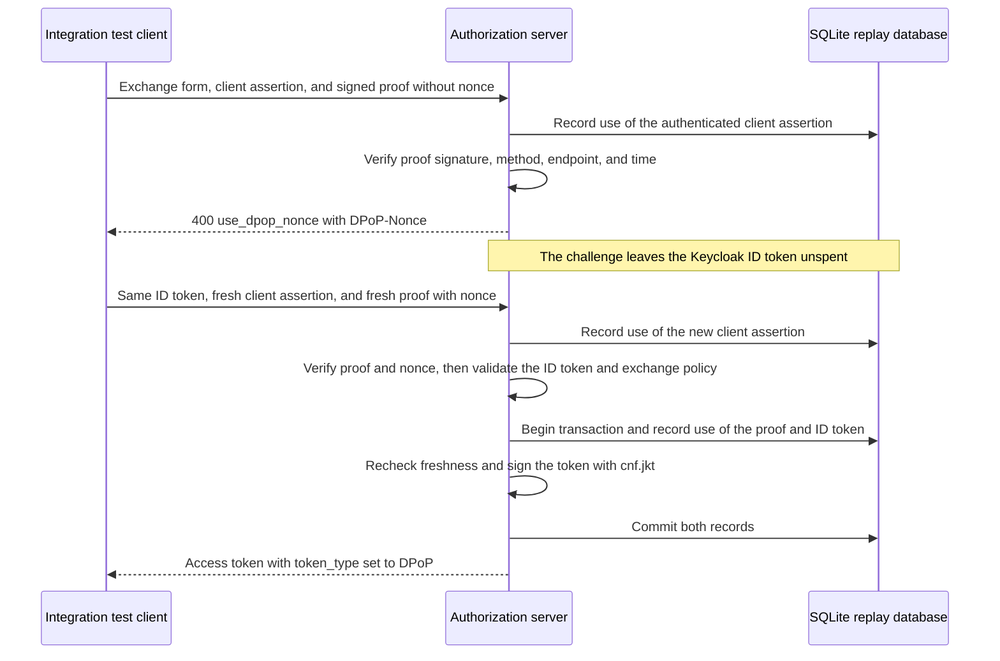
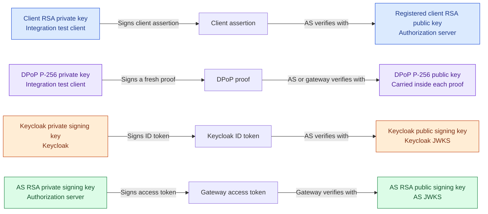

# How the authorization server issues a DPoP token

Follow one request to `POST /token` from startup to issuance. In the
Component 5 lab, the authorization server (AS) still verifies the registered
exchange client and the Keycloak ID token. DPoP adds a proof of possession
and ties the issued access token to the key that signed that proof.

A **nonce** is a short-lived, unpredictable value issued by the server. The
client includes it in the next signed DPoP proof to show the proof was made
after the server issued the challenge. A valid nonce can be used in several
fresh proofs during its lifetime. Each proof has its own ID, which the server
checks for replay.

The diagram shows a first request that needs a nonce. If the client already
has a valid nonce for this endpoint and DPoP key, it can send a fresh
proof containing that nonce on the first attempt and go straight to exchange
validation.

## 1. Select the DPoP profile at startup

When `--dpop-nonce-key` is supplied with `--exchange-policy`, `create_app()`
loads the server's owner-only nonce key and creates a verifier for the
configured token endpoint. The AS discovery document advertises ES256 for
DPoP proofs. [AS startup and metadata](../../components/oauth-as/app.py) (`create_app`) · [Nonce key loading](../../components/oauth-as/dpop.py) (`nonce_key`)

### Who signs and who verifies

A private key creates a signature over the signed content. The corresponding
public key lets a verifier check that the signature was created by the
matching private key and that the signed bytes are intact. The signer keeps
the private key on its side of the connection. A verifier also needs a
reason to trust the public key for that particular job.

| Signed message | Who signs and with what | Who verifies and where the public key comes from |
|---|---|---|
| Client assertion | The integration test client signs with its registered RSA private key. | The AS uses the RSA public key registered for that exchange client. This authenticates the client. |
| DPoP proof | The integration test client signs with its temporary P-256 private key. | The AS verifies the proof with the public key carried in the proof's `jwk` header. This demonstrates possession of that key. The registered client assertion separately establishes who is allowed to request the exchange. |
| Keycloak ID token | Keycloak signs with its own private key. | The AS uses Keycloak's public signing keys from the configured, trusted JWKS endpoint. |
| Gateway access token | The AS signs with its own RSA private key. | The gateway uses the AS public signing keys from the pinned JWKS endpoint. This lets the gateway trust the token's claims, including its binding to the client's DPoP key. |

Each color identifies a key pair. Blue is the registered exchange client
key pair, purple is the client's temporary DPoP key pair, orange is
Keycloak's signing key pair, and green is the AS signing key pair.
Private keys sign on the left. Verifiers use the corresponding public keys
on the right. The gateway also checks that the public key in the invocation
proof matches the thumbprint in the AS-signed access token.

The AS nonce uses a separate symmetric secret. The AS creates and checks
a message authentication code (HMAC) over the nonce data. The client
receives the nonce and includes it in a proof signed with its DPoP key.
[Nonce authentication](../../components/oauth-as/dpop.py) (`Verifier.nonce_mac`)

## HTTP headers at a glance

| Where | Header | Value or purpose |
|---|---|---|
| Client → AS, `POST /token` | `Content-Type` | `application/x-www-form-urlencoded`. The Keycloak ID token and signed client assertion travel in form fields. |
| Client → AS, `POST /token` | `DPoP` | A signed proof for the token endpoint. On retry, the JWT contains the AS nonce. |
| AS → client, HTTP 400 nonce challenge | `DPoP-Nonce` | The AS nonce to include inside the next proof. The JSON response body contains `error=use_dpop_nonce`. |
| Client → gateway, `POST /v1/messages` | `Authorization` | `DPoP <access-token>`. This carries the access token issued by the AS. |
| Client → gateway, `POST /v1/messages` | `DPoP` | A fresh signed proof for the Messages endpoint. It includes `ath`, the hash of the access token, and the gateway nonce when available. |
| Client → gateway, `POST /v1/messages` | `Content-Type` | `application/json` for the Messages request body. |
| Gateway → client, HTTP 401 nonce challenge | `WWW-Authenticate` | `DPoP error="use_dpop_nonce"`. This tells the client to retry with a fresh proof and the supplied nonce. |
| Gateway → client, HTTP 401 nonce challenge | `DPoP-Nonce` | The gateway nonce to include inside the next invocation proof. |

The AS and gateway issue separate nonces for their own endpoints. The client
reads each `DPoP-Nonce` response header and puts its value in the `nonce`
claim of the next signed proof. The `jwk`, `alg`, and `typ` fields are JWT
headers inside the proof carried by the HTTP `DPoP` header.
[Exchange response handling](../../components/oauth-as/exchange.py) (`token_endpoint`) · [Gateway response handling](../../components/gateway/gateway.py) (`messages`)

## 2. Authenticate the exchange client

`token_endpoint()` parses the OAuth form and passes all `DPoP` header values
to `Exchange.issue()`. Its first step, `authenticate()`, checks the registered
client's RS256 assertion and records its one-time use. Each exchange attempt,
including a nonce retry, needs a new client assertion. [Token endpoint](../../components/oauth-as/exchange.py) (`token_endpoint`) · [Client authentication](../../components/oauth-as/exchange.py) (`Exchange.authenticate`)

## 3. Verify the proof and challenge for a nonce

`Verifier.validate()` accepts a single proof header within the size limit.
It checks the proof type, ES256 signature, and embedded P-256 public key.
The proof must cover the configured `POST /token` endpoint and include a
fresh issuance time and proof ID. The verifier computes the public key's
thumbprint, called `jkt`. [Proof validation](../../components/oauth-as/dpop.py) (`Verifier.validate`)

A missing, expired, or mismatched nonce on an otherwise valid proof results
in `400 use_dpop_nonce` and a `DPoP-Nonce` response header. The AS authenticates
the nonce with its own secret and binds it to the endpoint and proof key.
A valid nonce skips the challenge. The Component 5 client starts each new
exchange session with a new DPoP key and no cached nonce, so its normal
first attempt receives the challenge. An invalid client assertion or
invalid proof signature fails earlier and receives its own error.

On retry, the client sends the original Keycloak ID token, a new client
assertion, and a new proof containing the nonce. [Nonce handling](../../components/oauth-as/dpop.py) (`Verifier.nonce_expiry`) · [Challenge response](../../components/oauth-as/exchange.py) (`token_endpoint`)

## 4. Record first use and issue the bound token

After proof validation, `Exchange.issue()` verifies the Keycloak ID token
and applies the existing exchange policy. The AS uses one SQLite transaction
in `auth-server-token-exchange-replay.sqlite3` to record both the proof ID's
first use with that key and the ID token's
first use. A duplicate reservation stops issuance. The AS rechecks freshness
and signs the token within the transaction. If signing fails, both records
roll back. The client assertion was consumed in its own earlier transaction.
[Exchange validation](../../components/oauth-as/exchange.py) (`Exchange.issue`) · [Replay transaction](../../components/oauth-as/exchange.py) (`ReplayStore.reserve`)

The AS returns the token after commit with `token_type=DPoP`.
`cnf` is the token's **confirmation** claim. Inside it, `jkt` means
**JSON Web Key (JWK) thumbprint**. In `{"cnf": {"jkt": "..."}}`, that value
is a base64url-encoded SHA-256 fingerprint computed from the client's
public DPoP key. It lets the AS name the key without embedding the
full public key in the access token.

On a later request, the gateway verifies the access token using the AS
public signing key. It also verifies the fresh proof using the public key
inside that proof and computes the key's thumbprint. It compares that
thumbprint to the AS-signed `cnf.jkt` to confirm the proof came from the
key the AS bound to the token.
[Token issuance and binding](../../components/oauth-as/exchange.py) (`mint` inside `Exchange.issue`)

The [challenge, binding, and replay test](../../components/oauth-as/tests/test_exchange.py) (`test_dpop_exchange_challenge_binding_and_replay`)
shows the initial nonce challenge, rejection of a reused client assertion,
successful issuance after retry, and rejection of a repeated proof.
