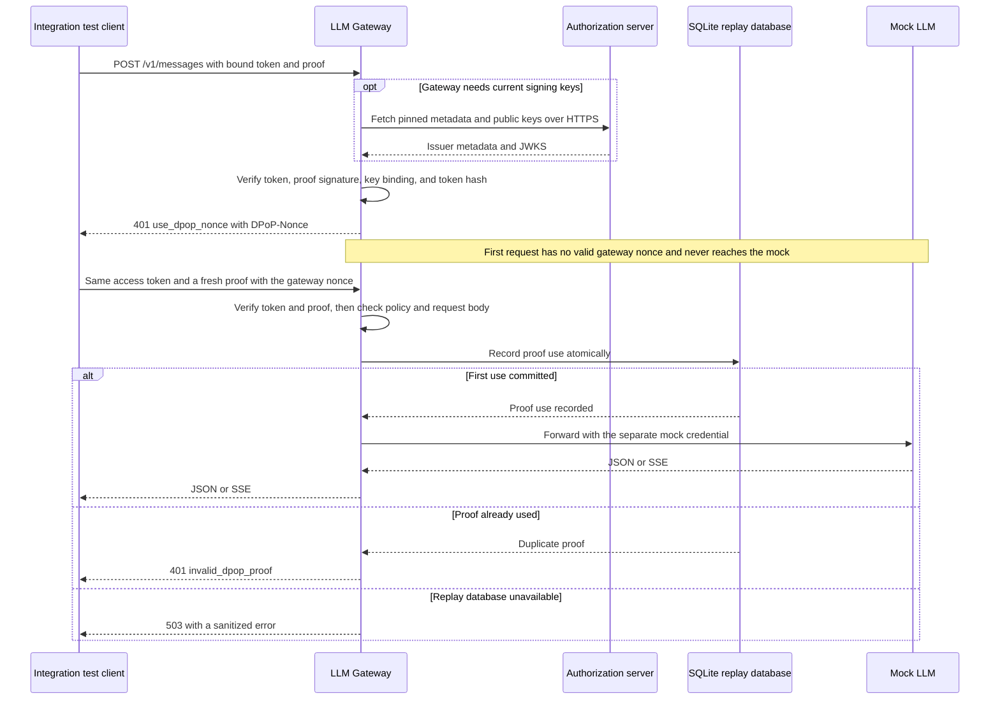

# How the gateway verifies a DPoP request

The integration test client has already exchanged its Keycloak ID token
for an access token containing `cnf.jkt`, the thumbprint of its DPoP public
key. The gateway checks that the authorization server issued the token and
that the caller can sign a fresh proof with the corresponding private key.

## 1. Enable DPoP at startup

`create_app()` requires both the gateway nonce key and replay directory to
enable DPoP. The nonce key authenticates gateway challenges. The SQLite
database, `llm-gateway-request-proof-replay.sqlite3`, records which proofs
the gateway has already used. Both belong to
the gateway. The authorization server uses its own nonce key and replay
state. [Gateway startup](../../components/gateway/gateway.py) (`create_app`)

## 2. Verify the access token

The Messages route expects `Authorization: DPoP <access-token>`. It
validates the AS signature using trusted public keys and checks the token's
type, issuer, audience, expiration, and `cnf.jkt` field. The gateway pins
where it fetches AS metadata and keys and checks that the metadata advertises
the lab's DPoP algorithm. The token's `kid` selects a key from the trusted
set. [Credential parsing and token validation](../../components/gateway/gateway.py) (`access_credential` and `validate_access_token`) · [Signing trust](../../components/gateway/gateway.py) (`Trust`)

## 3. Verify the proof and challenge for a nonce

The separate `DPoP` header carries a signed JWT. The shared verifier checks
its signature using the embedded P-256 public key and confirms its method,
endpoint, and freshness. The thumbprint of that key must match `cnf.jkt`.
The proof's `ath` must also match the hash of the exact access token in the
request. The key check ties the proof to the token's designated holder.
The hash check ties the proof to this particular token.
[Shared proof verifier](../../components/oauth-as/dpop.py) (`Verifier.validate`)

If the proof otherwise passes but needs a valid gateway nonce, the
gateway returns HTTP 401 with `WWW-Authenticate: DPoP error="use_dpop_nonce"`
and a `DPoP-Nonce` header. The client retries with the same access token and
a new proof containing the gateway nonce and a new proof ID. The challenge
does not record proof use or dispatch inference.
[Gateway route and challenge](../../components/gateway/gateway.py) (`messages`)

## 4. Authorize the request and record proof use

After validating the proof, the gateway checks the client and scope, then
validates the request body. `record_proof()` checks the time again and
commits a replay record keyed by the verifier namespace, proof key
thumbprint, and proof ID. Concurrent copies compete for the same unique
record. Once one succeeds, other copies cannot trigger another mock call.
[Policy and replay recording](../../components/gateway/gateway.py) (`enforce_policy` and `record_proof`) · [SQLite transaction](../../components/oauth-as/exchange.py) (`ReplayStore.reserve`)

## 5. Forward to the mock and return the response

Only after commit does `Invocation` forward the request. It constructs
upstream headers with the separate mock credential and returns either
JSON or an incremental SSE stream. The access token and proof stay at the
gateway boundary. A mock timeout or client disconnect after commit leaves
the proof spent. A subsequent invocation requires a new proof.
[Mock forwarding](../../components/gateway/gateway.py) (`Invocation.forward`)

The [challenge and restart test](../../components/gateway/tests/test_gateway.py) (`test_dpop_gateway_challenge_concurrent_use_restart_and_diagnostics`)
shows the nonce retry, a successful stream with a new proof, and rejection
of a used proof after restart. The
[cross-process test](../../components/gateway/tests/test_gateway.py) (`test_gateway_dpop_replay_across_processes`)
checks that two gateway processes sharing replay state dispatch only one
mock call for the same proof.
