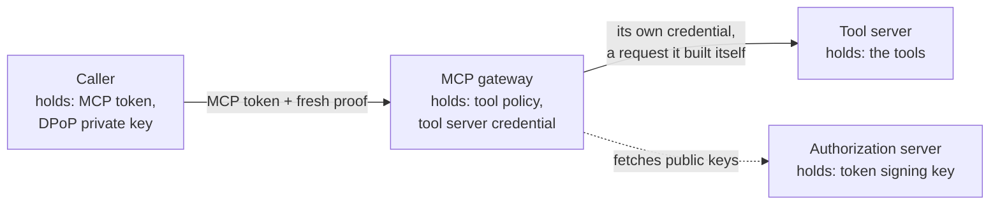
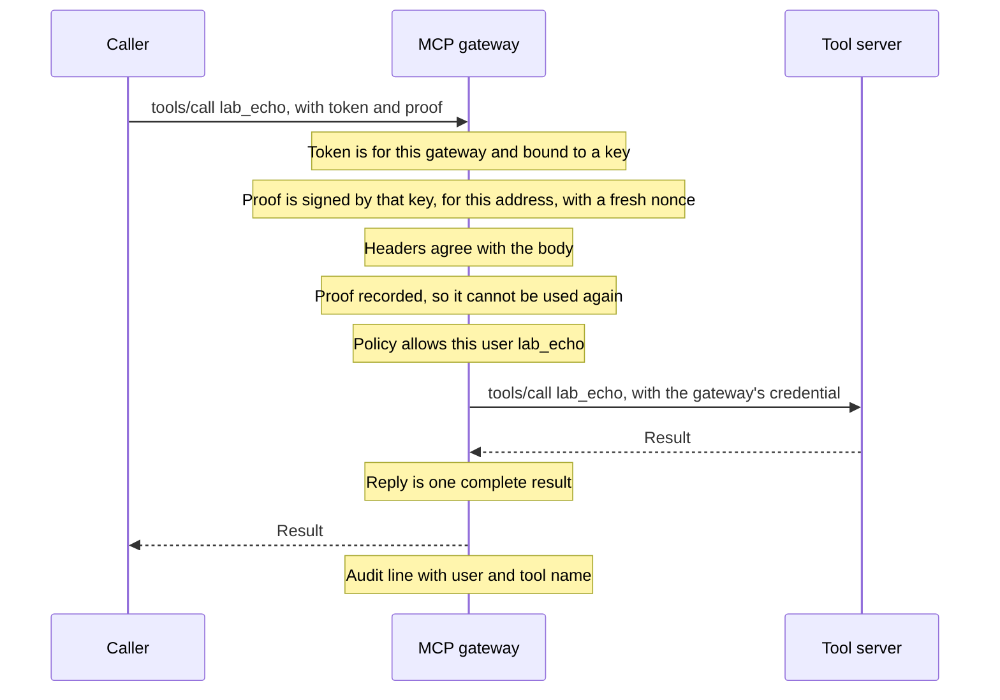
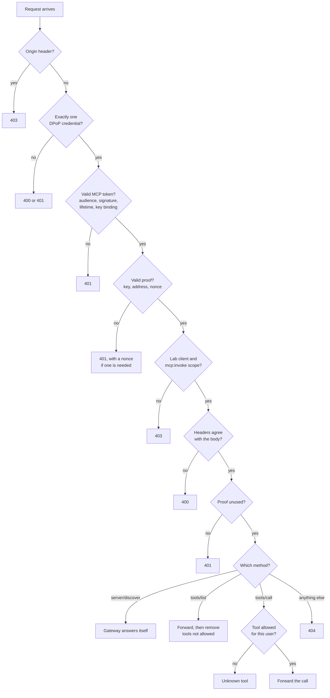

# The MCP gateway, step by step

The MCP gateway stands between a caller and a tool server. This page shows what
happens to one tool call, and where each check sits. It builds on
[the shape of an MCP request](mcp-request.md) and
[tokens and modes](tokens-and-modes.md). Unfamiliar terms are in the
[glossary](../glossary.md).

## Who holds what

The caller's token and proof stop at the gateway. The tool server never sees them,
and never learns who the user is. The gateway never sees the caller's private key.
In the lab the caller is a test client today; once the broker work is done it will
be the broker, acting for Claude Code.

## One allowed call

## The checks, in order

Every request passes these in order and stops at the first that fails. Nothing is
sent to the tool server until all have passed.

A model token fails at the token check, because its audience is the LLM gateway. A
proof made for the LLM gateway fails at the proof check, because a proof names the
address it was made for.

## Hiding a tool

The policy lists each user's tools. Two things follow from it, and the second is
the one that enforces it:

- `tools/list` shows only the user's tools. The list is marked private so that no
  cache hands one user's list to another.
- `tools/call` for any other tool is refused with the same "unknown tool" reply,
  byte for byte, whether the tool exists or not. The caller cannot tell a hidden
  tool from one that was never there, and the tool server is not contacted.

Leaving a tool out of the list would not be enough on its own. A caller who knew
the name could still ask for it.

## What the gateway does not pass on

| From the caller | Reaches the tool server? |
|---|---|
| The MCP token and the DPoP proof | No. The gateway sends its own credential |
| The tool name and arguments | Yes, for an allowed tool |
| The capabilities the caller declares, such as being able to prompt the user | No. The gateway sends an empty set, so a tool server cannot ask the user for input |
| Any other field of the request | No. The gateway builds a new request from named fields |
| The protocol revision | The gateway always sends 2026-07-28, in the header and the body, so the tool server applies this revision's rules |

And in the other direction, the gateway passes back only a complete result. A reply
that is a stream, asks for input, or hands back a task is refused.

## Why the gateway answers discovery itself

`server/discover` asks a server which kinds of feature it offers. The gateway
answers "tools only" under its own name, without asking the tool server. The tool
server would also claim prompts and resources, which the gateway refuses, and would
reveal what software sits behind the gateway.

Code: [`mcp_gateway.py`](../../components/gateway/mcp_gateway.py) and its
[tests](../../components/gateway/tests/test_mcp_gateway.py). How to run it:
[MCP gateway README](../../components/gateway/README-mcp.md).
