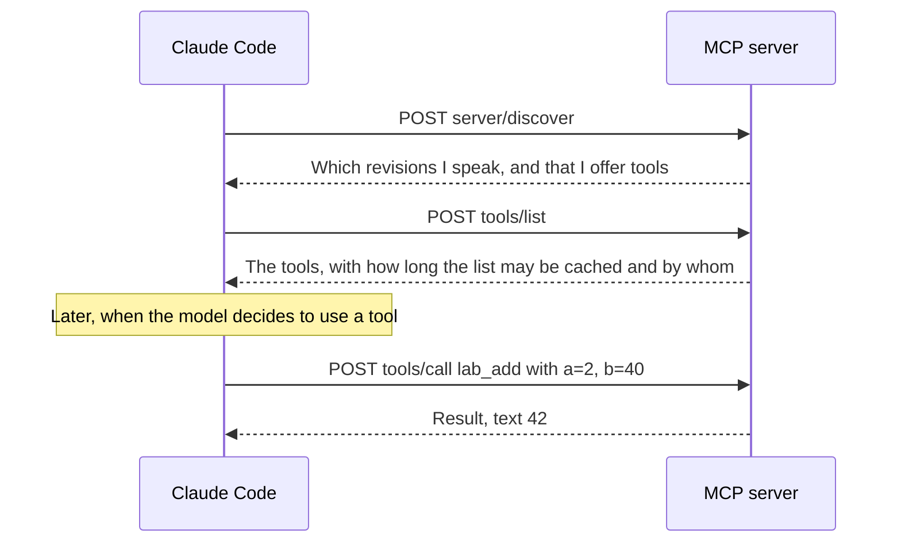
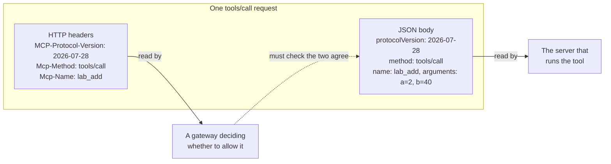

# The shape of an MCP request

The Model Context Protocol (MCP) is how Claude Code asks a server which tools it
has and asks it to run one. This page shows what such a request looks like in the
revision this lab uses, 2026-07-28. Unfamiliar terms are in the
[glossary](../glossary.md).

## No sessions: every request stands alone

Earlier revisions of MCP opened with a handshake and kept a session. This one does
neither. Each request is its own HTTP `POST` and carries everything needed to answer
it, including which revision of the protocol it speaks.

This is what the installed Claude Code actually sends when it is pointed at the
lab's mock server: `server/discover`, then `tools/list`.

## The same facts, twice

Each request states three things in two places: in HTTP headers, and inside the
JSON body.

The headers exist so that something in the middle, such as a gateway, can see which
tool is being called without having to understand the whole body. That creates a
risk: if the headers said one tool and the body another, a gateway could approve one
call while the server ran a different one. So the protocol requires whoever reads
the body to check that the two agree, and to refuse the request if they do not.

## What comes back

| Situation | Answer |
|---|---|
| The tool ran | A result containing the tool's output |
| The tool was given bad arguments | A normal result, flagged as an error, so the model can read it and try again |
| The headers and body disagree | Refused, HTTP 400 |
| The revision is not one the server speaks | Refused, HTTP 400, naming the revisions it does speak |
| The method does not exist | Refused, HTTP 404 |

A list of tools also says how long it may be cached and whether a shared cache may
hand it to other users. That matters later: a gateway that shows each user only the
tools they are allowed must mark its list as private.

## Where the lab's mock differs from the protocol's text

The mock is built with the official MCP software kit, and that kit is more
permissive than the written protocol in four places. The mock leaves them as they
are, its tests record them, and the MCP gateway will be strict about each:

- A call to a tool that does not exist comes back as a result flagged as an error,
  not as the protocol's "unknown tool" error.
- Older revisions are still accepted, even when the revision header disagrees with
  the body.
- A `GET` opens a long-lived stream, a feature of older revisions.
- The server says it offers prompts and resources as well as tools.

Code: [`mock-mcp/mock_mcp.py`](../../components/mock-mcp/mock_mcp.py) and its
[tests](../../components/mock-mcp/tests/test_mock_mcp.py).
