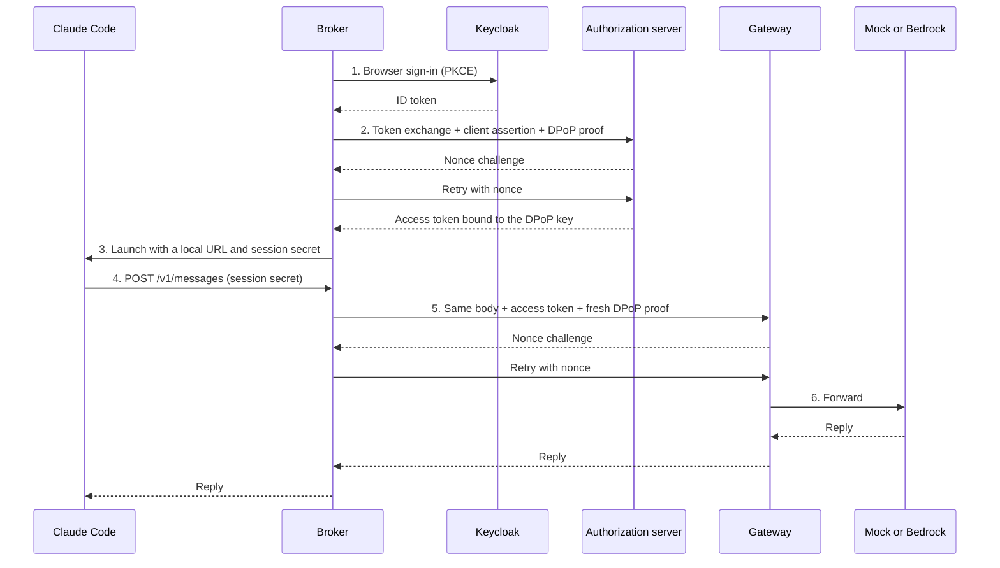

# One request, end to end

This page follows a single prompt from sign-in to the model's reply and names the
code that handles each step. Unfamiliar terms are in the [glossary](../glossary.md).

## 1. Sign in

The broker opens the system browser at Keycloak and waits on a one-time loopback
callback. It sends a PKCE challenge, a random `state` and a random `nonce`, and
checks all three when the browser returns. It then redeems the authorization code
and validates the ID token: signature, issuer, audience, lifetime and nonce.

Code: [`oauth-lab/login.py`](../../components/oauth-lab/login.py),
[`oauth-lab/oidc.py`](../../components/oauth-lab/oidc.py)

## 2. Exchange the ID token for a gateway token

The broker creates a P-256 key for this session, in memory or in the Secure Enclave.
It then posts to the authorization server's token endpoint with three things: the ID
token, a client assertion signed with the exchange client's RSA key, and a DPoP proof
signed with the new session key.

The authorization server authenticates the client, checks the proof, and answers the
first attempt with a nonce challenge. On the retry it verifies the ID token against
Keycloak's published keys, checks its policy, records the ID token and the proof as
used, and signs an access token. That token names the gateway as its audience, lasts
at most five minutes, and carries the thumbprint of the session key.

Code: [`gateway/lab_invoke.py`](../../components/gateway/lab_invoke.py) (client side),
[`oauth-as/exchange.py`](../../components/oauth-as/exchange.py),
[`oauth-as/dpop.py`](../../components/oauth-as/dpop.py).
Detail: [authorization server walkthrough](authorization-server-walkthrough.md)

## 3. Launch Claude Code

The broker checks the returned token itself, then starts a listener on a random
loopback port and launches Claude Code as a child process. The child gets a
minimal environment: the listener's URL as `ANTHROPIC_BASE_URL`, a random secret as
`ANTHROPIC_AUTH_TOKEN`, a temporary configuration directory, switches that turn off
telemetry and updates, and a few basics such as `HOME` and `PATH`. It never receives the gateway token, the session key or any
AWS credential.

Code: [`broker/broker.py`](../../components/broker/broker.py)

## 4. Claude Code calls the broker

Claude Code sends an ordinary Messages request to the local listener. The broker
checks the `Host` header, refuses forwarded or browser-originated requests, compares
the secret, and confirms the session has not expired.

## 5. The broker calls the gateway

The broker forwards the body over HTTPS with the access token in the `Authorization`
header and a newly signed proof in the `DPoP` header. The proof covers this request
only: its method, its URL, the time, a unique identifier, the gateway's nonce and a
hash of the access token.

The gateway verifies the token's signature and claims, checks that the proof was
signed by the key the token names, answers a missing or stale nonce with a challenge,
applies its policy, and records the proof so it cannot be used again.

Code: [`gateway/gateway.py`](../../components/gateway/gateway.py).
Detail: [gateway walkthrough](gateway-walkthrough.md)

## 6. Inference and the way back

With the mock backend the gateway forwards the request to the mock with its own
separate credential. With the Bedrock backend it translates the request to the
Converse API and signs it with the host's instance-role credentials. The reply is
returned on the same connections, as JSON or as a server-sent event stream, and the
broker relays it to Claude Code.

Code: [`gateway/bedrock.py`](../../components/gateway/bedrock.py),
[`mock-llm/app`](../../components/mock-llm/app)

## What a thief would need

| Stolen item | Enough to call the model? |
|---|---|
| The session secret Claude Code holds | Only through the broker, on the same machine, until the session ends |
| The gateway access token | No. Each request also needs a proof signed by the session key |
| The token and one captured proof | No. The proof is single-use and tied to one nonce |
| The ID token | Only with the exchange client's key as well, and only once, within a minute |
| The session key (software signer) | Yes, together with the token, for up to five minutes. The Secure Enclave signer prevents the key being copied |
