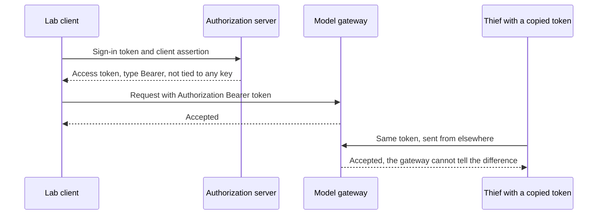
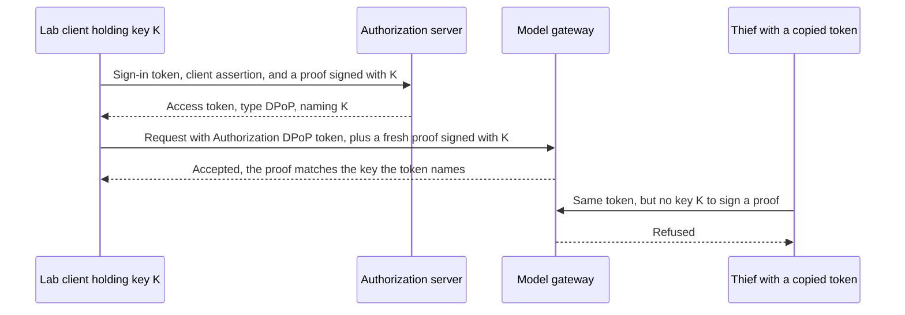
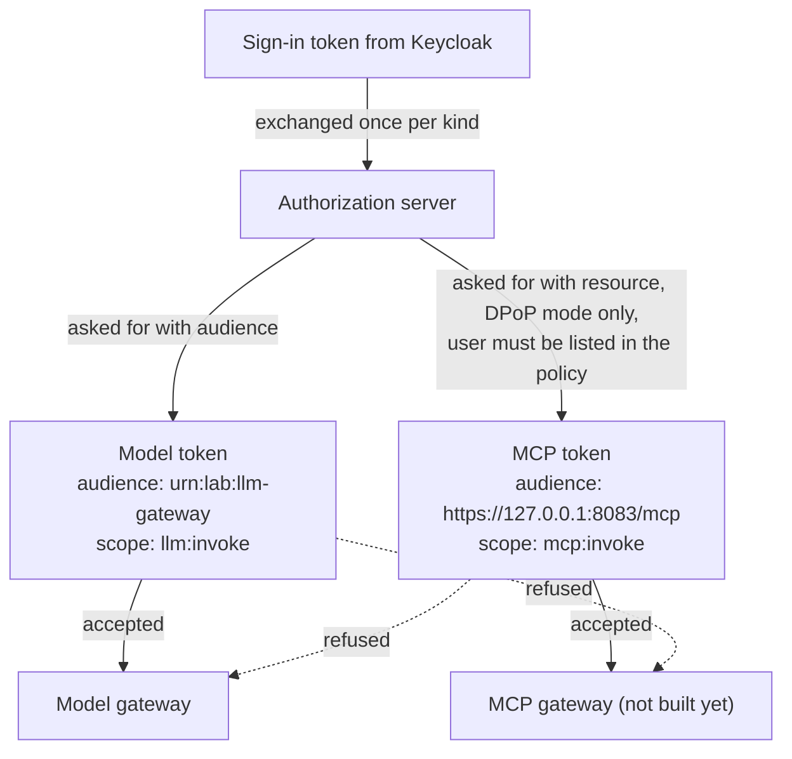

# Tokens and modes

Two ideas that are easy to mix up: the **mode** the lab runs in, which decides
whether a token is tied to a key, and the **kind** of token, which decides which
gateway will accept it. Unfamiliar terms are in the [glossary](../glossary.md).

## Bearer mode and DPoP mode

The authorization server and the gateway are each started in one of two modes. The
mode is chosen at startup: giving the authorization server a `--dpop-nonce-key`
turns DPoP on, and leaving it out gives Bearer mode. Both services must use the
same mode.

In **Bearer mode** a token works for whoever holds it.

In **DPoP mode** the token names a key, and every request must be signed with it.

| | Bearer mode | DPoP mode |
|---|---|---|
| Started with | No DPoP options | `--dpop-nonce-key` on both services |
| Token type | `Bearer` | `DPoP` |
| Token names a key | No | Yes, in its `cnf.jkt` claim |
| Each request carries | The token | The token and a fresh signed proof |
| A copied token alone | Works | Is useless |
| Model tokens issued | Yes | Yes |
| MCP tokens issued | **Never** | Yes, for listed users |

Bearer mode exists so the lab can show the system with and without the protection.
The quickstart uses DPoP mode.

The last row is a deliberate rule. A token for the MCP gateway that could be copied
and replayed would defeat the purpose of that gateway, so the authorization server
refuses to create one at all unless it is running in DPoP mode and can tie the
token to a key.

### What the token is called, and what is still a bearer credential

In DPoP mode the access token is called a **DPoP-bound access token**, or more
generally a *sender-constrained* token: it only works for the sender who holds the
key it names. It is the same kind of signed document as in Bearer mode, with one
extra claim naming the key, and it is sent with the word `DPoP` in place of
`Bearer`. The gateway refuses it if it arrives labelled `Bearer`, so it cannot be
downgraded.

DPoP mode protects the access token. A few other credentials in the lab still work
for whoever holds them, each limited in another way:

| Credential | Where it travels | What limits it |
|---|---|---|
| Sign-in token from Keycloak | Broker to authorization server | Accepted for one minute, once per kind of token, and only alongside the exchange client's signed assertion |
| Session secret | Claude Code to the broker | Random, valid for one broker session, and only on the Mac's own loopback address |
| The gateway's credential for the mock | Gateway to the mock model | Known only to those two services, on loopback |
| Keycloak's own access token | Returned at sign-in | Not used by the lab, and discarded |

## Two kinds of token from one sign-in

The authorization server issues two kinds of access token. Each names one gateway
as its audience and carries one scope, and each gateway accepts only its own kind.

One sign-in can be exchanged once for each kind, so the broker gets both without
sending the user through the browser twice. A second request for the same kind is
refused as a replay.

Whether a user may have an MCP token at all is decided here, by the `mcp_subjects`
list in the exchange policy. Which tools that user may call will be decided later,
by the MCP gateway, on every request.

Code: [`oauth-as/exchange.py`](../../components/oauth-as/exchange.py) issues both
kinds; [`gateway/gateway.py`](../../components/gateway/gateway.py) checks the
audience and scope of what it is given.
